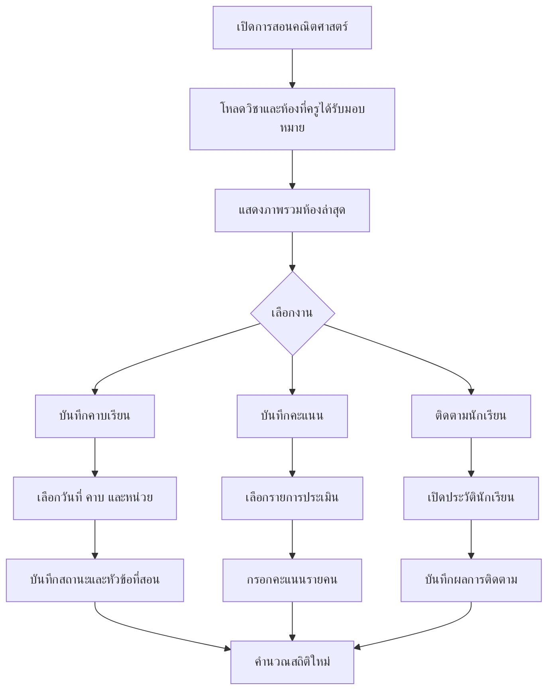

# แผนโมดูลครูผู้สอน: คณิตศาสตร์

## 1. เป้าหมายและขอบเขต

โมดูลนี้เป็นพื้นที่ทำงานของ **ครูผู้สอนวิชาคณิตศาสตร์** ต่างจากหน้าสำหรับครูวิชาการที่ใช้ดูภาพรวมหลายห้องหรือหลายวิชา ครูจะเห็นเฉพาะรายวิชาและห้องเรียนที่ได้รับมอบหมาย และสามารถบันทึกข้อมูลการสอนได้โดยตรง

ค่าเริ่มต้นของ prototype:

- ครูผู้สอน: ครูสมชาย ใจดี
- รายวิชาหลัก: `ค21101 คณิตศาสตร์พื้นฐาน`
- ระดับชั้น: ม.1
- ห้องที่รับผิดชอบ: ม.1/1 และ ม.1/2
- ภาคเรียน: ภาคเรียนที่ 1/2569

ขอบเขตในรุ่นแรก:

- ดูภาพรวมผลการเรียนและการเข้าเรียนของห้องที่สอน
- เลือกหน่วยการเรียนรู้และคาบเรียน
- บันทึกหรือแก้ไขสถานะการเข้าเรียนรายคาบ
- บันทึกคะแนนกิจกรรม แบบฝึกหัด เก็บก่อนกลางภาค กลางภาค และปลายภาค
- ติดตามนักเรียนที่คะแนนหรือการเข้าเรียนต่ำกว่าเกณฑ์
- ดูตัวอย่างและส่งออกรายงานเฉพาะห้อง/รายวิชา

นอกขอบเขตรุ่นแรก:

- จัดตารางสอนแทนครูคนอื่น
- อนุมัติผลการเรียนระดับวิชาการ
- แก้ไขข้อมูลทะเบียนนักเรียนหรือโครงสร้างรายวิชา
- ส่งข้อมูลไปยัง backend จริง

## 2. ความแตกต่างของบทบาท

| หัวข้อ | ครูวิชาการ | ครูผู้สอนคณิตศาสตร์ |
| --- | --- | --- |
| มุมมองข้อมูล | ภาพรวมหลายระดับชั้น หลายห้อง หลายวิชา | เฉพาะรายวิชาและห้องที่ได้รับมอบหมาย |
| งานหลัก | ตรวจสอบ วิเคราะห์ ติดตาม และจัดทำรายงาน | บันทึกผลการสอน ติดตามผู้เรียน และเตรียมผลการเรียน |
| สิทธิ์แก้ไข | ตั้งค่าเกณฑ์/รายงานในระดับระบบตามสิทธิ์ | แก้ไขเฉพาะข้อมูลคาบและคะแนนของวิชาตนเอง |
| จุดเริ่มต้น | เลือกขอบเขตรายงาน | เห็นคาบล่าสุดและห้องที่สอนทันที |

## 3. โครงหน้าจอที่เสนอ

ชื่อหน้า: **การสอนคณิตศาสตร์**

ใช้ sidebar, `page-header`, `results-panel`, `summary-grid`, `search-panel` และรูปแบบตารางจากระบบเดิม เพื่อคง theme สีน้ำเงิน-เทา-ขาวและการใช้งานแบบระบบโรงเรียน

ลำดับบน desktop:

```text
Page header: การสอนคณิตศาสตร์ | ภาคเรียนที่ 1/2569

Summary: ห้องที่สอน | เข้าเรียนเฉลี่ย | คะแนนเฉลี่ย | ต้องติดตาม

ตัวกรอง: ห้องเรียน | หน่วยการเรียนรู้ | ช่วงเวลา

แท็บงาน: ภาพรวม | บันทึกคาบเรียน | คะแนน | นักเรียนที่ต้องติดตาม

พื้นที่ทำงานของแท็บที่เลือก
```

บน tablet และ mobile:

- Summary ลดเป็น 2 คอลัมน์และ 1 คอลัมน์ตามพื้นที่
- ตัวกรองเรียงลงแนวตั้ง โดยค่าเริ่มต้นเป็นห้องล่าสุดที่ครูสอน
- แท็บเลื่อนแนวนอนได้
- ตารางคะแนนและสถานะเข้าเรียนยังเลื่อนแนวนอน พร้อมตรึง `รหัสนักเรียน` และ `ชื่อ`

## 4. โครงสร้างเมนูและมุมมอง

เพิ่มเมนูใหม่ในกลุ่ม **งานสอน** ของ sidebar:

```text
งานสอน
  การสอนคณิตศาสตร์
```

มุมมองภายในหน้า:

| มุมมอง | เป้าหมาย | ข้อมูลหลัก | คำสั่งหลัก |
| --- | --- | --- | --- |
| ภาพรวม | เห็นสถานะของห้องก่อนเริ่มงาน | ความคืบหน้าหน่วย คะแนนเฉลี่ย การเข้าเรียน นักเรียนที่ต้องติดตาม | เลือกห้อง, ไปยังนักเรียน |
| บันทึกคาบเรียน | บันทึกสิ่งที่เกิดขึ้นในคาบหนึ่ง | วันที่, คาบ, หน่วย, หัวข้อ, สถานะรายคน | บันทึกการเข้าเรียน |
| คะแนน | บันทึกและตรวจสอบองค์ประกอบคะแนน | คะแนนรายคนแยกตามรายการประเมิน | เพิ่มรายการ, บันทึกคะแนน |
| นักเรียนที่ต้องติดตาม | จัดลำดับการช่วยเหลือรายบุคคล | คะแนนต่ำ, ขาด/สาย, บันทึกติดตาม | ดูประวัติ, บันทึกการติดตาม |

## 5. Flow หลัก



### 5.1 เปิดหน้าครั้งแรก

1. ระบบระบุผู้สอนจากข้อมูล session แบบ mock
2. โหลดเฉพาะ `teacherAssignments` ของครูสมชาย
3. ตั้งค่าเริ่มต้นเป็น `ค21101`, ห้องที่มีคาบล่าสุด และภาคเรียนปัจจุบัน
4. แสดง summary และรายการที่ต้องทำก่อน เช่น คาบที่ยังไม่บันทึกหรือคะแนนที่ยังไม่ครบ

### 5.2 บันทึกคาบเรียน

1. ครูเลือกห้องเรียน วันที่ และคาบเรียน
2. ระบบแสดงหน่วยการเรียนรู้และหัวข้อจากแผนการสอนของคาบนั้น
3. ครูยืนยันหรือแก้ไขหัวข้อที่สอน แล้วเลือกสถานะนักเรียนรายคน: `มา`, `สาย`, `ขาด`, `ลากิจ`, `ลาป่วย`, `กิจกรรม`
4. ครูเพิ่มหมายเหตุได้เฉพาะเมื่อจำเป็น
5. กด `บันทึกการเข้าเรียน`
6. ระบบคำนวณอัตราการเข้าเรียนและรายชื่อนักเรียนที่ต้องติดตามใหม่ทันที

### 5.3 บันทึกคะแนน

1. ครูเลือกหน่วยการเรียนรู้และรายการประเมิน เช่น แบบฝึกหัดเรื่องสมการ
2. กำหนดคะแนนเต็มและวันประเมิน
3. ตารางแสดงนักเรียนของห้อง พร้อมช่องกรอกคะแนนที่มี validation `0 ถึง คะแนนเต็ม`
4. ระบบแสดงสถานะคะแนนขาดส่งหรือไม่เข้าสอบแยกจากคะแนน `0`
5. กด `บันทึกคะแนน`
6. ระบบอัปเดตคะแนนสะสม ร้อยละ และสถานะต้องติดตาม

### 5.4 ติดตามนักเรียน

1. ระบบจัดรายการตามความเสี่ยง: คะแนนต่ำกว่า 60%, เข้าเรียนต่ำกว่า 80%, หรือมีข้อมูลไม่ครบ
2. ครูเลือกนักเรียนเพื่อดูสรุปคะแนนรายหน่วย การขาด/สาย และบันทึกติดตามล่าสุด
3. ครูบันทึกการดำเนินการ เช่น มอบงานเสริม, นัดพูดคุย, ติดต่อผู้ปกครอง
4. รายการยังคงอยู่จนกว่าครูจะกำหนดสถานะเป็น `ติดตามแล้ว` หรือผลการเรียนกลับถึงเกณฑ์

## 6. ส่วนประกอบของแต่ละมุมมอง

### ภาพรวม

Summary 4 ค่า:

- ห้องที่สอน: `2 ห้อง`
- การเข้าเรียนเฉลี่ย: ร้อยละของทุกคาบในช่วงที่เลือก
- คะแนนเฉลี่ย: คะแนนสะสมเทียบสัดส่วนคะแนนเต็ม
- ต้องติดตาม: จำนวนนักเรียนที่เข้าเงื่อนไขอย่างน้อยหนึ่งข้อ

รายการทำงาน:

- คาบล่าสุด: วันที่, คาบ, ห้อง, หัวข้อ, สถานะการบันทึก
- ความคืบหน้าหน่วยการเรียนรู้: หน่วยที่สอนแล้วเทียบแผน
- รายชื่อนักเรียนที่ต้องติดตาม 5 คนแรก พร้อมเหตุผลสั้น ๆ

### บันทึกคาบเรียน

ส่วนหัวของคาบ:

- ห้องเรียน (required)
- วันที่ (required)
- คาบเรียน (required)
- หน่วยการเรียนรู้ (required)
- หัวข้อที่สอน (required)
- รูปแบบการสอน: ปกติ, ทบทวน, แบบฝึกหัด, ประเมิน

ตารางรายชื่อ:

| ลำดับ | รหัสนักเรียน | ชื่อ | สถานะ | หมายเหตุ |
| --- | --- | --- | --- | --- |

คำสั่งใน toolbar: `ตั้งสถานะทั้งหมด`, `บันทึกการเข้าเรียน`, `ดูประวัติคาบ`

### คะแนน

ข้อมูลรายการประเมิน:

- หน่วยการเรียนรู้
- ประเภทรายการ: งาน, แบบฝึกหัด, เก็บคะแนน, กลางภาค, ปลายภาค
- ชื่อรายการ
- คะแนนเต็ม
- วันประเมิน
- สัดส่วนคะแนน

ตารางคะแนน:

| ลำดับ | รหัสนักเรียน | ชื่อ | คะแนน | สถานะ | หมายเหตุ |
| --- | --- | --- | --- | --- | 

สถานะคะแนน: `ปกติ`, `ขาดส่ง`, `ไม่เข้าสอบ`, `ยกเว้น`

### นักเรียนที่ต้องติดตาม

| รหัสนักเรียน | ชื่อ | คะแนนสะสม | เข้าเรียน | เหตุผล | การติดตามล่าสุด | สถานะ |
| --- | --- | --- | --- | --- | --- |

เกณฑ์เริ่มต้น:

- คะแนนสะสมต่ำกว่า 60%
- อัตราการเข้าเรียนต่ำกว่า 80%
- คะแนนของรายการบังคับยังไม่ครบ

## 7. Data Model สำหรับ mock และ API ในอนาคต

ให้ใช้ความสัมพันธ์ชุดเดิมของระบบและเพิ่มข้อมูลเฉพาะการสอน:

```text
Teacher
  -> TeacherAssignment
  -> SubjectOffering (วิชา + ห้อง + ภาคเรียน)
  -> LessonUnit
  -> LessonSession
  -> AttendanceRecord

SubjectOffering
  -> AssessmentItem
  -> StudentScore

Student
  -> FollowUpRecord
```

ฟิลด์สำคัญ:

| Entity | ฟิลด์หลัก |
| --- | --- |
| `teacherAssignments` | `teacherId`, `subjectId`, `classroomId`, `semesterId` |
| `lessonUnits` | `subjectId`, `title`, `order`, `plannedPeriods` |
| `lessonSessions` | `offeringId`, `date`, `period`, `unitId`, `topic`, `status` |
| `assessmentItems` | `offeringId`, `unitId`, `title`, `type`, `fullScore`, `weight`, `dueDate` |
| `studentScores` | `assessmentItemId`, `studentId`, `score`, `status`, `remark` |
| `followUpRecords` | `studentId`, `offeringId`, `reason`, `action`, `status`, `recordedAt` |

สถานะของ `lessonSessions`: `draft`, `recorded`, `cancelled`

## 8. กติกาการคำนวณ

- อัตราการเข้าเรียน = `(จำนวนมา + สาย + ลา + กิจกรรม) / จำนวนคาบที่มีสถานะ` x 100
- อัตราการมาสาย = `จำนวนสาย / จำนวนคาบที่มีสถานะ` x 100
- คะแนนสะสม = `ผลรวมคะแนนที่บันทึก / ผลรวมคะแนนเต็มของรายการที่ต้องส่ง` x 100
- คะแนนขาดส่งและไม่เข้าสอบต้องไม่ถูกตีความเป็น `0` จนกว่าครูจะตัดสินใจบันทึกคะแนน `0`
- นักเรียนต้องติดตามเมื่อเข้าเงื่อนไขคะแนน, การเข้าเรียน หรือความครบถ้วนอย่างน้อยหนึ่งข้อ
- Summary ต้องคำนวณจากห้องและช่วงเวลาที่เลือกจริงทุกครั้ง

## 9. สิทธิ์และ validation

- ครูแก้ไขได้เฉพาะ `SubjectOffering` ที่มีใน `teacherAssignments` ของตน
- ช่องห้องเรียนและรายวิชาไม่แสดงข้อมูลที่ครูไม่ได้รับมอบหมาย
- ห้ามบันทึกคาบเรียนหากยังไม่เลือกห้อง วันที่ คาบ หน่วย และหัวข้อ
- ห้ามบันทึกคะแนนนอกช่วง `0 ถึง fullScore`
- ก่อนแก้ไขคาบที่บันทึกแล้ว ให้แสดงเวลาที่แก้ไขล่าสุดในประวัติ
- การลบรายการประเมินใช้ soft delete เพื่อรักษาประวัติคะแนน

## 10. แผนการพัฒนา

### ระยะ 1: หน้าพื้นฐานและข้อมูล mock

1. เพิ่มเมนู `การสอนคณิตศาสตร์` และ page section `data-page="teacher-math"`
2. สร้าง `../assets/js/modules/teacher-math.js` แยก state และ mock data ตาม data model นี้
3. โหลด assignment ของครูสมชาย และใช้ห้องล่าสุดเป็นค่าเริ่มต้น
4. แสดง summary, ตัวกรอง และแท็บงานครบทั้ง 4 มุมมอง

### ระยะ 2: การบันทึกข้อมูล

1. ทำฟอร์มบันทึกคาบเรียนและตารางสถานะรายคน
2. ทำรายการประเมินและตารางกรอกคะแนนรายคน
3. เก็บการแก้ไขใน memory ของ prototype และคำนวณ summary ใหม่ทันที
4. ทำ validation, toast และ empty state ตาม pattern เดิม

### ระยะ 3: การติดตามและรายงาน

1. สร้างกติกาคัดกรองนักเรียนที่ต้องติดตาม
2. ทำ drawer หรือ modal ประวัตินักเรียนและบันทึกการติดตาม
3. เพิ่ม preview ก่อน export/print
4. รวม export เป็น dropdown: Excel, CSV, PDF

### ระยะ 4: ตรวจสอบคุณภาพ

1. ทดสอบ filter cascade: ห้อง -> หน่วย -> รายการประเมิน
2. ทดสอบ validation คะแนนและข้อมูลคาบเรียน
3. ตรวจว่าการบันทึกทำให้ summary, ตาราง และรายการติดตามอัปเดตสอดคล้องกัน
4. ตรวจ desktop, tablet และ mobile โดยเฉพาะตารางที่เลื่อนแนวนอน

## 11. ไฟล์ที่คาดว่าจะเพิ่มหรือแก้ไข

| ไฟล์ | งาน |
| --- | --- |
| `../index.html` | เมนู sidebar, section ของหน้า, modal/drawer ที่จำเป็น, script tag |
| `../assets/js/modules/teacher-math.js` | state, mock database, filter, render, validation และ event handlers |
| `../assets/css/styles.css` | เฉพาะ class ที่ reuse จากระบบเดิมไม่ได้ |
| `TEACHER_MATH_MODULE_PLAN.md` | เอกสารแผนฉบับนี้ |

## 12. เกณฑ์รับงานของรุ่นแรก

- ครูเห็นเฉพาะคณิตศาสตร์และห้อง ม.1/1, ม.1/2 ที่ตนสอน
- เปิดหน้ามาแล้วมีข้อมูลสรุปที่ใช้งานได้ทันที
- บันทึกการเข้าเรียนและคะแนนได้ใน prototype โดยข้อมูลทุกส่วนอัปเดตตามกัน
- รายการที่ต้องติดตามมีเหตุผลที่ตรวจสอบได้
- ตารางใช้งานได้บนจอเล็กโดยไม่ทำให้ชื่อและข้อมูลนักเรียนหาย
- ทุกหน้าตาและ interaction ยึด component system ของ Academic Report เดิม
