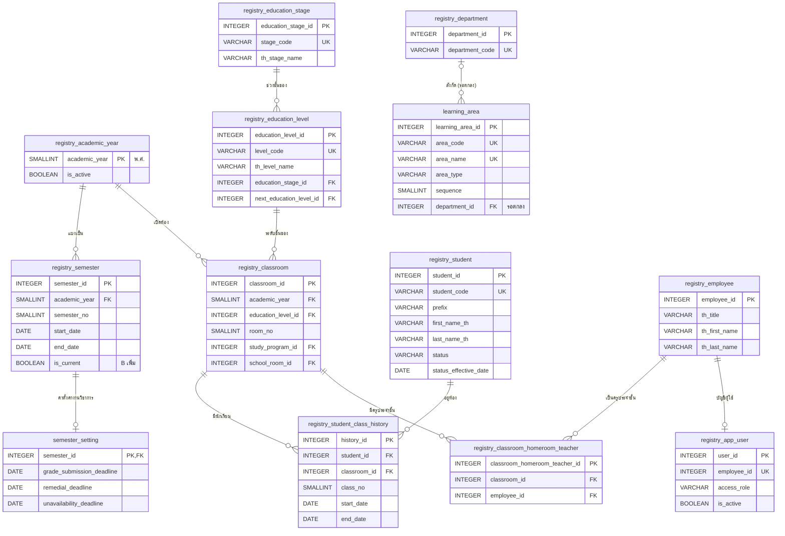

# ขอบเขต 0 — ข้อมูลหลักที่ใช้ร่วมกัน

> **สถานะ:** ร่าง (2026-11-03) · **ฉบับที่ 2 (2026-11-11)** เปลี่ยนไปใช้ข้อมูลหลักของ Team B ตาม [cross-team.md](cross-team.md) · ข้อตกลงการตั้งชื่อและชนิดข้อมูลอยู่ที่ [README.md](README.md#ข้อตกลง)

ข้อมูลที่ทุกโมดูลอ้างถึง ได้แก่ ปีการศึกษา ภาคเรียน ระดับชั้น กลุ่มสาระ นักเรียน ห้องเรียน ครูประจำชั้น และผู้ใช้

**ตั้งแต่ฉบับที่ 2 ข้อมูลส่วนใหญ่ในขอบเขตนี้เป็นของ Team B** (schema `registry`) ระบบของเราอ่านอย่างเดียว ขอบเขตนี้เหลือตารางของเราเอง 2 ตาราง คือ `learning_area` และ `semester_setting` ส่วนตารางของ B ระบุไว้ในหัวข้อ 3.2 เฉพาะฟิลด์ที่เราใช้ (ไม่ใช่นิยามเต็ม นิยามเต็มอยู่ในรายงานของ B)

## 1. ที่มาในระบบจำลอง

| ข้อมูล | ใช้ที่ | ต้นทาง |
|---|---|---|
| ปีการศึกษาและภาคเรียนปัจจุบัน | `AcademicLayout.currentTerm` ใน [shared/academic-layout.js](../../shared/academic-layout.js), ตัวกรองปี / ภาคของทุกหน้ารายงาน, กำหนดส่งผลการเรียนใน grading | B (`registry.academic_year`, `registry.semester`) + `semester_setting` |
| ระดับชั้น และ ม.ต้น / ม.ปลาย | ตัวกรองระดับชั้นทุกหน้า, หลักสูตรแยกตามระดับ ([curriculum-management.html](../../curriculum/curriculum-management.html)), เกณฑ์การตัดสินผลแยกตามระดับ | B (`registry.education_level`, `registry.education_stage`) |
| กลุ่มสาระ | ตัวกรองกลุ่มสาระในหน้ารายวิชาและรายงาน | `learning_area` (ของเรา) |
| ครู | ครูผู้สอนในหลักสูตรและตารางสอน (`t01`–`t55`), ผู้ใช้ใน grading (`u1`–`u13`) | B (`registry.app_user`, `registry.employee`) |
| นักเรียน สถานะนักเรียน | grading (`seed.js`), ตัวกรองสถานะนักเรียนในทะเบียนสะสม (กำลังศึกษา / ย้ายสถานศึกษา / สำเร็จการศึกษา) | B (`registry.student`) |
| ห้องเรียน เลขที่ ครูประจำชั้น | ตารางกรอกคะแนนเรียงตามเลขที่, ห้องประจำชั้นในหน้าเช็คชื่อ (`HOMEROOM` ใน `attendance-core.js`) | B (`registry.classroom`, `registry.student_class_history`, `registry.classroom_homeroom_teacher`) |

## 2. ER

ตารางที่ขึ้นต้นด้วย `registry_` คือตารางของ Team B (`registry.<ชื่อ>`) Mermaid ใช้จุดในชื่อไม่ได้ จึงเขียนด้วยขีดล่าง

## 3. Data dictionary

รูปแบบคอลัมน์: **ฟิลด์ · ชนิดข้อมูล · คีย์ · Null · คำอธิบาย / ค่าที่เป็นไปได้** · ทุกตารางที่แก้ไขได้มี `created_at`, `updated_at` (`TIMESTAMPTZ NOT NULL DEFAULT now()`) ซึ่งไม่ได้เขียนซ้ำในแต่ละตาราง

FK ที่ชี้ไป `registry.*` เขียนเป็น FK ปกติ ถ้าตกลงว่าเรียก API แทนการ sync สำเนา (คำถามเปิดข้อ 4 ใน [cross-team.md](cross-team.md#5-คำถามที่ยังเปิดอยู่)) FK เหล่านี้จะกลายเป็นการตรวจในแอป

### 3.1 ตารางของเรา

#### `learning_area` — กลุ่มสาระการเรียนรู้

| ฟิลด์ | ชนิดข้อมูล | คีย์ | Null | คำอธิบาย |
|---|---|---|---|---|
| learning_area_id | INTEGER | PK | N | รหัส |
| area_code | VARCHAR(10) | UK | N | รหัสย่อ เช่น `TH`, `MA`, `SC` |
| area_name | VARCHAR(100) | UK | N | `ภาษาไทย`, `คณิตศาสตร์`, `วิทยาศาสตร์และเทคโนโลยี`, … |
| area_type | VARCHAR(20) | | N | `learning_area` 8 กลุ่มสาระ · `activity` กิจกรรมพัฒนาผู้เรียน |
| sequence | SMALLINT | | N | ลำดับการแสดงผล |
| department_id | INTEGER | FK → registry.department | Y | กลุ่มสาระ / แผนกของ B ที่ตรงกัน ใช้กรองครูตามกลุ่มสาระ **(รอตกลงกับ B)** |
| | | CHECK (`area_type IN ('learning_area', 'activity')`) | | |

- ใช้จัดหมวด `subject` ตามหลักสูตรแกนกลาง จึงยังเป็นของเรา แม้ B จะมี `registry.department` (แผนก/กลุ่มสาระที่ครูสังกัด)
- มี `activity` เพราะในระบบจำลองครูบางคนสังกัดกลุ่มกิจกรรมพัฒนาผู้เรียน (อ.สุนิสา ใน [personas.md](../personas.md)) และรายงานแยกกิจกรรมเป็นกลุ่มของตัวเอง
- ตัวอักษรนำหน้ารหัสวิชา (ท ค ว …) ไม่ได้เก็บเป็นรหัสกลุ่มสาระ เพราะกลุ่มภาษาต่างประเทศมีหลายตัวอักษร (อ จ ญ ฝ) เรื่องนี้อยู่ในขอบเขต 1
- สังกัดของครูอ่านจาก `registry.job_detail.department_id` ไม่ได้เก็บฝั่งเรา (เดิมเป็น `app_user.learning_area_id`)

#### `semester_setting` — ค่าตั้งค่างานวิชาการของภาคเรียน

🆕 ฉบับที่ 2 รวมคอลัมน์ที่เดิมอยู่ใน `semester` ของเรา แต่ `registry.semester` ของ B ไม่มี

| ฟิลด์ | ชนิดข้อมูล | คีย์ | Null | คำอธิบาย |
|---|---|---|---|---|
| semester_id | INTEGER | PK, FK → registry.semester | N | ภาคเรียน (1:1) |
| grade_submission_deadline | DATE | | Y | กำหนดส่งผลการเรียน (ใช้ใน grading) |
| remedial_deadline | DATE | | Y | กำหนดสอบซ่อมของภาค หน้าภาพรวมของรายงานใช้นับ "สอบซ่อมเกินกำหนด" |
| unavailability_deadline | DATE | | Y | วันปิดรับเวลาไม่ว่างของครู (ใช้ในขอบเขต 3) |

ภาคเรียนที่ยังไม่มีแถวในตารางนี้ถือว่ายังไม่ได้ตั้งค่า (ทุกค่าเป็น NULL) ฝ่ายวิชาการตั้งค่าได้หลัง B สร้างภาคเรียนแล้ว

### 3.2 ตารางของ Team B ที่เราอ่าน

ข้อตกลงกับ B ไม่ใช่นิยามตารางเต็ม ชื่อเขียนตามรูปแบบที่ตกลง (snake_case) ในวงเล็บคือชื่อเดิมในรายงานของ B

| ตารางของ B | ฟิลด์ที่เราใช้ | ใช้ทำอะไร | แทนตารางเดิมของเรา |
|---|---|---|---|
| `registry.academic_year` (`AcademicYears`) | `academic_year` (SMALLINT, PK = ปี พ.ศ. ตามที่ B ตกลงเปลี่ยน), `is_active` | เป้าหมาย FK `academic_year` ในทุกขอบเขต · B ไม่มี `start_date` / `end_date` ให้คำนวณจาก `MIN(start_date)` / `MAX(end_date)` ของ `registry.semester` ในปีนั้น | `academic_year` |
| `registry.semester` (`Semesters`) | `semester_id`, `academic_year`, `semester_no`, `start_date`, `end_date`, `is_current` (B เพิ่ม) | เป้าหมาย FK `semester_id` · ภาคเรียนปัจจุบันของทุกระบบ (แทน `CURRENT_TERM` ในระบบจำลอง) | `semester` |
| `registry.education_level` (`EducationLevels`) | `education_level_id`, `level_code`, `th_level_name` (`ม.1`), `education_stage_id`, `next_education_level_id` | ระดับชั้น · เป้าหมาย FK `education_level_id` (เดิม `grade_level_id`) | `grade_level` |
| `registry.education_stage` (`EducationStage`) | `education_stage_id`, `stage_code` (`LOWER_SECONDARY`, `UPPER_SECONDARY`), `th_stage_name` | ม.ต้น / ม.ปลาย · แยกหลักสูตรและเกณฑ์การตัดสินผล (เดิมคอลัมน์ `grade_level.education_level`) | คอลัมน์ `education_level` |
| `registry.student` (`Student`) | `student_id`, `student_code`, `prefix`, `first_name_th`, `last_name_th`, `status`, `status_effective_date` | ชื่อนักเรียนในทุกหน้า · สถานะใช้กรองทะเบียนสะสม | `student` |
| `registry.classroom` (`Classroom`) | `classroom_id`, `academic_year`, `education_level_id`, `room_no`, `study_program_id`, `school_room_id` | ห้องเรียนของปีการศึกษา · ชื่อที่แสดง `ม.2/1` = `th_level_name` + `/` + `room_no` · `study_program_id` ใช้หาแผนการเรียน (ขอบเขต 1) · `school_room_id` คือห้องประจำ (ขอบเขต 3) | `classroom` |
| `registry.student_class_history` (`StudentClassHistory`) | `student_id`, `classroom_id`, `class_no`, `start_date`, `end_date` | นักเรียนในห้องและเลขที่ · **หาห้องตามวันที่** (ห้องของนักเรียน ณ วันที่ X = แถวที่ `start_date <= X` และ `end_date IS NULL OR end_date >= X`) | `student_classroom` |
| `registry.classroom_homeroom_teacher` (`ClassroomHomeroomTeacher`) | `classroom_id`, `employee_id` | ครูประจำชั้น · หน้าเช็คชื่อและรายงานการเข้าเรียน | `homeroom_teacher` |
| `registry.app_user` (`User`) | `user_id`, `employee_id`, `access_role`, `is_active` | เป้าหมาย FK ของครูผู้สอน ผู้บันทึก ผู้อนุมัติ ในทุกขอบเขต (คอลัมน์ฝั่งเรายังชื่อ `user_id`) | `app_user` |
| `registry.employee` (`Employees`) | `th_title`, `th_first_name`, `th_last_name` | ชื่อครูในทุกหน้าและรายงาน | `app_user.prefix`, `first_name`, `last_name` |
| `registry.job_detail` (`JobDetails`) + `registry.position` + `registry.department` | `position_id`, `department_id`, `work_status` | ตำแหน่ง สังกัด และสถานะการทำงานของครู (ครูที่ออกแล้วมอบหมายสอนไม่ได้) | `app_user.position`, `learning_area_id`, `status` |
| `registry.permission` + `registry.user_permission` | `permission_key` | แยกสิทธิ์ครูผู้สอนกับครูฝ่ายวิชาการ **(วิธี map รอตกลง)** | `role`, `user_role` |

**ชนิดของ FK:** PK ของ B เป็น `SERIAL` (INTEGER) ยกเว้น `registry.academic_year` ที่เป็นปี พ.ศ. (SMALLINT) FK ฝั่งเราจึงเป็น INTEGER ทั้งหมด ยกเว้น `academic_year` · เดิม `grade_level_id` เป็น SMALLINT เปลี่ยนเป็น `education_level_id INTEGER`

## 4. กฎทางธุรกิจ (ใช้ constraint ไม่ได้)

1. ตั้ง `semester_setting` ได้เฉพาะภาคเรียนที่มีใน `registry.semester` · `grade_submission_deadline` ต้องอยู่ระหว่าง `start_date` กับ `end_date` ของภาค หรือไม่เกินกี่วันหลังปิดภาคตามที่งานวิชาการกำหนด
2. ข้อมูลของ B แก้จากระบบเราไม่ได้ ถ้าพบข้อมูลผิด (เช่น เลขที่ซ้ำ) ต้องแจ้ง B
3. ครูผู้สอน ครูประจำชั้น และผู้บันทึกต้องมี `registry.app_user.is_active` และ `registry.job_detail.work_status` เป็นทำงานอยู่
4. นักเรียนที่ย้ายออกหรือจบแล้ว แถวใน `registry.student_class_history` ของปีเก่าต้องไม่ถูกลบ เพราะผลการเรียนย้อนหลังอ้างถึง (ต้องตกลงกับ B)

## 5. เทียบกับฉบับก่อน

### ฉบับที่ 2 (2026-11-11) เทียบกับฉบับที่ 1

| ฉบับที่ 1 | ฉบับที่ 2 | เหตุผล |
|---|---|---|
| `academic_year` | ❌ ใช้ `registry.academic_year` | B มีอยู่แล้ว และตกลงเปลี่ยน PK เป็นปี พ.ศ. FK ของเราจึงไม่ต้องแก้ |
| `semester` | ❌ ใช้ `registry.semester` + 🆕 `semester_setting` | คอลัมน์งานวิชาการ 3 ตัวที่ B ไม่มีย้ายมาตารางเสริม · `is_current` ขอ B เพิ่ม |
| `grade_level` (+ `education_level`) | ❌ ใช้ `registry.education_level` + `registry.education_stage` | FK `grade_level_id` ทุกตัว → `education_level_id` · `education_level` → `education_stage_id` |
| `student` | ❌ ใช้ `registry.student` | |
| `classroom` (+ `study_plan_id`, `home_room_id` จากขอบเขต 1, 3) | ❌ ใช้ `registry.classroom` | แผนการเรียนใช้ `study_program_id` ของ B · ห้องประจำใช้ `school_room_id` ของ B |
| `student_classroom` | ❌ ใช้ `registry.student_class_history` | ของ B มีช่วงวันที่ ตอบคำถามเรื่องย้ายห้องกลางปีที่เคยเปิดไว้ |
| `homeroom_teacher` | ❌ ใช้ `registry.classroom_homeroom_teacher` | |
| `app_user`, `role`, `user_role` | ❌ ใช้ `registry.app_user` + `employee` + `job_detail` + `permission` | |
| `learning_area` | `learning_area` + 🆕 `department_id` (รอตกลง) | ยังเป็นของเรา สังกัดครูอ่านจาก B |

### ฉบับที่ 1 เทียบกับ ER เดิม

| ER เดิม | ฉบับที่ 1 | เหตุผล |
|---|---|---|
| `academic_year INT` ซ้ำใน `Semester`, `Classroom`, `GradingPolicy` | 🆕 `academic_year` | ไม่มีที่ตรวจว่าปีนั้นมีจริง |
| `Semester` | `semester` + 🆕 `is_current` | ระบบจำลองต้องรู้ "ภาคปัจจุบัน" ทุกหน้า |
| `grade_level VARCHAR(10)` | 🆕 `grade_level` | ป้องกันพิมพ์ไม่ตรงกัน และเก็บ ม.ต้น / ม.ปลาย |
| `LearningArea` | `learning_area` + 🆕 `area_code`, `area_type`, `sequence` | แยกกิจกรรมพัฒนาผู้เรียน และเรียงลำดับตามหลักสูตรแกนกลาง |
| `User`, `Role`, `UserRole` | `app_user`, `role`, `user_role` (ฝ่ายทะเบียน) | `user` เป็นคำสงวนของ PostgreSQL |
| `StudentClassroom` | `student_classroom` + 🆕 `academic_year` | บังคับปีละ 1 ห้อง |
| `HomeroomTeacher` | `homeroom_teacher` | ใช้ทั้งเช็คชื่อและรายงาน |

## 6. คำถามที่ยังเปิดอยู่

- **ภาคฤดูร้อน** มีไหม ถ้ามี `registry.semester.semester_no` ต้องรับ `3` และตัดสินว่านับในการคำนวณ GPA หรือไม่
- **สถานะนักเรียน** ค่าใน `registry.student.status` ตรงกับ `studying` / `transferred` / `graduated` ที่รายงานของเราใช้หรือไม่ และมีพักการเรียน / ลาออกหรือไม่
- **สังกัดครู** ตกลงใช้ `registry.department` และ `learning_area.department_id` หรือไม่
- **บทบาทผู้ใช้** ครูผู้สอน / ครูฝ่ายวิชาการ map กับ `access_role` หรือ `permission` ของ B อย่างไร
- **ชื่อห้องพิเศษ** ถ้าโรงเรียนเรียกห้องด้วยชื่อ เช่น "ห้อง EP" ต้องขอ B เพิ่มใน `registry.classroom`
