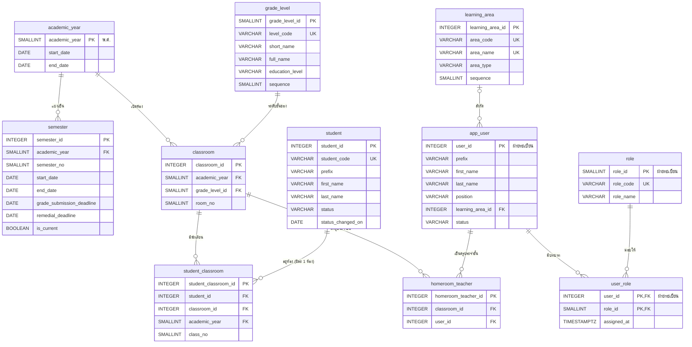

# ขอบเขต 0 — ข้อมูลหลักที่ใช้ร่วมกัน

> **สถานะ:** ร่าง (2026-11-03) · ข้อตกลงการตั้งชื่อและชนิดข้อมูลอยู่ที่ [README.md](README.md#ข้อตกลง)

ข้อมูลที่ทุกโมดูลอ้างถึง ได้แก่ ปีการศึกษา ภาคเรียน ระดับชั้น กลุ่มสาระ นักเรียน และห้องเรียน ขอบเขตนี้ไม่มี FK ไปหาขอบเขตอื่น ยกเว้นตารางผู้ใช้ของฝ่ายทะเบียน (หัวข้อ 3.1)

## 1. ที่มาในระบบจำลอง

| ข้อมูล | ใช้ที่ |
|---|---|
| ปีการศึกษาและภาคเรียนปัจจุบัน | `AcademicLayout.currentTerm` ใน [shared/academic-layout.js](../../shared/academic-layout.js), ตัวกรองปี / ภาคของทุกหน้ารายงาน, กำหนดส่งผลการเรียนใน grading |
| ระดับชั้น และ ม.ต้น / ม.ปลาย | ตัวกรองระดับชั้นทุกหน้า, หลักสูตรแยกตามระดับ ([curriculum-management.html](../../curriculum/curriculum-management.html)), เกณฑ์การตัดสินผลแยกตามระดับ |
| กลุ่มสาระ | ตัวกรองกลุ่มสาระในหน้ารายวิชาและรายงาน, สังกัดของครู |
| ครู | ครูผู้สอนในหลักสูตรและตารางสอน (`t01`–`t55`), ผู้ใช้ใน grading (`u1`–`u13`) |
| นักเรียน สถานะนักเรียน | grading (`seed.js`), ตัวกรองสถานะนักเรียนในทะเบียนสะสม (กำลังศึกษา / ย้ายสถานศึกษา / สำเร็จการศึกษา) |
| ห้องเรียน เลขที่ ครูประจำชั้น | ตารางกรอกคะแนนเรียงตามเลขที่, ห้องประจำชั้นในหน้าเช็คชื่อ (`HOMEROOM` ใน `attendance-core.js`) |

## 2. ER

## 3. Data dictionary

รูปแบบคอลัมน์: **ฟิลด์ · ชนิดข้อมูล · คีย์ · Null · คำอธิบาย / ค่าที่เป็นไปได้** · ทุกตารางที่แก้ไขได้มี `created_at`, `updated_at` (`TIMESTAMPTZ NOT NULL DEFAULT now()`) ซึ่งไม่ได้เขียนซ้ำในแต่ละตาราง

### `academic_year` — ปีการศึกษา

| ฟิลด์ | ชนิดข้อมูล | คีย์ | Null | คำอธิบาย |
|---|---|---|---|---|
| academic_year | SMALLINT | PK | N | ปีการศึกษา พ.ศ. เช่น `2569` (ใช้ค่าจริงเป็น PK เพราะเป็นค่าที่ทุกคนรู้จักและไม่เปลี่ยน) |
| start_date | DATE | | N | วันเริ่มปีการศึกษา |
| end_date | DATE | | N | วันสิ้นปีการศึกษา |
| | | CHECK (`start_date < end_date`) | | |

### `semester` — ภาคเรียน

| ฟิลด์ | ชนิดข้อมูล | คีย์ | Null | คำอธิบาย |
|---|---|---|---|---|
| semester_id | INTEGER | PK | N | รหัส |
| academic_year | SMALLINT | FK → academic_year | N | ปีการศึกษา |
| semester_no | SMALLINT | | N | `1`, `2` |
| start_date | DATE | | N | วันเปิดภาค |
| end_date | DATE | | N | วันปิดภาค |
| grade_submission_deadline | DATE | | Y | กำหนดส่งผลการเรียน (ใช้ใน grading) |
| remedial_deadline | DATE | | Y | กำหนดสอบซ่อมของภาค หน้าภาพรวมของรายงานใช้นับ "สอบซ่อมเกินกำหนด" (ย้ายมาจากขอบเขต 5) |
| is_current | BOOLEAN | | N | ภาคเรียนปัจจุบันของระบบ ค่าเริ่มต้น `false` |
| | | UK (academic_year, semester_no) | | |
| | | UNIQUE INDEX (is_current) WHERE is_current | | มีภาคเรียนปัจจุบันได้ภาคเดียว |
| | | CHECK (`semester_no IN (1, 2)`) · CHECK (`start_date < end_date`) | | |

ภาคเรียนปัจจุบันเลือกด้วย `is_current` ไม่ได้คำนวณจากวันที่ เพราะช่วงปิดภาคระหว่างภาค 1 กับภาค 2 ไม่อยู่ในภาคไหนเลย และงานวิชาการต้องเป็นคนตัดสินว่าจะเปลี่ยนภาคเมื่อไร ค่านี้ใช้แทน `CURRENT_TERM` ในระบบจำลอง

### `grade_level` — ระดับชั้น

| ฟิลด์ | ชนิดข้อมูล | คีย์ | Null | คำอธิบาย |
|---|---|---|---|---|
| grade_level_id | SMALLINT | PK | N | รหัส (กำหนดเอง ไม่ใช่ IDENTITY เพราะเป็นข้อมูลตั้งต้นที่แทบไม่เปลี่ยน) |
| level_code | VARCHAR(10) | UK | N | `M1`–`M6` |
| short_name | VARCHAR(10) | UK | N | `ม.1` |
| full_name | VARCHAR(50) | | N | `มัธยมศึกษาปีที่ 1` |
| education_level | VARCHAR(20) | | N | `lower_secondary` ม.ต้น · `upper_secondary` ม.ปลาย (ใช้แยกหลักสูตรและเกณฑ์การตัดสินผล) |
| sequence | SMALLINT | UK | N | ลำดับการเรียง |
| | | CHECK (`education_level IN ('lower_secondary', 'upper_secondary')`) | | |

ช่วงชั้นของตารางสอน (ชุดระดับชั้นที่ใช้โครงสร้างเวลาเดียวกัน) ไม่เก็บที่นี่ เพราะในระบบจำลองตั้งแยกได้ในแต่ละฉบับตาราง (`timeStructures[].levels`) จึงไปอยู่ในขอบเขต 3

### `learning_area` — กลุ่มสาระการเรียนรู้

| ฟิลด์ | ชนิดข้อมูล | คีย์ | Null | คำอธิบาย |
|---|---|---|---|---|
| learning_area_id | INTEGER | PK | N | รหัส |
| area_code | VARCHAR(10) | UK | N | รหัสย่อ เช่น `TH`, `MA`, `SC` |
| area_name | VARCHAR(100) | UK | N | `ภาษาไทย`, `คณิตศาสตร์`, `วิทยาศาสตร์และเทคโนโลยี`, … |
| area_type | VARCHAR(20) | | N | `learning_area` 8 กลุ่มสาระ · `activity` กิจกรรมพัฒนาผู้เรียน |
| sequence | SMALLINT | | N | ลำดับการแสดงผล |
| | | CHECK (`area_type IN ('learning_area', 'activity')`) | | |

มี `activity` เพราะในระบบจำลองครูบางคนสังกัดกลุ่มกิจกรรมพัฒนาผู้เรียน (อ.สุนิสา ใน [personas.md](../personas.md)) และรายงานแยกกิจกรรมเป็นกลุ่มของตัวเอง ตัวอักษรนำหน้ารหัสวิชา (ท ค ว …) ไม่ได้เก็บเป็นรหัสกลุ่มสาระ เพราะกลุ่มภาษาต่างประเทศมีหลายตัวอักษร (อ จ ญ ฝ) เรื่องนี้ไปอยู่ในขอบเขต 1

### 3.1 ตารางของฝ่ายทะเบียน (นอกขอบเขต)

**ฝ่ายทะเบียนเป็นผู้ออกแบบและดูแล** `app_user`, `role`, `user_role` รวมถึงบัญชีเข้าระบบ รหัสผ่าน และสิทธิ์ ใน ER ทุกรูปตารางเหล่านี้อยู่ในกรอบเส้นประ "ฝ่ายทะเบียน (นอกขอบเขต)" ระบบของเราอ่านอย่างเดียว และอ้างผ่าน FK `user_id` เท่านั้น

ฟิลด์ที่ระบบของเราต้องใช้ (ข้อตกลงกับฝ่ายทะเบียน ไม่ใช่นิยามตารางเต็ม)

| ตาราง | ฟิลด์ | ใช้ทำอะไร |
|---|---|---|
| `app_user` | `user_id` (INTEGER, PK) | เป้าหมาย FK ของครูผู้สอน ครูประจำชั้น ผู้บันทึก ผู้อนุมัติ ในทุกขอบเขต |
| `app_user` | `prefix`, `first_name`, `last_name` | แสดงชื่อครูในทุกหน้าและรายงาน |
| `app_user` | `position` | แสดงตำแหน่งในหน้าโปรไฟล์และเอกสาร |
| `app_user` | `learning_area_id` (FK → `learning_area`) | กรองครูตามกลุ่มสาระ |
| `app_user` | `status` (`active` · `inactive`) | กฎข้อ 4 และการมอบหมายสอน (ขอบเขต 1) |
| `role`, `user_role` | `role_code` เช่น `teacher` ครูผู้สอน · `academic` ครูฝ่ายวิชาการ | แยกสิทธิ์หน้าจอของครูผู้สอนกับฝ่ายวิชาการ |

### `student` — นักเรียน

| ฟิลด์ | ชนิดข้อมูล | คีย์ | Null | คำอธิบาย |
|---|---|---|---|---|
| student_id | INTEGER | PK | N | รหัสภายในระบบ |
| student_code | VARCHAR(20) | UK | N | เลขประจำตัวนักเรียน |
| prefix | VARCHAR(20) | | N | `เด็กชาย`, `เด็กหญิง`, `นาย`, `นางสาว` |
| first_name | VARCHAR(100) | | N | ชื่อ |
| last_name | VARCHAR(100) | | N | นามสกุล |
| status | VARCHAR(20) | | N | `studying` กำลังศึกษา · `transferred` ย้ายสถานศึกษา · `graduated` สำเร็จการศึกษา |
| status_changed_on | DATE | | Y | วันที่สถานะเปลี่ยนครั้งล่าสุด (ย้ายออก / จบ) |
| | | CHECK (`status IN ('studying', 'transferred', 'graduated')`) | | |

ไม่เก็บเลขประจำตัวประชาชน วันเกิด และที่อยู่ เพราะไม่มีหน้าจอไหนใช้ และเป็นข้อมูลส่วนบุคคลที่ไม่ควรเก็บโดยไม่จำเป็น

### `classroom` — ห้องเรียน (ห้องประจำชั้นของแต่ละปี)

| ฟิลด์ | ชนิดข้อมูล | คีย์ | Null | คำอธิบาย |
|---|---|---|---|---|
| classroom_id | INTEGER | PK | N | รหัส |
| academic_year | SMALLINT | FK → academic_year | N | ปีการศึกษา |
| grade_level_id | SMALLINT | FK → grade_level | N | ระดับชั้น |
| room_no | SMALLINT | | N | ห้องที่ เช่น `1` ใน ม.2/1 |
| | | UK (academic_year, grade_level_id, room_no) | | |
| | | UK (classroom_id, academic_year) | | ให้ `student_classroom` อ้างแบบ composite FK ได้ |
| | | CHECK (`room_no > 0`) | | |

- ห้องเรียนเป็นของปีการศึกษา ม.2/1 ปี 2569 กับ ม.2/1 ปี 2570 เป็นคนละแถว เพราะนักเรียนและครูประจำชั้นเปลี่ยนทุกปี
- ชื่อที่แสดง `ม.2/1` ประกอบจาก `grade_level.short_name` + `/` + `room_no` ไม่ได้เก็บซ้ำ
- **[ขอบเขต 1](01-curriculum.md#เพิ่มใน-classroom-ขอบเขต-0) เพิ่ม** `study_plan_id` (FK → แผนการเรียน) เพราะในระบบจำลองแผนการเรียนเป็นตัวกำหนดว่าห้องไหนเรียนรายวิชาอะไร

### `student_classroom` — นักเรียนในห้อง

| ฟิลด์ | ชนิดข้อมูล | คีย์ | Null | คำอธิบาย |
|---|---|---|---|---|
| student_classroom_id | INTEGER | PK | N | รหัส |
| student_id | INTEGER | FK → student | N | นักเรียน |
| classroom_id | INTEGER | FK (classroom_id, academic_year) → classroom | N | ห้อง |
| academic_year | SMALLINT | (ส่วนหนึ่งของ FK ข้างบน) | N | ปีการศึกษาของห้อง ซ้ำจาก `classroom` เพื่อบังคับ UK ข้างล่าง |
| class_no | SMALLINT | | N | เลขที่ในห้อง |
| | | UK (classroom_id, class_no) | | เลขที่ไม่ซ้ำในห้อง |
| | | UK (student_id, academic_year) | | นักเรียน 1 คนอยู่ได้ห้องเดียวต่อปี |
| | | CHECK (`class_no > 0`) | | |

ถ้าไม่มี `academic_year` ในตารางนี้ จะบังคับ "ปีละ 1 ห้อง" ด้วย constraint ไม่ได้ composite FK `(classroom_id, academic_year)` ทำให้ค่านี้ตรงกับปีของห้องเสมอ

### `homeroom_teacher` — ครูประจำชั้น

| ฟิลด์ | ชนิดข้อมูล | คีย์ | Null | คำอธิบาย |
|---|---|---|---|---|
| homeroom_teacher_id | INTEGER | PK | N | รหัส |
| classroom_id | INTEGER | FK → classroom | N | ห้อง |
| user_id | INTEGER | FK → app_user | N | ครูประจำชั้น (ห้องหนึ่งมีได้มากกว่า 1 คน) |
| | | UK (classroom_id, user_id) | | |

## 4. กฎทางธุรกิจ (ใช้ constraint ไม่ได้)

1. ช่วงวันที่ของ `semester` ต้องอยู่ใน `academic_year` และภาคเรียนในปีเดียวกันต้องไม่ทับกัน
2. `grade_submission_deadline` ต้องอยู่ระหว่าง `start_date` กับ `end_date` ของภาค หรือไม่เกินกี่วันหลังปิดภาคตามที่งานวิชาการกำหนด
3. เพิ่มนักเรียนเข้าห้องได้เฉพาะเมื่อ `student.status = 'studying'`
4. ครูประจำชั้นต้องเป็น `app_user.status = 'active'`
5. เปลี่ยน `student.status` เป็น `transferred` หรือ `graduated` แล้ว ห้ามลบแถวใน `student_classroom` ของปีเก่า เพราะผลการเรียนย้อนหลังอ้างถึง

## 5. เทียบกับ ER เดิม

| ER เดิม | ขอบเขตนี้ | เหตุผล |
|---|---|---|
| — | 🆕 `academic_year` | ER เดิมเก็บ `academic_year INT` ซ้ำใน `Semester`, `Classroom`, `GradingPolicy` โดยไม่มีที่ตรวจว่าปีนั้นมีจริง |
| `Semester` | `semester` + 🆕 `is_current` | ระบบจำลองต้องรู้ "ภาคปัจจุบัน" ทุกหน้า (`AcademicLayout.currentTerm`) |
| `grade_level VARCHAR(10)` ใน `Classroom`, `CurriculumSubject` | 🆕 `grade_level` | ป้องกันพิมพ์ไม่ตรงกัน (`ม.2` / `ม. 2` / `M2`) และเก็บ ม.ต้น / ม.ปลาย ที่เกณฑ์การตัดสินผลใช้ (`GradingPolicy.education_level`) |
| `LearningArea` | `learning_area` + 🆕 `area_code`, `area_type`, `sequence` | แยกกิจกรรมพัฒนาผู้เรียน และเรียงลำดับตามหลักสูตรแกนกลาง |
| `User` | `app_user` (ฝ่ายทะเบียน) | การจัดการผู้ใช้เป็นงานของฝ่ายทะเบียน ขอบเขตนี้ระบุแค่ฟิลด์ที่ต้องใช้ · `user` เป็นคำสงวนของ PostgreSQL |
| `Role`, `UserRole` | `role`, `user_role` (ฝ่ายทะเบียน) | วาดไว้ในกรอบของฝ่ายทะเบียนเพื่อให้เห็นว่าสิทธิ์มาจากไหน |
| `Student.status` (`studying`, `moved_out`, `graduated`) | `studying`, `transferred`, `graduated` | ใช้คำตามตัวกรองในหน้าทะเบียนสะสม |
| `Classroom.classroom_name` | `room_no` | ชื่อประกอบจากระดับชั้นกับเลขห้องได้ |
| `Classroom.study_program_id` | ย้ายไปขอบเขต 1 | แผนการเรียนเป็นข้อมูลของหลักสูตร |
| `StudyProgram` | ย้ายไปขอบเขต 1 | เหมือนข้างบน |
| `StudentClassroom` | `student_classroom` + 🆕 `academic_year` | บังคับปีละ 1 ห้อง |
| `HomeroomTeacher` (หัวข้อ 8 ใน er-data-dictionary.md) | `homeroom_teacher` | ใช้ทั้งเช็คชื่อและรายงาน จึงย้ายมาเป็นข้อมูลหลัก |

## 6. คำถามที่ยังเปิดอยู่

- **ภาคฤดูร้อน** มีไหม ถ้ามี `semester_no` ต้องรับ `3` และตัดสินว่าภาคฤดูร้อนนับเป็นภาคเรียนปกติในการคำนวณ GPA หรือไม่
- **ย้ายห้องกลางปี** ตอนนี้ย้ายห้องคือแก้ `classroom_id` ในแถวเดิม จึงไม่เหลือประวัติว่าเคยอยู่ห้องไหน ถ้าต้องการประวัติ ให้เพิ่ม `start_date` / `end_date` แต่ต้องเปลี่ยน UK "ปีละ 1 ห้อง" เป็นห้ามช่วงวันที่ทับกัน
- **ชื่อห้องพิเศษ** ถ้าโรงเรียนเรียกห้องด้วยชื่อ เช่น "ห้อง EP" นอกจากเลขห้อง ต้องเพิ่ม `room_label`
- **สถานะนักเรียนอื่น** เช่น พักการเรียน หรือ ลาออก ต้องเพิ่มในรายการ `status` หรือไม่
- **กลุ่มสาระของครู** `app_user.learning_area_id` เป็นของฝ่ายทะเบียนแต่อ้าง `learning_area` ของเรา ทำให้ FK วิ่งย้อนเข้าขอบเขต 0 ต้องตกลงกับฝ่ายทะเบียนว่าจะใช้ตารางกลุ่มสาระของใคร หรือย้ายสังกัดมาเก็บฝั่งเราเป็นตาราง `teacher_learning_area`
