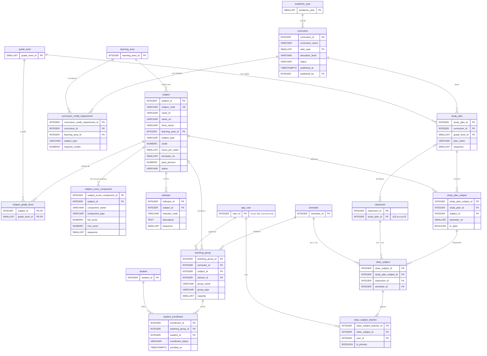

# ขอบเขต 1 — หลักสูตร

> **สถานะ:** ร่าง (2026-11-03) · อ้างตารางจาก [ขอบเขต 0](00-core.md) · ข้อตกลงอยู่ที่ [README.md](README.md#ข้อตกลง)

รายวิชา หลักสูตร แผนการเรียน และสิ่งที่ได้จากการนำแผนไปใช้กับห้องในแต่ละภาค คือ **ห้องเรียนที่สอน** กับครูผู้สอน รวมถึงชุมนุม ขอบเขตนี้เป็นจุดเริ่มของทั้งการบันทึกคะแนน (ขอบเขต 2) และตารางสอน (ขอบเขต 3)

## 1. ที่มาในระบบจำลอง

| ข้อมูล | หน้า | สิ่งที่หน้าทำ |
|---|---|---|
| รายวิชา | [course-management.html](../../curriculum/course-management.html) | รหัส ชื่อไทย / อังกฤษ / ชื่อย่อ กลุ่มสาระ ประเภท หน่วยกิต ชั่วโมงต่อสัปดาห์ ระดับชั้นที่เปิด · โครงสร้างคะแนน (ชื่อองค์ประกอบ คะแนนเต็ม คะแนนขั้นต่ำ รวม 100) และเกณฑ์ผ่าน (%) · ลบไม่ได้ถ้ามีห้องใช้อยู่ · แก้โครงสร้างคะแนนแล้วเตือนถ้ามีผลการเรียนแล้ว |
| หน่วยกิตขั้นต่ำ | [curriculum-structure.html](../../curriculum/curriculum-structure.html), ระเบียนสะสม (`record-report.js`) | หน่วยกิตขั้นต่ำรายกลุ่มสาระตามหลักสูตร (เกณฑ์จบ) · ระเบียนสะสมแสดงหน่วยกิตที่ยังขาด |
| หลักสูตร | [curriculum-management.html](../../curriculum/curriculum-management.html) | ชื่อ ปีที่เริ่มใช้ ระดับ (ม.ต้น / ม.ปลาย) สถานะ ฉบับร่าง / ใช้งานอยู่ / ปิดใช้งาน · ประกาศใช้แล้วหลักสูตรเดิมระดับเดียวกันถูกปิดอัตโนมัติ |
| แผนการเรียน | หน้าเดียวกัน | แผนของหลักสูตร × ระดับชั้น เช่น "ห้องเรียนพิเศษวิทยาศาสตร์-คณิตศาสตร์" ม.1 ใช้กับห้อง ม.1/5 |
| รายวิชาในแผน | หน้าเดียวกัน | เพิ่มรายวิชาเข้าแผนแยกภาค 1 / 2 · เปิด / ปิดสถานะวิชา · ย้ายภาคเรียน |
| ครูผู้สอน | หน้าเดียวกัน | มอบหมายครูรายห้อง ครูหลายคนในห้องเดียวกัน = ครูร่วมสอน · ปุ่มกำหนดครูอัตโนมัติ |
| ห้องเรียนที่สอน | grading (`scores.html`), ตารางสอน, รายงาน | รายวิชา × ห้อง × ภาคเรียน เป็นหน่วยที่กรอกคะแนน ส่งผล และจัดลงตาราง |
| ชุมนุม | grading (GLOSSARY, ADR 0010) | กลุ่มคละห้อง มีครูที่ปรึกษา ประเมิน ผ / มผ |

## 2. ER

ตารางที่มีแค่ PK อยู่ในขอบเขต 0 ใส่ไว้เพื่อให้เห็นความสัมพันธ์ ยกเว้น `app_user` ที่เป็นของฝ่ายทะเบียน (นอกขอบเขต)

## 3. Data dictionary

รูปแบบคอลัมน์: **ฟิลด์ · ชนิดข้อมูล · คีย์ · Null · คำอธิบาย / ค่าที่เป็นไปได้** · ทุกตารางที่แก้ไขได้มี `created_at`, `updated_at` ตาม [ข้อตกลง](README.md#กติกาอื่น)

### 3.1 รายวิชา

#### `subject` — รายวิชา

| ฟิลด์ | ชนิดข้อมูล | คีย์ | Null | คำอธิบาย |
|---|---|---|---|---|
| subject_id | INTEGER | PK | N | รหัส |
| subject_code | VARCHAR(10) | UK | N | รหัสวิชาตามหลักการกำหนดรหัส เช่น `ค22101` |
| name_th | VARCHAR(150) | | N | ชื่อวิชาภาษาไทย เช่น `คณิตศาสตร์พื้นฐาน 3` |
| name_en | VARCHAR(150) | | Y | ชื่อวิชาภาษาอังกฤษ (ใช้ในรายงานภาษาอังกฤษ) |
| short_name | VARCHAR(50) | | Y | ชื่อย่อที่แสดงในช่องตารางสอนและรายงาน |
| learning_area_id | INTEGER | FK → learning_area | N | กลุ่มสาระ |
| subject_type | VARCHAR(20) | | N | `basic` พื้นฐาน · `additional` เพิ่มเติม · `activity` กิจกรรมพัฒนาผู้เรียน (ผ / มผ) · `no_result` ไม่มีผลการเรียน |
| credit | NUMERIC(3,1) | | N | หน่วยกิต `0` สำหรับกิจกรรม |
| hours_per_week | SMALLINT | | N | ชั่วโมงต่อสัปดาห์ (ชั่วโมงต่อปี = × 20 คำนวณเอง ไม่เก็บ) |
| semester_no | SMALLINT | | Y | ภาคเรียนที่ออกแบบให้เรียน `1` / `2` · NULL = เรียนได้ทั้งสองภาค เช่น กิจกรรม |
| pass_percent | NUMERIC(5,2) | | Y | เกณฑ์ผ่านรายวิชา (%) · NULL สำหรับวิชาที่ไม่มีคะแนน |
| status | VARCHAR(20) | | N | `active` · `inactive` (เลิกใช้ ไม่ลบ เพราะผลการเรียนเก่าอ้างถึง) |
| | | CHECK (`subject_type IN ('basic', 'additional', 'activity', 'no_result')`) | | |
| | | CHECK (`credit >= 0`) · CHECK (`hours_per_week > 0`) · CHECK (`semester_no IN (1, 2)`) | | |
| | | CHECK (`subject_type IN ('basic', 'additional') OR (credit = 0 AND pass_percent IS NULL)`) | | กิจกรรมไม่มีหน่วยกิตและเกณฑ์คะแนน |

#### `subject_grade_level` — ระดับชั้นที่เปิดรายวิชา

| ฟิลด์ | ชนิดข้อมูล | คีย์ | Null | คำอธิบาย |
|---|---|---|---|---|
| subject_id | INTEGER | PK, FK → subject | N | รายวิชา |
| grade_level_id | SMALLINT | PK, FK → grade_level | N | ระดับชั้น |

หน้ารายวิชาให้เลือกได้หลายระดับชั้น (`levels[]`) เช่น วิชาเพิ่มเติมที่เปิดให้ ม.4–ม.6 เลือกเรียน วิชาพื้นฐานส่วนใหญ่จะมีแถวเดียว

#### `subject_score_component` — โครงสร้างคะแนนตั้งต้นของรายวิชา

แม่แบบที่ห้องเรียนที่สอนทุกห้องของวิชานี้คัดลอกไปใช้ (ขอบเขต 2 คัดลอกเป็นหมวดคะแนนของแต่ละห้อง ครูปรับต่อได้)

| ฟิลด์ | ชนิดข้อมูล | คีย์ | Null | คำอธิบาย |
|---|---|---|---|---|
| subject_score_component_id | INTEGER | PK | N | รหัส |
| subject_id | INTEGER | FK → subject | N | รายวิชา |
| component_name | VARCHAR(100) | | N | เช่น `เก็บระหว่างเรียน`, `สอบกลางภาค` |
| component_type | VARCHAR(20) | | N | `collect` คะแนนเก็บ · `midterm` กลางภาค · `final` ปลายภาค (รายงานสอบซ่อมแยกตามประเภทนี้) |
| full_score | NUMERIC(5,2) | | N | คะแนนเต็ม = สัดส่วนในคะแนนรวม 100 |
| min_score | NUMERIC(5,2) | | Y | คะแนนขั้นต่ำขององค์ประกอบนี้ |
| sequence | SMALLINT | | N | ลำดับ |
| | | UK (subject_id, sequence) | | |
| | | CHECK (`full_score > 0`) · CHECK (`min_score BETWEEN 0 AND full_score`) | | |
| | | CHECK (`component_type IN ('collect', 'midterm', 'final')`) | | |

#### `indicator` — ตัวชี้วัด / ผลการเรียนรู้

| ฟิลด์ | ชนิดข้อมูล | คีย์ | Null | คำอธิบาย |
|---|---|---|---|---|
| indicator_id | INTEGER | PK | N | รหัส |
| subject_id | INTEGER | FK → subject | N | รายวิชา |
| indicator_code | VARCHAR(30) | | N | เช่น `ค 1.1 ม.2/1` หรือ `ผลการเรียนรู้ข้อ 1` |
| description | TEXT | | N | รายละเอียด |
| sequence | SMALLINT | | N | ลำดับ |
| | | UK (subject_id, indicator_code) | | |

### 3.2 หลักสูตรและแผนการเรียน

#### `curriculum` — หลักสูตรสถานศึกษา

| ฟิลด์ | ชนิดข้อมูล | คีย์ | Null | คำอธิบาย |
|---|---|---|---|---|
| curriculum_id | INTEGER | PK | N | รหัส |
| curriculum_name | VARCHAR(200) | | N | เช่น `หลักสูตรสถานศึกษา ระดับมัธยมศึกษาตอนต้น` |
| start_year | SMALLINT | FK → academic_year | N | ปีการศึกษาที่เริ่มใช้ |
| education_level | VARCHAR(20) | | N | `lower_secondary` · `upper_secondary` (ค่าชุดเดียวกับ `grade_level.education_level`) |
| status | VARCHAR(20) | | N | `draft` ฉบับร่าง · `active` ใช้งานอยู่ · `inactive` ปิดใช้งาน |
| published_at | TIMESTAMPTZ | | Y | เวลาที่ประกาศใช้ |
| published_by | INTEGER | FK → app_user | Y | ผู้ประกาศใช้ |
| updated_by | INTEGER | FK → app_user | Y | ผู้แก้ไขล่าสุด (หน้ารายการหลักสูตรแสดง "แก้ไขล่าสุดโดย") |
| | | UNIQUE INDEX (education_level) WHERE status = 'active' | | ใช้งานได้หลักสูตรเดียวต่อระดับ |
| | | CHECK (`status IN ('draft', 'active', 'inactive')`) | | |
| | | CHECK (`status = 'draft' OR published_at IS NOT NULL`) | | |

#### `curriculum_credit_requirement` — หน่วยกิตขั้นต่ำตามหลักสูตร

| ฟิลด์ | ชนิดข้อมูล | คีย์ | Null | คำอธิบาย |
|---|---|---|---|---|
| curriculum_credit_requirement_id | INTEGER | PK | N | รหัส |
| curriculum_id | INTEGER | FK → curriculum | N | หลักสูตร |
| learning_area_id | INTEGER | FK → learning_area | N | กลุ่มสาระ |
| subject_type | VARCHAR(20) | | N | `basic` · `additional` (ค่าชุดเดียวกับ `subject.subject_type`) |
| required_credits | NUMERIC(4,1) | | N | หน่วยกิตขั้นต่ำตลอดหลักสูตร |
| | | UK (curriculum_id, learning_area_id, subject_type) | | |
| | | CHECK (`required_credits >= 0`) · CHECK (`subject_type IN ('basic', 'additional')`) | | |

เกณฑ์จบของหลักสูตร หน้าโครงสร้างหลักสูตรแสดงหน่วยกิตขั้นต่ำ และระเบียนสะสมใช้คำนวณ "หน่วยกิตที่ยังขาด" รายกลุ่มสาระ (`v_credit_progress` ใน [ขอบเขต 5](05-reports.md#32-ผลการเรียนและหน่วยกิต)) · เดิมอยู่ในขอบเขต 5 ย้ายมาเพราะเป็นข้อมูลของหลักสูตร ไม่ใช่ของรายงาน (2026-11-07)

#### `study_plan` — แผนการเรียน

| ฟิลด์ | ชนิดข้อมูล | คีย์ | Null | คำอธิบาย |
|---|---|---|---|---|
| study_plan_id | INTEGER | PK | N | รหัส |
| curriculum_id | INTEGER | FK → curriculum | N | หลักสูตร |
| grade_level_id | SMALLINT | FK → grade_level | N | ระดับชั้น |
| plan_name | VARCHAR(150) | | N | เช่น `ห้องเรียนปกติ`, `แผนการเรียนวิทยาศาสตร์-คณิตศาสตร์` |
| sequence | SMALLINT | | N | ลำดับในระดับชั้น |
| | | UK (curriculum_id, grade_level_id, plan_name) | | |

#### `study_plan_subject` — รายวิชาในแผน

| ฟิลด์ | ชนิดข้อมูล | คีย์ | Null | คำอธิบาย |
|---|---|---|---|---|
| study_plan_subject_id | INTEGER | PK | N | รหัส |
| study_plan_id | INTEGER | FK → study_plan | N | แผน |
| subject_id | INTEGER | FK → subject | N | รายวิชา |
| semester_no | SMALLINT | | N | ภาคที่เรียนในแผนนี้ `1` / `2` (หน้าหลักสูตรย้ายภาคได้ จึงไม่ใช้ค่าจาก `subject`) |
| is_open | BOOLEAN | | N | เปิดสอน · `false` = อยู่ในแผนแต่ภาคนี้ไม่เปิด (ปุ่มเปิด / ปิดสถานะวิชา) |
| | | UK (study_plan_id, subject_id, semester_no) | | |
| | | CHECK (`semester_no IN (1, 2)`) | | |

#### เพิ่มใน `classroom` (ขอบเขต 0)

| ฟิลด์ | ชนิดข้อมูล | คีย์ | Null | คำอธิบาย |
|---|---|---|---|---|
| study_plan_id | INTEGER | FK → study_plan | Y | แผนที่ห้องนี้เรียนในปีการศึกษานั้น · NULL = ยังไม่กำหนด |

ระบบจำลองเก็บห้องไว้ในแผน (`plan.rooms = ['ม.1/5']`) แต่ห้องเป็นของแต่ละปี ส่วนแผนเป็นของหลักสูตรที่ใช้หลายปี จึงให้ห้องชี้ไปที่แผนแทน หน้าหลักสูตรได้รายการห้องของแผนจาก `classroom` ที่ `study_plan_id` ตรงกัน ในปีที่เลือก

### 3.3 ห้องเรียนที่สอนและครูผู้สอน

#### `class_subject` — ห้องเรียนที่สอน (รายวิชา × ห้อง × ภาคเรียน)

| ฟิลด์ | ชนิดข้อมูล | คีย์ | Null | คำอธิบาย |
|---|---|---|---|---|
| class_subject_id | INTEGER | PK | N | รหัส |
| study_plan_subject_id | INTEGER | FK → study_plan_subject | N | รายวิชาในแผน (ได้ทั้งรายวิชาและแผน) |
| classroom_id | INTEGER | FK → classroom | N | ห้อง |
| semester_id | INTEGER | FK → semester | N | ภาคเรียน |
| | | UK (study_plan_subject_id, classroom_id, semester_id) | | |
| | | UK (class_subject_id, classroom_id) | | ให้ `timetable_entry` (ขอบเขต 3) อ้างแบบ composite FK |

- สร้างเมื่อนำแผนไปใช้กับห้องในภาคนั้น: ทุก `study_plan_subject` ที่ `is_open` × ทุกห้องที่ `study_plan_id` ตรงกัน × ภาคที่ `semester_no` ตรงกัน
- วิชากิจกรรม ผ / มผ ที่สอนทั้งห้อง (แนะแนว) ก็เป็น `class_subject` ส่วนชุมนุมที่คละห้องใช้ `teaching_group`
- **ขอบเขต 2 จะเพิ่ม** `grading_status`, `status_updated_at`

#### `class_subject_teacher` — ครูผู้สอนของห้องเรียนที่สอน

| ฟิลด์ | ชนิดข้อมูล | คีย์ | Null | คำอธิบาย |
|---|---|---|---|---|
| class_subject_teacher_id | INTEGER | PK | N | รหัส |
| class_subject_id | INTEGER | FK → class_subject | N | ห้องเรียนที่สอน |
| user_id | INTEGER | FK → app_user | N | ครู |
| is_primary | BOOLEAN | | N | ครูหลัก (ผู้ส่งผลการเรียนและขอปลดล็อก) · ครูคนอื่นในห้องเดียวกัน = ครูร่วมสอน (กรอกคะแนนได้) |
| | | UK (class_subject_id, user_id) | | |
| | | UNIQUE INDEX (class_subject_id) WHERE is_primary | | มีครูหลักได้คนเดียว |

ER เดิมมี `ClassSubject.teacher_id` คนเดียว แต่หน้าหลักสูตรและตารางสอนรองรับครูร่วมสอน จึงแยกเป็นตาราง

**สิทธิ์ของครูร่วมสอน (ตัดสินแล้ว 2026-11-03):** ครูทุกคนใน `class_subject_teacher` ของห้องนั้นกรอกและแก้คะแนนได้เท่ากัน ส่วนการส่งผลการเรียนและขอปลดล็อกเป็นหน้าที่ของครูหลัก (`is_primary`) เพื่อให้แต่ละรอบการตรวจมีผู้รับผิดชอบคนเดียว ขอบเขต 2 ต้องปรับกฎ "ผู้แก้ต้องเป็น `ClassSubject.teacher_id`" ของ ER เดิมให้ตรงกับข้อนี้

### 3.4 ชุมนุม

#### `teaching_group` — ชุมนุม

| ฟิลด์ | ชนิดข้อมูล | คีย์ | Null | คำอธิบาย |
|---|---|---|---|---|
| teaching_group_id | INTEGER | PK | N | รหัส |
| semester_id | INTEGER | FK → semester | N | ภาคเรียน |
| subject_id | INTEGER | FK → subject | Y | รายวิชากิจกรรมที่ชุมนุมนี้นับเป็น เช่น `ก22903 ชุมนุม` (ใช้ออกรายงานและระเบียนสะสม) |
| advisor_id | INTEGER | FK → app_user | N | ครูที่ปรึกษา |
| group_name | VARCHAR(100) | | N | ชื่อชุมนุม |
| group_type | VARCHAR(20) | | N | `club` ชุมนุม · `scout` ลูกเสือ-เนตรนารี · `social_service` เพื่อสังคมและสาธารณประโยชน์ |
| capacity | SMALLINT | | Y | จำนวนรับ |
| | | CHECK (`group_type IN ('club', 'scout', 'social_service')`) · CHECK (`capacity > 0`) | | |

**ขอบเขต 2 จะเพิ่ม** `grading_status`, `status_updated_at`

#### `student_enrollment` — สมาชิกชุมนุม

| ฟิลด์ | ชนิดข้อมูล | คีย์ | Null | คำอธิบาย |
|---|---|---|---|---|
| enrollment_id | INTEGER | PK | N | รหัส |
| teaching_group_id | INTEGER | FK → teaching_group | N | ชุมนุม |
| student_id | INTEGER | FK → student | N | นักเรียน |
| enrollment_status | VARCHAR(20) | | N | `enrolled` · `withdrawn` |
| enrolled_at | TIMESTAMPTZ | | N | เวลาสมัคร |
| | | UK (teaching_group_id, student_id) | | |
| | | CHECK (`enrollment_status IN ('enrolled', 'withdrawn')`) | | |

## 4. กฎทางธุรกิจ (ใช้ constraint ไม่ได้)

1. ผลรวม `subject_score_component.full_score` ของรายวิชาที่เป็น `basic` / `additional` ต้องเท่ากับ 100 (หน้ารายวิชาบังคับก่อนบันทึก)
2. แก้โครงสร้างคะแนนตั้งต้นได้เสมอ แต่ไม่กระทบห้องเรียนที่สอนที่คัดลอกไปแล้ว ถ้ามีห้องที่บันทึกคะแนนแล้ว ระบบต้องเตือน (หน้ารายวิชาแสดงคำเตือนนี้)
3. ลบรายวิชาไม่ได้ถ้ามีแถวใน `study_plan_subject` ให้เปลี่ยน `status` เป็น `inactive` แทน
4. `study_plan_subject`: ระดับชั้นของแผนต้องอยู่ใน `subject_grade_level` ของรายวิชา และ `curriculum.education_level` ต้องตรงกับ `grade_level.education_level` ของแผน
5. แก้แผนได้เฉพาะเมื่อ `curriculum.status = 'draft'` หรือ `active` (หลักสูตร `inactive` อ่านอย่างเดียว)
6. ประกาศใช้หลักสูตร: เปลี่ยนหลักสูตร `active` เดิมของระดับเดียวกันเป็น `inactive` ใน transaction เดียวกัน
7. `classroom.study_plan_id`: ระดับชั้นของแผนต้องตรงกับห้อง และหลักสูตรของแผนต้องไม่ใช่ `draft`
8. `class_subject`: `study_plan_subject.semester_no` = `semester.semester_no` · ห้องต้องใช้แผนเดียวกัน (`classroom.study_plan_id`) · `semester.academic_year` = `classroom.academic_year`
9. ห้องเรียนที่สอนต้องมีครูหลัก 1 คนก่อนเริ่มบันทึกคะแนน (ขอบเขต 2) และครูต้องเป็น `app_user.status = 'active'`
10. นักเรียน 1 คนอยู่ได้ 1 ชุมนุมต่อ `group_type` ต่อภาคเรียน (นับเฉพาะ `enrolled`) และจำนวน `enrolled` ต้องไม่เกิน `capacity`

## 5. เทียบกับ ER เดิม

| ER เดิม | ขอบเขตนี้ | เหตุผล |
|---|---|---|
| `Subject` (code, name, learning_area) | `subject` + ฟิลด์จาก `CurriculumSubject` และหน้ารายวิชา | หน้ารายวิชาเก็บประเภท หน่วยกิต ชั่วโมง เกณฑ์ผ่าน และโครงสร้างคะแนนที่ตัวรายวิชา ไม่ได้แยกตามหลักสูตร · `subject_code` เดิมซ้ำทั้งใน `Subject` และ `CurriculumSubject` |
| `CurriculumSubject` | `study_plan_subject` | เหลือแค่ "วิชานี้อยู่ในแผนไหน ภาคไหน เปิดหรือไม่" ซึ่งเป็นสิ่งที่หน้าหลักสูตรจัดการ · ER เดิมไม่มี FK ไปหาหลักสูตรหรือแผนเลย |
| — | 🆕 `curriculum` | หน้าหลักสูตรมีปี ระดับ สถานะ และการประกาศใช้ |
| `StudyProgram` (ข้ามระดับชั้น) | `study_plan` (หลักสูตร × ระดับชั้น) | ในระบบจำลองแผนเป็นของแต่ละระดับชั้นและแต่ละหลักสูตร |
| `Classroom.study_program_id` | `classroom.study_plan_id` | ชี้ไปที่แผนของระดับชั้นนั้น |
| — | 🆕 `subject_grade_level` | หน้ารายวิชาเลือกได้หลายระดับชั้น |
| `AssessmentCategoryTemplate` (ต่อ `CurriculumSubject`, `weight_percent`) | `subject_score_component` (ต่อ `subject`, `full_score`, `min_score`) | หน้ารายวิชาตั้งโครงสร้างคะแนนที่ตัวรายวิชา และมีคะแนนขั้นต่ำรายองค์ประกอบ · `full_score` รวม 100 จึงเท่ากับสัดส่วน |
| `Indicator.curriculum_subject_id` | `indicator.subject_id` | ตัวชี้วัดเป็นของรายวิชา ไม่ได้เปลี่ยนตามแผน |
| `ClassSubject.curriculum_subject_id` | `class_subject.study_plan_subject_id` | ได้ทั้งรายวิชาและแผน |
| `ClassSubject.teacher_id` | 🆕 `class_subject_teacher` | รองรับครูร่วมสอน |
| `ClassSubject.grading_status`, `TeachingGroup.grading_status` | ย้ายไปขอบเขต 2 | เป็นสถานะของการบันทึกคะแนน |
| `TeachingGroup` | `teaching_group` + 🆕 `subject_id` · `group_type` มีชุดค่า | ระเบียนสะสมต้องรู้ว่าชุมนุมนับเป็นรายวิชากิจกรรมตัวไหน |
| `StudentEnrollment` | `student_enrollment` | คงเดิม |

## 6. คำถามที่ยังเปิดอยู่

- **ประเภทรายวิชา** หน้ารายวิชาใช้ "เลือก" แต่หน้าหลักสูตรใช้ "เพิ่มเติม" ในฐานข้อมูลใช้ `additional` ตัวเดียว · และ `no_result` (ไม่มีผลการเรียน) ต่างจาก `activity` (ผ / มผ) อย่างไร ถ้าแนะแนวก็ประเมิน ผ / มผ อาจรวมเป็นค่าเดียว
- **ครูที่ปรึกษาชุมนุมหลายคน** ตอนนี้มีได้คนเดียว (`advisor_id`) ถ้าชุมนุมมีครูร่วม ต้องแยกเป็นตารางแบบ `class_subject_teacher`
- **วิชาเลือกเสรีที่เรียนข้ามห้อง** (ม.ปลายบางโรงเรียนให้เลือกวิชาคละห้อง) ตอนนี้รายวิชาเพิ่มเติมเรียนทั้งห้องตาม ER เดิม ถ้ามีกรณีคละห้อง ต้องมีกลุ่มเรียนแบบ `teaching_group` ที่ให้เกรด 0–4
- **รายวิชาที่ครูสอนได้** (หน้าโปรไฟล์ครูในตารางสอน) จะอยู่ในขอบเขต 3 ร่วมกับเวลาไม่ว่าง
