# ขอบเขต 2 — บันทึกคะแนน

> **สถานะ:** ร่าง (2026-11-03) · อ้างตารางจาก [ขอบเขต 0](00-core.md) และ [ขอบเขต 1](01-curriculum.md) · ข้อตกลงอยู่ที่ [README.md](README.md#ข้อตกลง)

ใช้ ER เดิมของระบบบันทึกคะแนน ([er-data-dictionary.md](../../grading/docs/er-data-dictionary.md) หัวข้อ 5.3–5.4) เกือบทั้งหมด ไฟล์นี้แปลงเป็น PostgreSQL ผูกกับขอบเขต 0–1 และแก้จุดที่ขัดกับระบบจำลองหรือกับการตัดสินใจใหม่ ความหมายของคำและเหตุผลเบื้องหลังอยู่ใน [grading/GLOSSARY.md](../../grading/GLOSSARY.md) และ [ADR 0001–0011](../../grading/docs/adr/)

**หน่วยส่งผล** มี 2 แบบ: ห้องเรียนที่สอน (`class_subject` ให้เกรด 0–4 / ร / มส) และชุมนุม (`teaching_group` ให้ ผ / มผ) ตารางที่ใช้กับทั้งสองแบบมี FK ทั้งสองตัวและบังคับว่ามีค่าได้ตัวเดียว ([ER เดิมข้อ 4.1](../../grading/docs/er-data-dictionary.md#41-หน่วยส่งผลมี-2-แบบ-ใช้-fk-2-ตัว--check))

```sql
CHECK (num_nonnulls(class_subject_id, teaching_group_id) = 1)
```

## 1. ที่มาในระบบจำลอง

| ข้อมูล | หน้า / ไฟล์ |
|---|---|
| โครงสร้างคะแนน (กลุ่ม เก็บ / กลางภาค / ปลายภาค, คะแนนเต็ม, สัดส่วน, ตัวชี้วัด) | `scores.html#/s/<id>` · `mathStructure()` ใน [data.js](../../grading/assets/js/data.js) |
| คะแนน และ ร / ข แทนคะแนน | `SPECIAL_MARKS` ใน data.js · ตารางกรอกคะแนน |
| คุณลักษณะอันพึงประสงค์ 8 ข้อ, อ่าน คิดวิเคราะห์ และเขียน 5 ด้าน, ระดับ 0–3 | `ATTRIBUTES`, `RTW`, `LEVELS` ใน data.js |
| เกณฑ์ระดับผลการเรียน 8 ระดับ, เวลาเรียนขั้นต่ำ 80% | `GRADE_SCALE`, `MIN_ATTENDANCE` · `scores.html#/criteria` |
| สถานะห้อง ไม่มีโครงสร้าง → ร่าง → รอตรวจ → อนุมัติ | การ์ดใน `scores.html#/` · [ADR 0002](../../grading/docs/adr/0002-section-status-lifecycle.md) |
| ส่งผล ตรวจ อนุมัติ ตีกลับ หมุดข้อสังเกต ตรวจงานตนเอง | `scores.html#/a`, `#/a/inbox`, `#/a/s/<id>` · ADR 0001, 0006, 0007 |
| คำขอปลดล็อก | ADR 0005 |
| ประวัติการแก้ไข | แท็บประวัติในหน้าห้องเรียนที่สอน |
| สอบซ่อม (รายวิชา และรายประเภทคะแนน) | [student-retake-management.html](../../reports/student-retake-management.html), [student-list-by-classroom.html](../../reports/student-list-by-classroom.html) |

## 2. ER

ตารางที่มีแค่ PK มาจากขอบเขต 0–1 ใส่ไว้เพื่อให้เห็นความสัมพันธ์

```mermaid
erDiagram
    class_subject ||--o{ assessment_category : "หมวดคะแนน"
    subject_score_component |o--o{ assessment_category : "คัดลอกจาก"
    assessment_category ||--o{ assessment_item : "องค์ประกอบ"
    assessment_item ||--o{ assessment_item_indicator : "วัดตัวชี้วัด"
    indicator ||--o{ assessment_item_indicator : "ถูกวัดโดย"
    assessment_item ||--o{ student_score : "คะแนน"
    student ||--o{ student_score : "ได้คะแนน"

    trait_item ||--o{ student_trait_score : "ข้อประเมิน"
    class_subject ||--o{ student_trait_score : "ประเมินใน"
    student ||--o{ student_trait_score : "ได้ระดับ"

    academic_year ||--o{ grading_policy : "ใช้ตั้งแต่ปี"
    grading_policy ||--|{ grade_scale : "ช่วงคะแนน"
    class_subject ||--o{ student_subject_result : "ผลการเรียน"
    student ||--o{ student_subject_result : "ได้ผล"
    grade_scale |o--o{ student_subject_result : "ตรงกับระดับ"
    student_subject_result ||--o{ remedial_attempt : "สอบซ่อม"
    assessment_category |o--o{ remedial_attempt : "ซ่อมหมวด"
    teaching_group ||--o{ activity_result : "ผลชุมนุม"
    student ||--o{ activity_result : "ได้ ผ / มผ"

    class_subject |o--o{ grade_submission : "ส่งผล"
    teaching_group |o--o{ grade_submission : "ส่งผล"
    grade_submission ||--o{ review_note : "หมุด"
    student ||--o{ review_note : "ปักที่นักเรียน"
    assessment_item |o--o{ review_note : "ปักที่ช่องคะแนน"
    trait_item |o--o{ review_note : "ปักที่ช่องประเมิน"
    grade_submission ||--o{ unlock_request : "ขอปลดล็อก"
    class_subject |o--o{ grade_change_log : "ประวัติ"
    teaching_group |o--o{ grade_change_log : "ประวัติ"

    assessment_category {
        INTEGER assessment_category_id PK
        INTEGER class_subject_id FK
        INTEGER subject_score_component_id FK
        VARCHAR category_name
        VARCHAR category_type
        NUMERIC weight_percent
        NUMERIC min_score
        SMALLINT sequence
    }
    assessment_item {
        INTEGER assessment_item_id PK
        INTEGER assessment_category_id FK
        VARCHAR item_name
        NUMERIC max_score
        NUMERIC weight_percent
        DATE assessment_date
        SMALLINT sequence
        INTEGER created_by FK
    }
    assessment_item_indicator {
        INTEGER assessment_item_id PK,FK
        INTEGER indicator_id PK,FK
    }
    student_score {
        BIGINT student_score_id PK
        INTEGER assessment_item_id FK
        INTEGER student_id FK
        NUMERIC score
        VARCHAR score_status
        INTEGER updated_by FK
    }
    trait_item {
        SMALLINT trait_item_id PK
        VARCHAR trait_type
        SMALLINT item_no
        VARCHAR item_name
        BOOLEAN is_active
    }
    student_trait_score {
        BIGINT student_trait_score_id PK
        INTEGER class_subject_id FK
        INTEGER student_id FK
        SMALLINT trait_item_id FK
        SMALLINT level
        INTEGER updated_by FK
    }
    grading_policy {
        INTEGER grading_policy_id PK
        SMALLINT academic_year FK
        VARCHAR education_level
        NUMERIC min_attendance_percent
        NUMERIC activity_min_attendance_percent
        NUMERIC remedial_pass_score
        NUMERIC remedial_max_grade
        VARCHAR rounding_method
    }
    grade_scale {
        INTEGER grade_scale_id PK
        INTEGER grading_policy_id FK
        NUMERIC grade_value
        VARCHAR grade_label
        NUMERIC min_score
        NUMERIC max_score
    }
    student_subject_result {
        INTEGER student_subject_result_id PK
        INTEGER class_subject_id FK
        INTEGER student_id FK
        NUMERIC attendance_percent
        NUMERIC total_score
        VARCHAR grade_result
        INTEGER grade_scale_id FK
        VARCHAR result_status
        SMALLINT characteristic_level
        SMALLINT reading_level
        TIMESTAMPTZ calculated_at
    }
    remedial_attempt {
        INTEGER remedial_attempt_id PK
        INTEGER student_subject_result_id FK
        INTEGER assessment_category_id FK
        SMALLINT attempt_no
        NUMERIC score
        VARCHAR outcome
        INTEGER recorded_by FK
    }
    activity_result {
        INTEGER activity_result_id PK
        INTEGER teaching_group_id FK
        INTEGER student_id FK
        NUMERIC attendance_percent
        VARCHAR result
        TEXT remark
        INTEGER updated_by FK
    }
    grade_submission {
        INTEGER grade_submission_id PK
        INTEGER class_subject_id FK
        INTEGER teaching_group_id FK
        SMALLINT round_no
        INTEGER submitted_by FK
        TIMESTAMPTZ submitted_at
        INTEGER reviewer_id FK
        VARCHAR decision
        TEXT decision_reason
        TIMESTAMPTZ decided_at
        BOOLEAN is_self_review
    }
    review_note {
        INTEGER review_note_id PK
        INTEGER grade_submission_id FK
        INTEGER student_id FK
        INTEGER assessment_item_id FK
        SMALLINT trait_item_id FK
        TEXT note_text
        BOOLEAN is_resolved
        INTEGER created_by FK
    }
    unlock_request {
        INTEGER unlock_request_id PK
        INTEGER grade_submission_id FK
        INTEGER requested_by FK
        TEXT reason
        VARCHAR status
        INTEGER decided_by FK
        TEXT reject_reason
    }
    grade_change_log {
        BIGINT change_log_id PK
        INTEGER class_subject_id FK
        INTEGER teaching_group_id FK
        INTEGER student_id FK
        VARCHAR change_type
        VARCHAR field_label
        TEXT old_value
        TEXT new_value
        INTEGER changed_by FK
        TIMESTAMPTZ changed_at
    }
    class_subject {
        INTEGER class_subject_id PK
        VARCHAR grading_status "เพิ่มในขอบเขตนี้"
    }
    teaching_group {
        INTEGER teaching_group_id PK
        VARCHAR grading_status "เพิ่มในขอบเขตนี้"
    }
    subject_score_component {
        INTEGER subject_score_component_id PK
    }
    indicator {
        INTEGER indicator_id PK
    }
    student {
        INTEGER student_id PK
    }
    academic_year {
        SMALLINT academic_year PK
    }
```



## 3. Data dictionary

รูปแบบคอลัมน์: **ฟิลด์ · ชนิดข้อมูล · คีย์ · Null · คำอธิบาย / ค่าที่เป็นไปได้** · ทุกตารางที่แก้ไขได้มี `created_at`, `updated_at` ตาม [ข้อตกลง](README.md#กติกาอื่น) ยกเว้นที่ระบุเวลาของตัวเองไว้แล้ว

### 3.1 สถานะของหน่วยส่งผล

#### เพิ่มใน `class_subject` และ `teaching_group` (ขอบเขต 1)

| ฟิลด์ | ชนิดข้อมูล | คีย์ | Null | คำอธิบาย |
|---|---|---|---|---|
| grading_status | VARCHAR(20) | | N | `no_structure` ยังไม่ตั้งโครงสร้างคะแนน · `draft` ร่าง (บันทึกคะแนนได้) · `pending` รอตรวจ · `approved` อนุมัติแล้ว |
| status_updated_at | TIMESTAMPTZ | | N | เวลาที่สถานะเปลี่ยนล่าสุด |
| | | CHECK (`grading_status IN ('no_structure', 'draft', 'pending', 'approved')`) | | |

ชุมนุมไม่มีโครงสร้างคะแนน จึงเริ่มที่ `draft` ส่วนห้องเรียนที่สอนเริ่มที่ `no_structure` และเปลี่ยนเป็น `draft` เมื่อตั้งโครงสร้างครบ 100% ([ADR 0002](../../grading/docs/adr/0002-section-status-lifecycle.md)) "ตีกลับ" ไม่ใช่สถานะ เป็นการกลับไป `draft` พร้อมบันทึกใน `grade_submission`

### 3.2 โครงสร้างคะแนนและการบันทึก

#### `assessment_category` — หมวดคะแนนของห้องเรียนที่สอน

| ฟิลด์ | ชนิดข้อมูล | คีย์ | Null | คำอธิบาย |
|---|---|---|---|---|
| assessment_category_id | INTEGER | PK | N | รหัส |
| class_subject_id | INTEGER | FK → class_subject | N | ห้องเรียนที่สอน |
| subject_score_component_id | INTEGER | FK → subject_score_component | Y | คัดลอกมาจากโครงสร้างตั้งต้นของรายวิชาข้อใด · NULL = ครูเพิ่มเอง |
| category_name | VARCHAR(100) | | N | ชื่อหมวด |
| category_type | VARCHAR(20) | | N | `collect` คะแนนเก็บ · `midterm` กลางภาค · `final` ปลายภาค |
| weight_percent | NUMERIC(5,2) | | N | สัดส่วนของหมวด **ทุกหมวดรวมกันต้องเท่ากับ 100** |
| min_score | NUMERIC(5,2) | | Y | คะแนนขั้นต่ำของหมวด (คัดลอกจากรายวิชา) |
| sequence | SMALLINT | | N | ลำดับ |
| | | UK (class_subject_id, sequence) | | |
| | | CHECK (`weight_percent > 0`) · CHECK (`min_score BETWEEN 0 AND weight_percent`) | | |
| | | CHECK (`category_type IN ('collect', 'midterm', 'final')`) | | |

#### `assessment_item` — องค์ประกอบคะแนน (คอลัมน์ในตารางกรอกคะแนน)

| ฟิลด์ | ชนิดข้อมูล | คีย์ | Null | คำอธิบาย |
|---|---|---|---|---|
| assessment_item_id | INTEGER | PK | N | รหัส |
| assessment_category_id | INTEGER | FK → assessment_category | N | หมวด |
| item_name | VARCHAR(100) | | N | เช่น `ทดสอบย่อย 1` |
| max_score | NUMERIC(5,2) | | N | คะแนนดิบเต็ม |
| weight_percent | NUMERIC(5,2) | | N | สัดส่วนในคะแนนรวม 100 · **ผลรวมในหมวดต้องเท่ากับ weight ของหมวด** |
| assessment_date | DATE | | Y | วันที่ประเมิน |
| sequence | SMALLINT | | N | ลำดับคอลัมน์ |
| created_by | INTEGER | FK → app_user | N | ผู้สร้าง |
| | | UK (assessment_category_id, sequence) | | |
| | | CHECK (`max_score > 0`) · CHECK (`weight_percent > 0`) | | |

คะแนนที่แปลงแล้ว = `score / max_score × weight_percent` รวมทุกองค์ประกอบได้คะแนนรวมเต็ม 100

#### `assessment_item_indicator` — องค์ประกอบคะแนน × ตัวชี้วัด

| ฟิลด์ | ชนิดข้อมูล | คีย์ | Null | คำอธิบาย |
|---|---|---|---|---|
| assessment_item_id | INTEGER | PK, FK → assessment_item | N | องค์ประกอบ |
| indicator_id | INTEGER | PK, FK → indicator | N | ตัวชี้วัด (ต้องเป็นของรายวิชาเดียวกัน) |

#### `student_score` — คะแนนรายช่อง

| ฟิลด์ | ชนิดข้อมูล | คีย์ | Null | คำอธิบาย |
|---|---|---|---|---|
| student_score_id | BIGINT | PK | N | รหัส (BIGINT เพราะเป็นตารางที่ใหญ่ที่สุด: นักเรียน × องค์ประกอบ × ทุกห้อง × ทุกภาค) |
| assessment_item_id | INTEGER | FK → assessment_item | N | องค์ประกอบ |
| student_id | INTEGER | FK → student | N | นักเรียน |
| score | NUMERIC(5,2) | | Y | 0 ถึง `max_score` · NULL เมื่อสถานะไม่ใช่ `scored` |
| score_status | VARCHAR(20) | | N | `scored` · `pending_work` **ร** รอส่งงาน · `absent` **ข** ขาดสอบ |
| updated_by | INTEGER | FK → app_user | N | ผู้บันทึกล่าสุด (ครูหลักหรือครูร่วมสอน) |
| updated_at | TIMESTAMPTZ | | N | บันทึกล่าสุด |
| | | UK (assessment_item_id, student_id) | | |
| | | CHECK (`(score_status = 'scored') = (score IS NOT NULL)`) | | |
| | | CHECK (`score >= 0`) | | |
| | | CHECK (`score_status IN ('scored', 'pending_work', 'absent')`) | | |

ช่องที่ยังไม่กรอกไม่มีแถว ร่างที่ยังไม่กดบันทึกอยู่ฝั่งหน้าจอเท่านั้น ([ADR 0004](../../grading/docs/adr/0004-academic-sees-saved-data-live.md))

#### `trait_item` — รายการประเมินคุณลักษณะฯ / อ่าน คิดวิเคราะห์ และเขียน

| ฟิลด์ | ชนิดข้อมูล | คีย์ | Null | คำอธิบาย |
|---|---|---|---|---|
| trait_item_id | SMALLINT | PK | N | รหัส (ข้อมูลตั้งต้น) |
| trait_type | VARCHAR(30) | | N | `characteristic` คุณลักษณะอันพึงประสงค์ (8 ข้อ) · `reading_thinking` อ่าน คิดวิเคราะห์ และเขียน (5 ด้าน) |
| item_no | SMALLINT | | N | ข้อที่ |
| item_name | VARCHAR(200) | | N | เช่น `มีวินัย` |
| is_active | BOOLEAN | | N | ใช้งานอยู่ |
| | | UK (trait_type, item_no) | | |
| | | CHECK (`trait_type IN ('characteristic', 'reading_thinking')`) | | |

#### `student_trait_score` — ผลประเมินรายข้อ

| ฟิลด์ | ชนิดข้อมูล | คีย์ | Null | คำอธิบาย |
|---|---|---|---|---|
| student_trait_score_id | BIGINT | PK | N | รหัส |
| class_subject_id | INTEGER | FK → class_subject | N | ห้องเรียนที่สอน |
| student_id | INTEGER | FK → student | N | นักเรียน |
| trait_item_id | SMALLINT | FK → trait_item | N | ข้อที่ประเมิน |
| level | SMALLINT | | N | `3` ดีเยี่ยม · `2` ดี · `1` ผ่าน · `0` ไม่ผ่าน |
| updated_by | INTEGER | FK → app_user | N | ผู้บันทึก |
| updated_at | TIMESTAMPTZ | | N | บันทึกล่าสุด |
| | | UK (class_subject_id, student_id, trait_item_id) | | |
| | | CHECK (`level BETWEEN 0 AND 3`) | | |

### 3.3 เกณฑ์และผลการเรียน

#### `grading_policy` — ชุดเกณฑ์การตัดสินผล

| ฟิลด์ | ชนิดข้อมูล | คีย์ | Null | คำอธิบาย |
|---|---|---|---|---|
| grading_policy_id | INTEGER | PK | N | รหัส |
| academic_year | SMALLINT | FK → academic_year | N | ปีการศึกษาที่เริ่มใช้ (ใช้ต่อไปจนมีชุดใหม่) |
| education_level | VARCHAR(20) | | N | `lower_secondary` · `upper_secondary` |
| min_attendance_percent | NUMERIC(5,2) | | N | เวลาเรียนขั้นต่ำของวิชาหลัก ค่าเริ่มต้น `80` (ต่ำกว่านี้ = มส) |
| activity_min_attendance_percent | NUMERIC(5,2) | | N | เวลาเข้าร่วมขั้นต่ำของชุมนุม ค่าเริ่มต้น `80` (ต่ำกว่านี้ระบบเสนอ มผ) |
| remedial_pass_score | NUMERIC(5,2) | | N | คะแนนผ่านสอบซ่อม (%) ค่าเริ่มต้น `50` |
| remedial_max_grade | NUMERIC(2,1) | | N | ระดับสูงสุดหลังสอบซ่อม ค่าเริ่มต้น `1.0` |
| rounding_method | VARCHAR(20) | | N | `round_half_up` · `floor` วิธีปัดคะแนนรวมก่อนเทียบช่วง |
| created_by | INTEGER | FK → app_user | N | ผู้กำหนด |
| | | UK (academic_year, education_level) | | |
| | | CHECK ร้อยละทุกตัวอยู่ระหว่าง 0–100 · CHECK (`rounding_method IN ('round_half_up', 'floor')`) | | |

#### `grade_scale` — ช่วงคะแนนของแต่ละระดับผลการเรียน

| ฟิลด์ | ชนิดข้อมูล | คีย์ | Null | คำอธิบาย |
|---|---|---|---|---|
| grade_scale_id | INTEGER | PK | N | รหัส |
| grading_policy_id | INTEGER | FK → grading_policy | N | ชุดเกณฑ์ |
| grade_value | NUMERIC(2,1) | | N | `4`, `3.5`, … `0` |
| grade_label | VARCHAR(50) | | N | เช่น `ผลการเรียนดีเยี่ยม` |
| min_score | NUMERIC(5,2) | | N | คะแนนต่ำสุดของช่วง |
| max_score | NUMERIC(5,2) | | N | คะแนนสูงสุดของช่วง |
| | | UK (grading_policy_id, grade_value) | | |
| | | EXCLUDE USING gist (grading_policy_id WITH =, numrange(min_score, max_score, '[]') WITH &&) | | ช่วงคะแนนในชุดเดียวกันห้ามทับกัน (ต้องเปิด extension `btree_gist`) |
| | | CHECK (`min_score <= max_score`) | | |

#### `student_subject_result` — ผลการเรียนรายวิชา

| ฟิลด์ | ชนิดข้อมูล | คีย์ | Null | คำอธิบาย |
|---|---|---|---|---|
| student_subject_result_id | INTEGER | PK | N | รหัส |
| class_subject_id | INTEGER | FK → class_subject | N | ห้องเรียนที่สอน |
| student_id | INTEGER | FK → student | N | นักเรียน |
| attendance_percent | NUMERIC(5,2) | | Y | เวลาเรียน (%) คำนวณจากการเช็คชื่อ (ขอบเขต 4) เก็บเป็น snapshot ตอนส่งผล |
| total_score | NUMERIC(5,2) | | Y | คะแนนรวม 0–100 |
| grade_result | VARCHAR(5) | | Y | `4` … `0`, `ร`, `มส` · NULL = ยังคำนวณไม่ได้ |
| grade_scale_id | INTEGER | FK → grade_scale | Y | ระดับที่ตรงกับคะแนน · NULL เมื่อได้ ร / มส |
| result_status | VARCHAR(20) | | N | `incomplete` คะแนนยังไม่ครบ · `pass` ผ่าน · `remedial` ได้ 0 รอสอบซ่อม · `remedial_pass` ผ่านหลังสอบซ่อม · `pending` ร · `no_exam_right` มส |
| characteristic_level | SMALLINT | | Y | สรุปคุณลักษณะฯ 0–3 |
| reading_level | SMALLINT | | Y | สรุปอ่าน คิดวิเคราะห์ และเขียน 0–3 |
| calculated_at | TIMESTAMPTZ | | N | เวลาคำนวณล่าสุด |
| | | UK (class_subject_id, student_id) | | |
| | | CHECK (`result_status IN ('incomplete', 'pass', 'remedial', 'remedial_pass', 'pending', 'no_exam_right')`) | | |
| | | CHECK (`characteristic_level BETWEEN 0 AND 3`) · CHECK (`reading_level BETWEEN 0 AND 3`) | | |

ทั้งตารางเป็นค่าที่คำนวณได้ แต่เก็บไว้เพราะเป็นหลักฐานของผลที่อนุมัติแล้ว ถ้าคะแนน เกณฑ์ หรือการเช็คชื่อเปลี่ยนภายหลัง ผลที่อนุมัติแล้วต้องไม่เปลี่ยนตาม (ER เดิมข้อ 4.4) และรายงานทุกหน้าอ่านจากตารางนี้

#### `remedial_attempt` — การสอบซ่อม

| ฟิลด์ | ชนิดข้อมูล | คีย์ | Null | คำอธิบาย |
|---|---|---|---|---|
| remedial_attempt_id | INTEGER | PK | N | รหัส |
| student_subject_result_id | INTEGER | FK → student_subject_result | N | ผลการเรียนที่สอบซ่อม |
| assessment_category_id | INTEGER | FK → assessment_category | Y | ซ่อมเฉพาะหมวด เช่น สอบกลางภาคที่ขาดสอบ · NULL = สอบซ่อมทั้งรายวิชา (ได้ 0) |
| attempt_no | SMALLINT | | N | ครั้งที่ |
| score | NUMERIC(5,2) | | Y | คะแนนที่ได้ (%) · NULL = ยังไม่ได้สอบ |
| outcome | VARCHAR(20) | | N | `scheduled` รอสอบซ่อม · `passed` ผ่าน · `failed` ไม่ผ่าน · `follow_up` ติดตามงาน |
| recorded_by | INTEGER | FK → app_user | Y | ผู้บันทึกผล |
| recorded_at | TIMESTAMPTZ | | Y | เวลาบันทึกผล |
| | | UK (student_subject_result_id, assessment_category_id, attempt_no) | | |
| | | CHECK (`outcome IN ('scheduled', 'passed', 'failed', 'follow_up')`) | | |
| | | CHECK (`outcome = 'scheduled' OR recorded_at IS NOT NULL`) | | |

แทนฟิลด์ `remedial_score`, `remedial_recorded_by`, `remedial_recorded_at` ใน ER เดิม ซึ่งเก็บได้ครั้งเดียวและไม่รู้ว่าซ่อมส่วนไหน หน้ารายงานสอบซ่อมแยกตามประเภทคะแนน (กลางภาค / ปลายภาค) และมีสถานะ รอสอบซ่อม / สอบซ่อมแล้ว / ติดตามงาน · หมายเหตุ: UK ข้างบนไม่กันซ้ำเมื่อ `assessment_category_id` เป็น NULL ให้ใช้ `UNIQUE NULLS NOT DISTINCT` (PostgreSQL 15 ขึ้นไป)

#### `activity_result` — ผลชุมนุม (ผ / มผ)

| ฟิลด์ | ชนิดข้อมูล | คีย์ | Null | คำอธิบาย |
|---|---|---|---|---|
| activity_result_id | INTEGER | PK | N | รหัส |
| teaching_group_id | INTEGER | FK → teaching_group | N | ชุมนุม |
| student_id | INTEGER | FK → student | N | นักเรียน (ต้องเป็นสมาชิกใน `student_enrollment`) |
| attendance_percent | NUMERIC(5,2) | | Y | เวลาเข้าร่วม (%) ครูที่ปรึกษากรอกเอง เพราะชุมนุมไม่เช็คชื่อรายคาบ (ตัดสินแล้ว 2026-11-03) |
| result | VARCHAR(10) | | Y | `pass` **ผ** · `fail` **มผ** · NULL = ยังไม่ประเมิน (ครูเป็นผู้เลือก) |
| remark | TEXT | | Y | เช่น เหตุผลที่ให้ มผ ทั้งที่เวลาเข้าร่วมครบ |
| updated_by | INTEGER | FK → app_user | N | ผู้บันทึก |
| updated_at | TIMESTAMPTZ | | N | บันทึกล่าสุด |
| | | UK (teaching_group_id, student_id) | | |
| | | CHECK (`result IN ('pass', 'fail')`) | | |

### 3.4 การตรวจและอนุมัติ

#### `grade_submission` — รอบการตรวจ

| ฟิลด์ | ชนิดข้อมูล | คีย์ | Null | คำอธิบาย |
|---|---|---|---|---|
| grade_submission_id | INTEGER | PK | N | รหัส |
| class_subject_id | INTEGER | FK → class_subject | Y | หน่วยส่งผล: ห้องเรียนที่สอน |
| teaching_group_id | INTEGER | FK → teaching_group | Y | หน่วยส่งผล: ชุมนุม |
| round_no | SMALLINT | | N | รอบที่ 1, 2, 3 … ของหน่วยนั้น |
| submitted_by | INTEGER | FK → app_user | N | ผู้ส่ง (ครูหลัก หรือครูที่ปรึกษาชุมนุม) |
| submitted_at | TIMESTAMPTZ | | N | เวลาส่ง |
| reviewer_id | INTEGER | FK → app_user | Y | ผู้ตรวจ |
| decision | VARCHAR(20) | | Y | NULL รอตรวจ · `approved` · `returned` ตีกลับ · `unlocked` ปลดล็อกหลังอนุมัติ |
| decision_reason | TEXT | | Y | **บังคับเมื่อ `returned`** |
| decided_at | TIMESTAMPTZ | | Y | เวลาตัดสิน |
| is_self_review | BOOLEAN | | N | ผู้ตรวจเป็นครูของหน่วยนั้นเอง ([ADR 0007](../../grading/docs/adr/0007-self-review-allowed-with-label.md)) ค่าเริ่มต้น `false` |
| | | CHECK (`num_nonnulls(class_subject_id, teaching_group_id) = 1`) | | |
| | | UK (class_subject_id, round_no) · UK (teaching_group_id, round_no) | | |
| | | UNIQUE INDEX (class_subject_id) WHERE decision IS NULL · เช่นเดียวกันกับ teaching_group_id | | รอตรวจได้ทีละ 1 รอบ |
| | | CHECK (`decision IN ('approved', 'returned', 'unlocked')`) | | |
| | | CHECK (`decision IS DISTINCT FROM 'returned' OR decision_reason IS NOT NULL`) | | |
| | | CHECK (`(decision IS NULL) = (decided_at IS NULL)`) | | |

#### `review_note` — หมุดข้อสังเกต

| ฟิลด์ | ชนิดข้อมูล | คีย์ | Null | คำอธิบาย |
|---|---|---|---|---|
| review_note_id | INTEGER | PK | N | รหัส |
| grade_submission_id | INTEGER | FK → grade_submission | N | รอบการตรวจ |
| student_id | INTEGER | FK → student | N | นักเรียน |
| assessment_item_id | INTEGER | FK → assessment_item | Y | ปักที่ช่องคะแนน |
| trait_item_id | SMALLINT | FK → trait_item | Y | ปักที่ช่องประเมิน |
| note_text | TEXT | | N | ข้อความ |
| is_resolved | BOOLEAN | | N | ครูกด "แก้แล้ว" |
| resolved_at | TIMESTAMPTZ | | Y | เวลาที่กดแก้แล้ว |
| created_by | INTEGER | FK → app_user | N | ผู้ปักหมุด |
| created_at | TIMESTAMPTZ | | N | เวลาปักหมุด |
| | | CHECK (`num_nonnulls(assessment_item_id, trait_item_id) <= 1`) | | ว่างทั้งคู่ = ปักทั้งแถว (ชุมนุมใช้แบบนี้เท่านั้น) |
| | | CHECK (`is_resolved = (resolved_at IS NOT NULL)`) | | |

#### `unlock_request` — คำขอปลดล็อก

| ฟิลด์ | ชนิดข้อมูล | คีย์ | Null | คำอธิบาย |
|---|---|---|---|---|
| unlock_request_id | INTEGER | PK | N | รหัส |
| grade_submission_id | INTEGER | FK → grade_submission | N | รอบที่ได้รับอนุมัติและขอปลดล็อก (หน่วยส่งผลหาได้จากรอบนี้) |
| requested_by | INTEGER | FK → app_user | N | ผู้ขอ (ครูหลัก) |
| reason | TEXT | | N | เหตุผล |
| requested_at | TIMESTAMPTZ | | N | เวลายื่น |
| status | VARCHAR(20) | | N | `pending` · `approved` · `rejected` |
| decided_by | INTEGER | FK → app_user | Y | ผู้พิจารณา |
| decided_at | TIMESTAMPTZ | | Y | เวลาพิจารณา |
| reject_reason | TEXT | | Y | **บังคับเมื่อ `rejected`** |
| | | UNIQUE INDEX (grade_submission_id) WHERE status = 'pending' | | ค้างได้ทีละ 1 คำขอ |
| | | CHECK (`status IN ('pending', 'approved', 'rejected')`) | | |
| | | CHECK (`status <> 'rejected' OR reject_reason IS NOT NULL`) | | |
| | | CHECK (`(status = 'pending') = (decided_at IS NULL)`) | | |

#### `grade_change_log` — ประวัติการแก้ไข

| ฟิลด์ | ชนิดข้อมูล | คีย์ | Null | คำอธิบาย |
|---|---|---|---|---|
| change_log_id | BIGINT | PK | N | รหัส |
| class_subject_id | INTEGER | FK → class_subject | Y | หน่วยส่งผล |
| teaching_group_id | INTEGER | FK → teaching_group | Y | หน่วยส่งผล |
| student_id | INTEGER | FK → student | Y | NULL ถ้าเป็นการแก้โครงสร้าง |
| change_type | VARCHAR(20) | | N | `score` · `trait` · `structure` · `remedial` · `activity` · `attendance` (แก้การเช็คชื่อหลังบันทึก ขอบเขต 4) |
| field_label | VARCHAR(150) | | N | สิ่งที่แก้ เช่น `ทดสอบย่อย 1` |
| old_value | TEXT | | Y | ค่าเดิม |
| new_value | TEXT | | Y | ค่าใหม่ |
| changed_by | INTEGER | FK → app_user | N | ผู้แก้ไข |
| changed_at | TIMESTAMPTZ | | N | เวลา |
| | | CHECK (`num_nonnulls(class_subject_id, teaching_group_id) = 1`) | | |
| | | CHECK (`change_type IN ('score', 'trait', 'structure', 'remedial', 'activity', 'attendance')`) | | |

เพิ่มอย่างเดียว ไม่แก้และไม่ลบ

## 4. กฎทางธุรกิจ (ใช้ constraint ไม่ได้)

1. ผลรวม `assessment_category.weight_percent` ของ 1 ห้องเรียนที่สอน = 100 และผลรวม `assessment_item.weight_percent` ในหมวด = weight ของหมวด จึงจะเปลี่ยนจาก `no_structure` เป็น `draft` ได้
2. `student_score.score` ไม่เกิน `assessment_item.max_score` และนักเรียนต้องอยู่ใน `student_classroom` ของห้องนั้น
3. **ผู้กรอกและแก้คะแนน** ต้องเป็นครูใน `class_subject_teacher` ของห้องนั้น ทั้งครูหลักและครูร่วมสอน ([ขอบเขต 1](01-curriculum.md#class_subject_teacher--ครูผู้สอนของห้องเรียนที่สอน)) หรือ `teaching_group.advisor_id` สำหรับชุมนุม ฝ่ายวิชาการดูได้แต่แก้ไม่ได้ ([ADR 0001](../../grading/docs/adr/0001-academic-view-only-and-return.md))
4. **ผู้ส่งผลและผู้ขอปลดล็อก** ต้องเป็นครูหลัก (`is_primary`) หรือครูที่ปรึกษาชุมนุม
5. แก้ข้อมูลของหน่วยส่งผลได้เฉพาะเมื่อ `grading_status` เป็น `no_structure` หรือ `draft`
6. การเปลี่ยนสถานะ: ส่งผล → `pending` · อนุมัติ → `approved` · ตีกลับ หรืออนุมัติคำขอปลดล็อก → `draft` ทุกครั้งต้องสร้างหรือปิด `grade_submission` ใน transaction เดียวกัน
7. `is_self_review = true` เมื่อผู้ตรวจอยู่ใน `class_subject_teacher` ของห้องนั้น หรือเป็นครูที่ปรึกษาชุมนุม
8. อนุมัติหลายหน่วยพร้อมกันได้เฉพาะหน่วยที่ `pending` ไม่มีคำขอปลดล็อกค้าง และ `is_self_review = false` ([ADR 0009](../../grading/docs/adr/0009-remove-automated-observations.md))
9. ส่งผลชุมนุมได้เมื่อสมาชิกที่ `enrolled` ทุกคนมี `activity_result.result` แล้ว
10. `grade_scale` ของชุดเกณฑ์ต้องครอบคลุม 0–100 ไม่มีช่องว่าง (EXCLUDE กันแค่การทับกัน)
11. ผลการเรียนใช้ `grading_policy` ที่ `academic_year` มากที่สุดซึ่งไม่เกินปีของห้อง และ `education_level` ตรงกับระดับชั้นของห้อง
12. คะแนนหลังสอบซ่อมทั้งรายวิชาให้ระดับได้ไม่เกิน `remedial_max_grade`
13. ทุกการแก้คะแนน คุณลักษณะ โครงสร้าง ผลสอบซ่อม และผลชุมนุม ต้องเพิ่มแถวใน `grade_change_log`

## 5. เทียบกับ ER เดิม

ชื่อตารางเปลี่ยนเป็น `snake_case` ทุกตาราง (`StudentScore` → `student_score`) ตาม [ข้อตกลง](README.md#การตั้งชื่อ) ตารางข้างล่างเป็นการเปลี่ยนแปลงอื่น

| ER เดิม | ขอบเขตนี้ | เหตุผล |
|---|---|---|
| `AssessmentCategoryTemplate` | ย้ายไปขอบเขต 1 เป็น `subject_score_component` | หน้ารายวิชาตั้งโครงสร้างคะแนนที่ตัวรายวิชา |
| `AssessmentCategory.assessment_category_template_id` | `subject_score_component_id` + 🆕 `min_score` | ตามข้างบน และคัดลอกคะแนนขั้นต่ำมาด้วย |
| `grading_status` (ค่าเดิม `not_started`) | `no_structure` | ตรงกับระบบจำลองและ ADR 0002 (`nostructure`) |
| `GradeScale` ไม่มีกันช่วงทับ | 🆕 EXCLUDE constraint | ใช้ความสามารถของ PostgreSQL กันช่วงคะแนนทับกันได้จริง |
| `StudentSubjectResult.remedial_score`, `remedial_recorded_by`, `remedial_recorded_at` | 🆕 `remedial_attempt` | สอบซ่อมได้หลายครั้ง และซ่อมรายหมวดได้ ตามหน้ารายงานสอบซ่อม |
| `UnlockRequest.class_subject_id`, `teaching_group_id` | ตัดออก | ซ้ำกับรอบการตรวจที่อ้างถึง และมีโอกาสไม่ตรงกัน |
| `GradeChangeLog.old_value VARCHAR(100)`, `new_value VARCHAR(255)` | `TEXT` ทั้งคู่ | ความยาวไม่เท่ากันทำให้แก้กลับค่าเดิมไม่ได้ในบางกรณี |
| `GradeChangeLog.change_type` | 🆕 `attendance` | ADR 0011 กำหนดให้การแก้การเช็คชื่อต้องลงประวัติ |
| ผู้แก้ต้องเป็น `ClassSubject.teacher_id` | ครูทุกคนใน `class_subject_teacher` กรอกได้ ครูหลักเป็นผู้ส่ง | ตัดสินใจเรื่องครูร่วมสอน ([ขอบเขต 1](01-curriculum.md)) |
| `TINYINT`, `DATETIME`, `VARCHAR(500)` | `SMALLINT`, `TIMESTAMPTZ`, `TEXT` | PostgreSQL ไม่มี `TINYINT` / `DATETIME` |
| CHECK หน่วยส่งผลแบบ AND / OR | `num_nonnulls(...) = 1` | สั้นกว่าและอ่านง่ายกว่า ความหมายเดิม |
| `HomeroomTeacher`, `AttendanceSession`, `AttendanceRecord` (หัวข้อ 8) | ขอบเขต 0 และ 4 | ไม่ใช่ข้อมูลการบันทึกคะแนน |

## 6. คำถามที่ยังเปิดอยู่

- **สอบซ่อมรายหมวด** `remedial_attempt` รองรับการซ่อมเฉพาะหมวด (เช่น ขาดสอบกลางภาค) ตามหน้ารายงาน แต่ระบบบันทึกคะแนนในระบบจำลองยังไม่มีหน้าจอนี้ ต้องยืนยันว่าการซ่อมรายหมวดเป็นงานจริงของโรงเรียน หรือเป็นแค่การแก้คะแนนช่อง ข ทีหลัง
- **ผู้บันทึกผลสอบซ่อม** เป็นครูผู้สอนหรือฝ่ายวิชาการ และต้องผ่านการตรวจอนุมัติรอบใหม่ไหม
- **เกณฑ์ผ่านรายวิชา** `subject.pass_percent` (ขอบเขต 1) ซ้ำกับระดับ 1 ใน `grade_scale` (50 คะแนน) ควรใช้ค่าไหนเป็นหลัก หรือวิชาบางวิชามีเกณฑ์ผ่านต่างจากชุดเกณฑ์จริง
