# ขอบเขต 3 — ตารางสอน

> **สถานะ:** ร่าง (2026-11-03) · อ้างตารางจาก [ขอบเขต 0](00-core.md) และ [ขอบเขต 1](01-curriculum.md) · ข้อตกลงอยู่ที่ [README.md](README.md#ข้อตกลง)
>
> **ฉบับที่ 2 (2026-11-11):** ตัด `room` ออก ใช้ `registry.school_room` ของ Team B (B เพิ่ม `room_type`, `max_classes`, `short_name` และขอเพิ่ม `room_code`, `is_active`) · FK `room_id` ทุกตัวเปลี่ยนเป็น `school_room_id` · ห้องประจำใช้ `registry.classroom.school_room_id` แทน `classroom.home_room_id` · `unavailability_deadline` ย้ายไป `semester_setting` ([ขอบเขต 0](00-core.md#semester_setting--ค่าตั้งค่างานวิชาการของภาคเรียน)) · ดู [cross-team.md](cross-team.md)

วิชาที่ครูสอนได้ ฉบับตารางสอน โครงสร้างเวลาของแต่ละช่วงชั้น กิจกรรมล็อกเวลา เงื่อนไขการจัด คาบที่จัด เวลาไม่ว่างของครู คำร้องขอเปลี่ยนการจัด ประวัติ และการแจ้งเตือน ศัพท์ทั้งหมดใช้ตาม [timetable/GLOSSARY.md](../../timetable/GLOSSARY.md)

ข้อตัดสินใจเดิมที่ฐานข้อมูลต้องรองรับ
- **ฉบับเผยแพร่แก้ไม่ได้** การเปลี่ยนแปลงทุกอย่างทำผ่านฉบับร่างที่คัดลอกมา และการอนุมัติคำร้องสร้างฉบับเผยแพร่ใหม่ ([ADR 0001](../../timetable/docs/adr/0001-published-timetable-is-immutable.md))
- **ตัดสินการซ้อนจากเวลาจริง** ไม่ใช่เลขคาบ เพราะแต่ละช่วงชั้นมีโครงสร้างเวลาต่างกัน ([ADR 0002](../../timetable/docs/adr/0002-conflict-by-clock-time.md)) ฐานข้อมูลจึงต้องเก็บเวลาเริ่ม–จบของทุกคาบ

## 1. ที่มาในระบบจำลอง

ข้อมูลทั้งหมดอยู่ใน `localStorage['tt-store-v1']` รูปร่างอธิบายไว้ที่หัวไฟล์ [timetable-core.js](../../timetable/timetable-core.js) seed อยู่ที่ [timetable-data.js](../../timetable/timetable-data.js)

| ในระบบจำลอง | ตารางในขอบเขตนี้ |
|---|---|
| `external.rooms` (ประเภท ความจุ อาคาร `maxClasses`) | `registry.school_room` (Team B) |
| `external.classes[].homeroom` | `registry.classroom.school_room_id` (Team B) |
| `external.teachers[].canTeach` | `teacher_subject` |
| `terms[term].unavailDeadline` | `semester_setting.unavailability_deadline` (ขอบเขต 0) |
| `versions[]` (status draft / published / old, basedOn) | `timetable_version` |
| `version.timeStructures[]` (levels, days, start, periodMin, periods, breaks, homeroom) | `time_structure`, `time_structure_grade_level`, `period` |
| `version.activities[]` | `locked_activity`, `locked_activity_teacher` |
| `version.conditions` (defaults, teacher, subject, room) | คอลัมน์ใน `timetable_version`, `teacher_condition`, `subject_condition`, `subject_forbidden_slot`, `room_unavailability` |
| `version.entries[cid][slot]` (code, teachers, room, locked, src) | `timetable_entry`, `timetable_entry_teacher` |
| `assignments` (มาจากหน้าหลักสูตร) | `class_subject_teacher` ใน [ขอบเขต 1](01-curriculum.md) |
| `unavailability[]` | `teacher_unavailability` |
| `requests[]` (move / swap / room, final) | `schedule_change_request` |
| `history[]` | `timetable_history` |
| `notifications[]` (กระดิ่งใน sidebar) | `notification` |
| Conflict, คำเตือน, การตรวจความพร้อม, รายการรอจัด | ไม่เก็บ คำนวณจากข้อมูลข้างบน (หัวข้อ 4) |

## 2. ER

ตารางที่มีแค่ PK มาจากขอบเขต 0–1 ตารางที่ขึ้นต้นด้วย `registry_` เป็นของ Team B

```mermaid
erDiagram
    registry_school_room |o--o{ registry_classroom : "ห้องประจำ"
    registry_semester ||--o| semester_setting : "วันปิดรับเวลาไม่ว่าง"
    registry_app_user ||--o{ teacher_subject : "สอนได้"
    subject ||--o{ teacher_subject : "สอนได้โดย"

    registry_semester ||--o{ timetable_version : "มีหลายฉบับ"
    timetable_version |o--o{ timetable_version : "คัดลอกจาก"
    timetable_version ||--|{ time_structure : "โครงสร้างเวลา"
    time_structure ||--|{ time_structure_grade_level : "ใช้กับระดับชั้น"
    registry_education_level ||--o{ time_structure_grade_level : "อยู่ในช่วงชั้น"
    time_structure ||--|{ period : "คาบ"

    timetable_version ||--o{ locked_activity : "กิจกรรมล็อกเวลา"
    locked_activity ||--o{ locked_activity_teacher : "ครูที่ต้องเข้าร่วม"
    timetable_version ||--o{ teacher_condition : "เงื่อนไขครู"
    timetable_version ||--o{ subject_condition : "เงื่อนไขวิชา"
    subject_condition ||--o{ subject_forbidden_slot : "เวลาที่ห้าม"
    timetable_version ||--o{ room_unavailability : "ห้องไม่พร้อม"

    timetable_version ||--o{ timetable_entry : "คาบที่จัด"
    class_subject ||--o{ timetable_entry : "จัดลงตาราง"
    period ||--o{ timetable_entry : "ที่คาบ"
    registry_school_room |o--o{ timetable_entry : "เรียนที่ห้อง"
    timetable_entry ||--o{ timetable_entry_teacher : "ครูผู้สอน"

    registry_semester ||--o{ teacher_unavailability : "ภาคเรียน"
    registry_app_user ||--o{ teacher_unavailability : "ไม่ว่าง"
    timetable_entry ||--o{ schedule_change_request : "ขอเปลี่ยน"
    timetable_version |o--o{ schedule_change_request : "ฉบับใหม่ที่ได้"
    timetable_version ||--o{ timetable_history : "ประวัติ"
    registry_app_user |o--o{ notification : "ผู้รับ"

    registry_school_room {
        INTEGER school_room_id PK
        VARCHAR room_code UK "B เพิ่ม"
        VARCHAR name
        VARCHAR short_name "B เพิ่ม"
        VARCHAR room_type "B เพิ่ม"
        INTEGER capacity
        INTEGER building_id FK
        SMALLINT max_classes "B เพิ่ม"
        BOOLEAN is_active "B เพิ่ม"
    }
    teacher_subject {
        INTEGER user_id PK,FK
        INTEGER subject_id PK,FK
    }
    timetable_version {
        INTEGER timetable_version_id PK
        INTEGER semester_id FK
        VARCHAR version_name
        VARCHAR status
        INTEGER based_on_id FK
        SMALLINT teacher_max_per_day
        SMALLINT teacher_max_consecutive
        SMALLINT teacher_max_per_week
        INTEGER created_by FK
        TIMESTAMPTZ published_at
        INTEGER published_by FK
    }
    time_structure {
        INTEGER time_structure_id PK
        INTEGER timetable_version_id FK
        VARCHAR structure_name
        SMALLINT_ARRAY school_days
    }
    time_structure_grade_level {
        INTEGER time_structure_id PK,FK
        INTEGER education_level_id PK,FK
        INTEGER timetable_version_id FK
    }
    period {
        INTEGER period_id PK
        INTEGER time_structure_id FK
        VARCHAR period_type
        SMALLINT period_no
        VARCHAR period_name
        TIME start_time
        TIME end_time
    }
    locked_activity {
        INTEGER locked_activity_id PK
        INTEGER timetable_version_id FK
        VARCHAR activity_name
        VARCHAR scope
        INTEGER time_structure_id FK
        INTEGER education_level_id FK
        SMALLINT day_of_week
        SMALLINT_ARRAY period_nos
        VARCHAR staff_mode
        BOOLEAN lock_classes
    }
    locked_activity_teacher {
        INTEGER locked_activity_id PK,FK
        INTEGER user_id PK,FK
    }
    teacher_condition {
        INTEGER timetable_version_id PK,FK
        INTEGER user_id PK,FK
        SMALLINT max_per_day
        SMALLINT max_consecutive
        SMALLINT max_per_week
    }
    subject_condition {
        INTEGER subject_condition_id PK
        INTEGER timetable_version_id FK
        INTEGER subject_id FK
        VARCHAR room_type
        SMALLINT max_per_day
        BOOLEAN double_period
        SMALLINT max_consecutive
        VARCHAR preferred_time
        SMALLINT priority
    }
    subject_forbidden_slot {
        INTEGER subject_condition_id PK,FK
        SMALLINT day_of_week PK
        SMALLINT period_no PK
    }
    room_unavailability {
        INTEGER room_unavailability_id PK
        INTEGER timetable_version_id FK
        INTEGER school_room_id FK
        SMALLINT day_of_week
        TIME start_time
        TIME end_time
        TEXT note
    }
    timetable_entry {
        BIGINT timetable_entry_id PK
        INTEGER timetable_version_id FK
        INTEGER class_subject_id FK
        INTEGER classroom_id FK
        SMALLINT day_of_week
        INTEGER period_id FK
        INTEGER school_room_id FK
        BOOLEAN is_locked
        VARCHAR source
    }
    timetable_entry_teacher {
        BIGINT timetable_entry_id PK,FK
        INTEGER user_id PK,FK
    }
    teacher_unavailability {
        INTEGER teacher_unavailability_id PK
        INTEGER semester_id FK
        INTEGER user_id FK
        SMALLINT day_of_week
        TIME start_time
        TIME end_time
        VARCHAR reason
        TEXT note
        VARCHAR status
        INTEGER decided_by FK
    }
    schedule_change_request {
        INTEGER request_id PK
        BIGINT timetable_entry_id FK
        INTEGER requested_by FK
        VARCHAR request_type
        SMALLINT target_day
        INTEGER target_period_id FK
        INTEGER target_room_id FK
        BIGINT target_swap_entry_id FK
        VARCHAR status
        INTEGER result_version_id FK
    }
    timetable_history {
        BIGINT timetable_history_id PK
        INTEGER semester_id FK
        INTEGER timetable_version_id FK
        VARCHAR action
        TEXT detail
        INTEGER actor_id FK
        TIMESTAMPTZ occurred_at
    }
    notification {
        BIGINT notification_id PK
        INTEGER recipient_user_id FK
        VARCHAR recipient_role
        VARCHAR title
        TEXT body
        VARCHAR link
        TIMESTAMPTZ read_at
    }
    registry_classroom {
        INTEGER classroom_id PK
        INTEGER school_room_id FK
    }
    registry_semester {
        INTEGER semester_id PK
    }
    semester_setting {
        INTEGER semester_id PK,FK
        DATE unavailability_deadline
    }
    class_subject {
        INTEGER class_subject_id PK
    }
    subject {
        INTEGER subject_id PK
    }
    registry_education_level {
        INTEGER education_level_id PK
    }
    registry_app_user {
        INTEGER user_id PK
    }
```

## 3. Data dictionary

รูปแบบคอลัมน์: **ฟิลด์ · ชนิดข้อมูล · คีย์ · Null · คำอธิบาย / ค่าที่เป็นไปได้** · ทุกตารางที่แก้ไขได้มี `created_at`, `updated_at` ตาม [ข้อตกลง](README.md#กติกาอื่น)

**วันในสัปดาห์** (`day_of_week`) ใช้ `SMALLINT` 1 = จันทร์ … 7 = อาทิตย์ ตรงกับ `EXTRACT(ISODOW FROM date)` ของ PostgreSQL (ระบบจำลองใช้ 0 = จันทร์ ต้องบวก 1 ตอนย้ายข้อมูล) ทุกที่มี `CHECK (day_of_week BETWEEN 1 AND 7)`

**Array** ใช้ `SMALLINT[]` เฉพาะชุดเลขเล็ก ๆ ที่อ่านและเขียนพร้อมกันเสมอ ไม่ต้อง join และไม่มี FK คือ `time_structure.school_days` และ `locked_activity.period_nos` นอกนั้นแยกเป็นตาราง

### 3.1 ห้องและวิชาที่ครูสอนได้

#### ห้อง — ใช้ `registry.school_room` ของ Team B

ฉบับที่ 1 มีตาราง `room` ของเราเอง ฉบับที่ 2 ตัดออก B ตกลงเพิ่มคอลัมน์ที่การจัดตารางต้องใช้ใน `registry.school_room` (`SchoolRoom`) ฟิลด์ที่เราใช้

| ฟิลด์ใน `registry.school_room` | ใช้ทำอะไร | หมายเหตุ |
|---|---|---|
| school_room_id | เป้าหมาย FK ของ `timetable_entry`, `room_unavailability`, `schedule_change_request` | |
| room_code | รหัสห้อง เช่น `R201`, `LAB1`, `GYM` | ขอ B เพิ่ม |
| name | ชื่อเต็ม เช่น `ห้องปฏิบัติการวิทยาศาสตร์ 1` | มีอยู่แล้ว |
| short_name | ชื่อที่แสดงในช่องตาราง เช่น `Lab วิทย์ 1` | B เพิ่ม |
| room_type | `regular` ห้องเรียนปกติ · `lab` ห้องปฏิบัติการวิทยาศาสตร์ · `computer` ห้องคอมพิวเตอร์ · `sport` โรงยิม / สนาม · `art` ห้องศิลปะ · `music` ห้องดนตรี | B เพิ่ม · ชุดค่าต้องตกลงกับ B |
| capacity | ความจุ (คน) | มีอยู่แล้ว |
| building_id → `registry.building` | อาคาร | มีอยู่แล้ว |
| max_classes | จำนวนห้องเรียนที่ใช้พร้อมกันได้ ค่าเริ่มต้น `1` (โรงยิม / สนามเป็น `2`) | B เพิ่ม |
| is_active | ห้องที่ปิดใช้ไม่แสดงเป็นตัวเลือก | ขอ B เพิ่ม |

**ห้องประจำของห้องเรียน** ใช้ `registry.classroom.school_room_id` เป็นห้องเรียนเริ่มต้นตอนจัดตาราง (ฉบับที่ 1 คือ `classroom.home_room_id`)

#### `teacher_subject` — วิชาที่ครูสอนได้

| ฟิลด์ | ชนิดข้อมูล | คีย์ | Null | คำอธิบาย |
|---|---|---|---|---|
| user_id | INTEGER | PK, FK → registry.app_user | N | ครู |
| subject_id | INTEGER | PK, FK → subject | N | รายวิชาที่สอนได้ |

ใช้เป็นตัวเลือกตอนมอบหมายสอน (ขอบเขต 1) และแสดงในหน้าโปรไฟล์ครู · ฉบับที่ 1 กำกับว่า "(งานบุคคล)" แต่ Team B ไม่มีข้อมูลนี้ และอ้าง `subject` ของเรา จึงเป็นตารางของเรา

**วันปิดรับเวลาไม่ว่าง** ย้ายไป `semester_setting.unavailability_deadline` ใน [ขอบเขต 0](00-core.md#semester_setting--ค่าตั้งค่างานวิชาการของภาคเรียน)

### 3.2 ฉบับตารางสอนและโครงสร้างเวลา

#### `timetable_version` — ฉบับตารางสอน

| ฟิลด์ | ชนิดข้อมูล | คีย์ | Null | คำอธิบาย |
|---|---|---|---|---|
| timetable_version_id | INTEGER | PK | N | รหัส |
| semester_id | INTEGER | FK → registry.semester | N | ภาคเรียน |
| version_name | VARCHAR(150) | | N | เช่น `ตารางสอน 2/2569`, `ร่าง ปรับห้อง Lab` |
| status | VARCHAR(20) | | N | `draft` ฉบับร่าง · `published` ฉบับเผยแพร่ · `old` ฉบับเก่า |
| based_on_id | INTEGER | FK → timetable_version | Y | คัดลอกมาจากฉบับใด (ข้ามภาคเรียนได้) |
| teacher_max_per_day | SMALLINT | | N | เงื่อนไขมาตรฐาน: ครูสอนไม่เกินกี่คาบต่อวัน ค่าเริ่มต้น `5` |
| teacher_max_consecutive | SMALLINT | | N | ครูสอนติดกันไม่เกินกี่คาบ ค่าเริ่มต้น `3` |
| teacher_max_per_week | SMALLINT | | N | ครูสอนไม่เกินกี่คาบต่อสัปดาห์ ค่าเริ่มต้น `24` |
| created_by | INTEGER | FK → registry.app_user | N | ผู้สร้าง |
| published_at | TIMESTAMPTZ | | Y | เวลาเผยแพร่ |
| published_by | INTEGER | FK → registry.app_user | Y | ผู้เผยแพร่ |
| | | UNIQUE INDEX (semester_id) WHERE status = 'published' | | 1 ภาคเรียนมีฉบับเผยแพร่ได้ทีละฉบับ |
| | | CHECK (`status IN ('draft', 'published', 'old')`) | | |
| | | CHECK (`(status = 'draft') = (published_at IS NULL)`) | | ฉบับเก่าเคยเผยแพร่มาก่อนเสมอ |

#### `time_structure` — โครงสร้างเวลาของช่วงชั้น

| ฟิลด์ | ชนิดข้อมูล | คีย์ | Null | คำอธิบาย |
|---|---|---|---|---|
| time_structure_id | INTEGER | PK | N | รหัส |
| timetable_version_id | INTEGER | FK → timetable_version | N | ฉบับ |
| structure_name | VARCHAR(50) | | N | ชื่อช่วงชั้น เช่น `ม.ต้น` |
| school_days | SMALLINT[] | | N | วันที่มีเรียน เช่น `{1,2,3,4,5}` |
| | | UK (timetable_version_id, structure_name) | | |
| | | UK (time_structure_id, timetable_version_id) | | ให้ `time_structure_grade_level` อ้างแบบ composite FK |
| | | CHECK (`school_days <@ '{1,2,3,4,5,6,7}'` AND `cardinality(school_days) > 0`) | | |

ช่วงชั้นเป็นของแต่ละฉบับ เพราะ admin จัดกลุ่มระดับชั้นเองตอนสร้างตาราง (GLOSSARY: ช่วงชั้น)

#### `time_structure_grade_level` — ระดับชั้นในช่วงชั้น

| ฟิลด์ | ชนิดข้อมูล | คีย์ | Null | คำอธิบาย |
|---|---|---|---|---|
| time_structure_id | INTEGER | FK (time_structure_id, timetable_version_id) → time_structure | N | ช่วงชั้น |
| timetable_version_id | INTEGER | (ส่วนหนึ่งของ FK ข้างบน) | N | ซ้ำจาก `time_structure` เพื่อบังคับ UK ข้างล่าง |
| education_level_id | INTEGER | FK → registry.education_level | N | ระดับชั้น |
| | | PK (time_structure_id, education_level_id) | | |
| | | UK (timetable_version_id, education_level_id) | | ระดับชั้นหนึ่งอยู่ได้ช่วงชั้นเดียวในฉบับ |

#### `period` — คาบและช่วงพัก

| ฟิลด์ | ชนิดข้อมูล | คีย์ | Null | คำอธิบาย |
|---|---|---|---|---|
| period_id | INTEGER | PK | N | รหัส |
| time_structure_id | INTEGER | FK → time_structure | N | ช่วงชั้น |
| period_type | VARCHAR(20) | | N | `class` คาบเรียน · `break` พัก · `homeroom` โฮมรูม |
| period_no | SMALLINT | | Y | คาบที่ 1, 2, … · NULL สำหรับพักและโฮมรูม |
| period_name | VARCHAR(50) | | Y | เช่น `พักกลางวัน` |
| start_time | TIME | | N | เวลาเริ่ม |
| end_time | TIME | | N | เวลาจบ |
| | | UK (time_structure_id, period_no) | | |
| | | EXCLUDE USING gist (time_structure_id WITH =, tsrange(...) WITH &&) | | ช่วงเวลาในช่วงชั้นเดียวกันห้ามทับกัน (ดูหมายเหตุ) |
| | | CHECK (`start_time < end_time`) · CHECK (`(period_type = 'class') = (period_no IS NOT NULL)`) | | |

- หน้าจัดตารางให้กรอกเวลาเริ่ม ความยาวคาบ จำนวนคาบ และช่วงพัก แล้วระบบสร้างแถวใน `period` ให้ เก็บเป็นแถวแทนการเก็บสูตร เพราะการตรวจ Conflict ต้องใช้เวลาจริงของทุกคาบ (ADR 0002) และรองรับคาบที่ยาวไม่เท่ากัน
- `TIME` ใช้กับ range ของ PostgreSQL ตรง ๆ ไม่ได้ EXCLUDE ข้างบนต้องแปลงเป็น `tsrange('2000-01-01'::date + start_time, '2000-01-01'::date + end_time)` หรือทำเป็นกฎในระบบแทน
- แทน `Period` ใน ER เดิม ซึ่งมีชุดเดียวทั้งโรงเรียน

#### `locked_activity` — กิจกรรมล็อกเวลา

| ฟิลด์ | ชนิดข้อมูล | คีย์ | Null | คำอธิบาย |
|---|---|---|---|---|
| locked_activity_id | INTEGER | PK | N | รหัส |
| timetable_version_id | INTEGER | FK → timetable_version | N | ฉบับ |
| activity_name | VARCHAR(100) | | N | เช่น `ชุมนุม`, `ประชุมระดับ` |
| scope | VARCHAR(10) | | N | `school` ทั้งโรงเรียน · `stage` ช่วงชั้น · `level` ระดับชั้น |
| time_structure_id | INTEGER | FK → time_structure | Y | ช่วงชั้น เมื่อ `scope = 'stage'` |
| education_level_id | INTEGER | FK → registry.education_level | Y | ระดับชั้น เมื่อ `scope = 'level'` |
| day_of_week | SMALLINT | | N | วัน |
| period_nos | SMALLINT[] | | N | คาบที่ล็อก เช่น `{7}` |
| staff_mode | VARCHAR(10) | | N | ครูที่ต้องเข้าร่วม: `advisor` ครูประจำชั้น · `all` ครูทุกคน · `teachers` ระบุรายคน · `none` ไม่มี |
| lock_classes | BOOLEAN | | N | ห้องเรียนในขอบเขตห้ามมีคาบเรียนช่วงนี้ |
| | | CHECK (`scope IN ('school', 'stage', 'level')`) · CHECK (`staff_mode IN ('advisor', 'all', 'teachers', 'none')`) | | |
| | | CHECK (`(scope = 'stage') = (time_structure_id IS NOT NULL)`) · CHECK (`(scope = 'level') = (education_level_id IS NOT NULL)`) | | |

#### `locked_activity_teacher` — ครูที่ต้องเข้าร่วมกิจกรรม

| ฟิลด์ | ชนิดข้อมูล | คีย์ | Null | คำอธิบาย |
|---|---|---|---|---|
| locked_activity_id | INTEGER | PK, FK → locked_activity | N | กิจกรรม |
| user_id | INTEGER | PK, FK → registry.app_user | N | ครู (ใช้เมื่อ `staff_mode = 'teachers'`) |

### 3.3 เงื่อนไขการจัด

เงื่อนไขเป็นของแต่ละฉบับ และคัดลอกไปพร้อมฉบับ เงื่อนไขมาตรฐานของครูอยู่ในคอลัมน์ของ `timetable_version`

#### `teacher_condition` — เงื่อนไขรายครู

| ฟิลด์ | ชนิดข้อมูล | คีย์ | Null | คำอธิบาย |
|---|---|---|---|---|
| timetable_version_id | INTEGER | PK, FK → timetable_version | N | ฉบับ |
| user_id | INTEGER | PK, FK → registry.app_user | N | ครู |
| max_per_day | SMALLINT | | Y | NULL = ใช้ค่ามาตรฐานของฉบับ |
| max_consecutive | SMALLINT | | Y | |
| max_per_week | SMALLINT | | Y | |
| | | CHECK (`num_nonnulls(max_per_day, max_consecutive, max_per_week) > 0`) | | |

#### `subject_condition` — เงื่อนไขรายวิชา

| ฟิลด์ | ชนิดข้อมูล | คีย์ | Null | คำอธิบาย |
|---|---|---|---|---|
| subject_condition_id | INTEGER | PK | N | รหัส |
| timetable_version_id | INTEGER | FK → timetable_version | N | ฉบับ |
| subject_id | INTEGER | FK → subject | N | รายวิชา |
| room_type | VARCHAR(20) | | Y | ประเภทห้องที่ต้องใช้ (ค่าชุดเดียวกับ `registry.school_room.room_type`) |
| max_per_day | SMALLINT | | Y | คาบต่อวันสูงสุด |
| double_period | BOOLEAN | | N | ต้องเรียนคาบคู่ |
| max_consecutive | SMALLINT | | Y | คาบติดกันสูงสุด |
| preferred_time | VARCHAR(10) | | Y | ข้อพึงประสงค์ `morning` · `afternoon` |
| priority | SMALLINT | | Y | ระดับความสำคัญตอนจัดอัตโนมัติ (มากจัดก่อน) |
| | | UK (timetable_version_id, subject_id) | | |
| | | CHECK (`preferred_time IN ('morning', 'afternoon')`) | | |

#### `subject_forbidden_slot` — เวลาที่ห้ามจัดวิชา

| ฟิลด์ | ชนิดข้อมูล | คีย์ | Null | คำอธิบาย |
|---|---|---|---|---|
| subject_condition_id | INTEGER | PK, FK → subject_condition | N | เงื่อนไขวิชา |
| day_of_week | SMALLINT | PK | N | วัน |
| period_no | SMALLINT | PK | N | คาบที่ (ตามโครงสร้างเวลาของห้องที่เรียน) |

#### `room_unavailability` — ช่วงที่ห้องไม่พร้อมใช้

| ฟิลด์ | ชนิดข้อมูล | คีย์ | Null | คำอธิบาย |
|---|---|---|---|---|
| room_unavailability_id | INTEGER | PK | N | รหัส |
| timetable_version_id | INTEGER | FK → timetable_version | N | ฉบับ |
| school_room_id | INTEGER | FK → registry.school_room | N | ห้อง |
| day_of_week | SMALLINT | | N | วัน |
| start_time | TIME | | N | เวลาเริ่ม |
| end_time | TIME | | N | เวลาจบ |
| note | TEXT | | Y | เช่น `ปิดปรับปรุงระบบเครือข่าย` |
| | | CHECK (`start_time < end_time`) | | |

### 3.4 คาบที่จัด

#### `timetable_entry` — คาบในตารางสอน

| ฟิลด์ | ชนิดข้อมูล | คีย์ | Null | คำอธิบาย |
|---|---|---|---|---|
| timetable_entry_id | BIGINT | PK | N | รหัส |
| timetable_version_id | INTEGER | FK → timetable_version | N | ฉบับ |
| class_subject_id | INTEGER | FK (class_subject_id, classroom_id) → class_subject | N | ห้องเรียนที่สอน |
| classroom_id | INTEGER | (ส่วนหนึ่งของ FK ข้างบน) | N | ซ้ำจาก `class_subject` เพื่อบังคับ UK ข้างล่าง |
| day_of_week | SMALLINT | | N | วัน |
| period_id | INTEGER | FK → period | N | คาบ (`period_type = 'class'` ของโครงสร้างเวลาที่ห้องนี้ใช้) |
| school_room_id | INTEGER | FK → registry.school_room | Y | ห้องที่เรียน · NULL = ยังไม่กำหนด |
| is_locked | BOOLEAN | | N | admin ล็อกไว้ การจัดอัตโนมัติจะไม่ย้าย |
| source | VARCHAR(10) | | N | ที่มา `manual` จัดเอง · `auto` จัดอัตโนมัติ · `import` นำเข้า Excel · `copy` คัดลอกจากฉบับอื่น · `request` จากคำร้อง |
| | | UK (timetable_version_id, classroom_id, day_of_week, period_id) | | ห้องเรียนมีวิชาเดียวต่อคาบ |
| | | UK (timetable_entry_id, class_subject_id) | | ให้ `attendance_session` (ขอบเขต 4) อ้างแบบ composite FK |
| | | CHECK (`source IN ('manual', 'auto', 'import', 'copy', 'request')`) | | |

- composite FK นี้อ้าง UK (class_subject_id, classroom_id) ที่เพิ่มไว้ใน [`class_subject`](01-curriculum.md#class_subject--ห้องเรียนที่สอน-รายวิชา--ห้อง--ภาคเรียน)
- ห้องเรียนที่สอนต้องเป็นของภาคเรียนเดียวกับฉบับ
- คาบชุมนุมใช้ `locked_activity` ที่ทั้งระดับเรียนพร้อมกัน ไม่ได้เก็บเป็นคาบในตารางนี้ และไม่เช็คชื่อรายคาบ (ตัดสินแล้ว 2026-11-03) ครูที่ปรึกษากรอกเวลาเข้าร่วมเองใน `activity_result` ([ขอบเขต 2](02-grading.md))

#### `timetable_entry_teacher` — ครูของคาบ

| ฟิลด์ | ชนิดข้อมูล | คีย์ | Null | คำอธิบาย |
|---|---|---|---|---|
| timetable_entry_id | BIGINT | PK, FK → timetable_entry | N | คาบ |
| user_id | INTEGER | PK, FK → registry.app_user | N | ครู |

คัดลอกจาก `class_subject_teacher` ตอนวางคาบ ไม่ได้ดึงสด เพราะฉบับเผยแพร่ต้องไม่เปลี่ยนเมื่อการมอบหมายสอนเปลี่ยนภายหลัง (ADR 0001) ฉบับร่างที่คัดลอกใหม่จะได้ครูชุดล่าสุด

### 3.5 เวลาไม่ว่าง คำร้อง ประวัติ

#### `teacher_unavailability` — เวลาไม่ว่างของครู

| ฟิลด์ | ชนิดข้อมูล | คีย์ | Null | คำอธิบาย |
|---|---|---|---|---|
| teacher_unavailability_id | INTEGER | PK | N | รหัส |
| semester_id | INTEGER | FK → registry.semester | N | ภาคเรียน |
| user_id | INTEGER | FK → registry.app_user | N | ครู |
| day_of_week | SMALLINT | | N | วัน |
| start_time | TIME | | N | เวลาเริ่ม |
| end_time | TIME | | N | เวลาจบ |
| reason | VARCHAR(30) | | N | `meeting` ประชุม · `administration` งานบริหาร / งานฝ่าย · `supervision` คุมกิจกรรม / นักกีฬา · `other_school` อื่น ๆ ในโรงเรียน |
| note | TEXT | | Y | รายละเอียด |
| status | VARCHAR(20) | | N | `pending` · `approved` · `rejected` |
| entered_by | INTEGER | FK → registry.app_user | N | ผู้กรอก (ครูเอง หรือ admin กรอกแทน) |
| decided_by | INTEGER | FK → registry.app_user | Y | ผู้พิจารณา |
| decided_at | TIMESTAMPTZ | | Y | เวลาพิจารณา |
| admin_note | TEXT | | Y | หมายเหตุจาก admin |
| | | CHECK (`start_time < end_time`) · CHECK (`status IN ('pending', 'approved', 'rejected')`) | | |
| | | CHECK (`reason IN ('meeting', 'administration', 'supervision', 'other_school')`) | | |
| | | CHECK (`(status = 'pending') = (decided_at IS NULL)`) | | |

ผูกกับภาคเรียน ไม่ใช่ฉบับ เพราะครูกรอกก่อนมีฉบับ และใช้กับทุกฉบับของภาคนั้น

#### `schedule_change_request` — คำร้องขอเปลี่ยนการจัด

| ฟิลด์ | ชนิดข้อมูล | คีย์ | Null | คำอธิบาย |
|---|---|---|---|---|
| request_id | INTEGER | PK | N | รหัส |
| timetable_entry_id | BIGINT | FK → timetable_entry | N | คาบที่ขอเปลี่ยน (อยู่ในฉบับเผยแพร่ตอนยื่น จึงได้ฉบับและภาคเรียนด้วย) |
| requested_by | INTEGER | FK → registry.app_user | N | ครูผู้ยื่น |
| request_type | VARCHAR(10) | | N | `move` ย้ายคาบ · `swap` สลับคาบของตนเอง · `room` เปลี่ยนห้องเรียน |
| target_day | SMALLINT | | Y | `move`: วันที่ขอย้ายไป |
| target_period_id | INTEGER | FK → period | Y | `move`: คาบที่ขอย้ายไป |
| target_room_id | INTEGER | FK → registry.school_room | Y | `room`: ห้องที่ขอใช้ |
| target_swap_entry_id | BIGINT | FK → timetable_entry | Y | `swap`: คาบที่ขอสลับด้วย |
| reason | VARCHAR(100) | | N | เหตุผลที่เลือกจากรายการ เช่น `สอนติดกันเกินไป` |
| note | TEXT | | N | หมายเหตุ (บังคับตาม GLOSSARY) |
| status | VARCHAR(20) | | N | `pending` รออนุมัติ · `approved` อนุมัติ · `modified` อนุมัติพร้อมแก้ไข · `rejected` ไม่อนุมัติ · `cancelled` ครูยกเลิก |
| final_day | SMALLINT | | Y | `modified`: วันที่ admin เลือกแทน |
| final_period_id | INTEGER | FK → period | Y | `modified`: คาบที่ admin เลือกแทน |
| final_room_id | INTEGER | FK → registry.school_room | Y | `modified`: ห้องที่ admin เลือกแทน |
| final_swap_entry_id | BIGINT | FK → timetable_entry | Y | `modified`: คาบที่ admin ให้สลับแทน |
| admin_note | TEXT | | Y | หมายเหตุจาก admin (บังคับเมื่อ `rejected` หรือ `modified`) |
| decided_by | INTEGER | FK → registry.app_user | Y | ผู้พิจารณา |
| decided_at | TIMESTAMPTZ | | Y | เวลาพิจารณา |
| result_version_id | INTEGER | FK → timetable_version | Y | ฉบับเผยแพร่ใหม่ที่สร้างจากการอนุมัติ (ADR 0001) |
| | | CHECK (`request_type IN ('move', 'swap', 'room')`) | | |
| | | CHECK (`status IN ('pending', 'approved', 'modified', 'rejected', 'cancelled')`) | | |
| | | CHECK เป้าหมายตรงกับประเภท: `move` มี target_day + target_period_id · `swap` มี target_swap_entry_id · `room` มี target_room_id | | |
| | | CHECK (`(status IN ('approved', 'modified')) = (result_version_id IS NOT NULL)`) | | |

#### `timetable_history` — ประวัติการเปลี่ยนแปลง

| ฟิลด์ | ชนิดข้อมูล | คีย์ | Null | คำอธิบาย |
|---|---|---|---|---|
| timetable_history_id | BIGINT | PK | N | รหัส |
| semester_id | INTEGER | FK → registry.semester | N | ภาคเรียน |
| timetable_version_id | INTEGER | FK → timetable_version | Y | ฉบับที่เกี่ยวข้อง |
| action | VARCHAR(50) | | N | เช่น `สร้างฉบับร่าง`, `เผยแพร่`, `ยื่นคำร้อง`, `อนุมัติคำร้อง` |
| detail | TEXT | | Y | รายละเอียดที่แสดงในหน้าประวัติ |
| actor_id | INTEGER | FK → registry.app_user | Y | ผู้ทำ · NULL = ระบบ |
| occurred_at | TIMESTAMPTZ | | N | เวลา |

เพิ่มอย่างเดียว ไม่แก้และไม่ลบ

#### `notification` — การแจ้งเตือน

| ฟิลด์ | ชนิดข้อมูล | คีย์ | Null | คำอธิบาย |
|---|---|---|---|---|
| notification_id | BIGINT | PK | N | รหัส |
| recipient_user_id | INTEGER | FK → registry.app_user | Y | ผู้รับรายคน |
| recipient_role | VARCHAR(20) | | Y | ผู้รับเป็นบทบาท `admin` (ทุกคนในงานวิชาการเห็น) |
| title | VARCHAR(150) | | N | หัวข้อ |
| body | TEXT | | Y | ข้อความ |
| link | VARCHAR(255) | | Y | หน้าที่เปิดเมื่อกด เช่น `timetable-approvals.html` |
| read_at | TIMESTAMPTZ | | Y | เวลาที่อ่าน · NULL = ยังไม่อ่าน |
| | | CHECK (`num_nonnulls(recipient_user_id, recipient_role) = 1`) · CHECK (`recipient_role IN ('admin')`) | | |

กระดิ่งใน sidebar ใช้กับทั้งระบบ แต่ตอนนี้มีแค่ตารางสอนที่สร้างการแจ้งเตือน จึงวางไว้ในขอบเขตนี้ก่อน ถ้าขอบเขตอื่นเริ่มใช้ ควรย้ายไปขอบเขต 0 · การแจ้งเตือนแบบ `admin` อ่านแล้วถือว่าอ่านแล้วสำหรับทุกคน (ตรงกับระบบจำลอง)

## 4. ค่าที่คำนวณ ไม่เก็บ

| สิ่งที่หน้าจอแสดง | คำนวณจาก |
|---|---|
| รายการรอจัด | `class_subject` ของภาค × คาบต่อสัปดาห์ (`subject.hours_per_week`) ลบด้วยจำนวน `timetable_entry` ที่วางแล้วในฉบับ |
| Conflict ครูสอนซ้อน / ห้องใช้ซ้อน | join `timetable_entry` กับ `period` แล้วหาคู่ที่วันเดียวกันและช่วงเวลาทับกัน (`tsrange && tsrange`) สำหรับครูเดียวกัน หรือห้องเดียวกันเกิน `max_classes` |
| ตรงเวลาไม่ว่างของครู | `teacher_unavailability` ที่ `approved` ทับกับเวลาของคาบ |
| คำเตือน (ห้องไม่ตรงประเภท คาบเกินต่อวัน ฯลฯ) | `subject_condition`, `teacher_condition`, `room_unavailability` |
| การตรวจความพร้อม | ครบการมอบหมายสอน มีโครงสร้างเวลาทุกระดับ ห้องพอ เวลาไม่ว่างพิจารณาครบ |

ควรทำเป็น view เช่น `v_timetable_conflict` เพื่อให้หน้าจัดตาราง หน้าอนุมัติคำร้อง และการตรวจก่อนเผยแพร่ใช้ชุดกฎเดียวกัน

## 5. กฎทางธุรกิจ (ใช้ constraint ไม่ได้)

1. **ฉบับที่ไม่ใช่ `draft` แก้ไม่ได้** ทั้งตัวฉบับและทุกตารางลูก (โครงสร้างเวลา กิจกรรม เงื่อนไข คาบ) ควรบังคับด้วย trigger
2. เผยแพร่ฉบับร่าง: เปลี่ยนฉบับ `published` เดิมของภาคเป็น `old` แล้วเปลี่ยนฉบับนี้เป็น `published` ใน transaction เดียวกัน · เผยแพร่ไม่ได้ถ้ามี Conflict
3. อนุมัติคำร้อง: คัดลอกฉบับเผยแพร่ปัจจุบัน ใส่การเปลี่ยนแปลง แล้วเผยแพร่ฉบับใหม่ทันที บันทึก `result_version_id` และ `timetable_history` ใน transaction เดียวกัน
4. ยื่นคำร้องได้เฉพาะคาบในฉบับ `published` ที่ตนเองอยู่ใน `timetable_entry_teacher` และ `swap` ต้องสลับกับคาบของตนเองเท่านั้น
5. กรอกหรือแก้เวลาไม่ว่างได้ไม่เกิน `semester_setting.unavailability_deadline` (admin กรอกแทนได้หลังวันปิดรับ)
6. `timetable_entry.period_id` ต้องเป็นคาบ `class` ของโครงสร้างเวลาที่ระดับชั้นของห้องอยู่ ในฉบับเดียวกัน
7. `timetable_entry.class_subject_id` ต้องเป็นของภาคเรียนเดียวกับฉบับ
8. คัดลอกฉบับ: คัดลอกโครงสร้างเวลา กิจกรรม เงื่อนไข และคาบ จับคู่ข้ามภาคด้วยชื่อห้องและรหัสวิชา คาบที่ไม่ตรงกับการมอบหมายสอนปัจจุบันไม่ถูกคัดลอก (GLOSSARY: การคัดลอกตารางสอน)

## 6. เทียบกับ ER เดิม

| ER เดิม | ขอบเขตนี้ | เหตุผล |
|---|---|---|
| `Timetable` (version INT, status) | `timetable_version` + ชื่อ ฉบับต้นทาง เงื่อนไขมาตรฐาน · สถานะ `draft` / `published` / `old` | ตามวงจรฉบับใน GLOSSARY และ ADR 0001 |
| `Period` (ชุดเดียวทั้งโรงเรียน) | `period` ต่อ `time_structure` | แต่ละช่วงชั้นมีเวลาคาบต่างกัน และตรวจซ้อนด้วยเวลาจริง (ADR 0002) |
| — | 🆕 `time_structure`, `time_structure_grade_level` | โครงสร้างเวลาแยกตามช่วงชั้นของแต่ละฉบับ |
| `TimetableEntry.teacher_id` | 🆕 `timetable_entry_teacher` | ครูร่วมสอน และ snapshot ครูของฉบับเผยแพร่ |
| `TimetableEntry.teaching_group_id` | ตัดออก | คาบชุมนุมใช้กิจกรรมล็อกเวลา และไม่เช็คชื่อรายคาบ |
| `TimetableEntry.day_of_week VARCHAR(10)` | `SMALLINT` 1–7 | เทียบกับวันที่ด้วย `ISODOW` ได้ตรง ๆ |
| — | 🆕 `classroom_id`, `is_locked`, `source` ใน `timetable_entry` | บังคับห้องละวิชาต่อคาบ และตามที่หน้าจัดตารางแสดง |
| `Room` | ฉบับที่ 1: `room` + ชื่อย่อ อาคาร `max_classes` สถานะ · ฉบับที่ 2: ❌ ใช้ `registry.school_room` ของ B ซึ่งเพิ่มคอลัมน์เหล่านี้ | โรงยิมและสนามใช้พร้อมกันได้มากกว่า 1 ห้อง |
| — | 🆕 `locked_activity`, เงื่อนไข 4 ตาราง, `teacher_unavailability`, `schedule_change_request`, `timetable_history`, `notification`, `teacher_subject` | ฟีเจอร์ที่ระบบจำลองมีแต่ ER เดิมไม่มี |

## 7. คำถามที่ยังเปิดอยู่

- **ห้องของคาบ** ถ้า `school_room_id` เป็น NULL ให้ถือว่าเรียนที่ `registry.classroom.school_room_id` หรือบังคับให้ระบุทุกคาบ
- **ประเภทห้อง** ตอนนี้เป็นรายการคงที่ใน CHECK ถ้าโรงเรียนเพิ่มประเภทเองได้ ต้องแยกเป็นตาราง `room_type`
- **การแจ้งเตือนแบบบทบาท** เมื่อมีระบบผู้ใช้จริง (นอกขอบเขตตอนนี้) ควรแยก "อ่านแล้ว" เป็นรายคน
