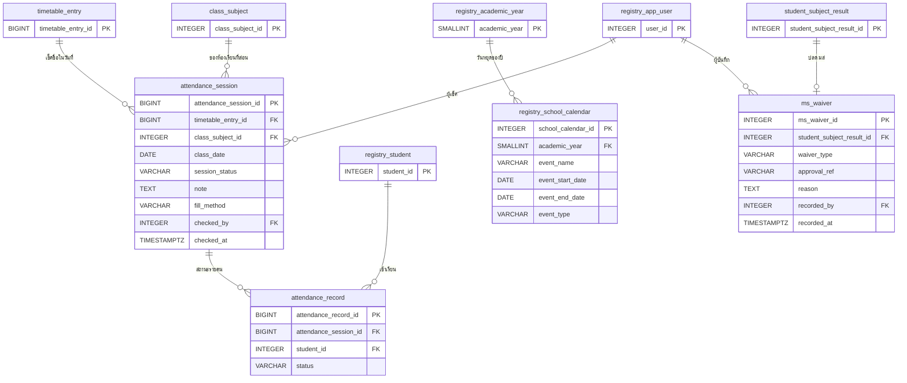

# ขอบเขต 4 — เช็คชื่อ

> **สถานะ:** ร่าง (2026-11-03, เพิ่ม `fill_method` และ `ms_waiver` 2026-11-05 ตาม [ADR 0013](../../grading/docs/adr/0013-attendance-backfill-strict-edit-ms-waiver.md)) · อ้างตารางจาก [ขอบเขต 0](00-core.md), [1](01-curriculum.md), [2](02-grading.md) และ [3](03-timetable.md) · ข้อตกลงอยู่ที่ [README.md](README.md#ข้อตกลง)
>
> **ฉบับที่ 2 (2026-11-11):** ตัด `school_holiday` ออก อ่านวันหยุดจาก `registry.school_calendar` ของ Team B · นักเรียนในห้องอ่านจาก `registry.student_class_history` (หาห้องตามวันที่) · `attendance_record` และ `v_attendance_summary` เป็นข้อมูลที่ Team C ใช้ออก ปพ. ดู [cross-team.md](cross-team.md)

การเช็คชื่อรายคาบของห้องเรียนที่สอน เวลาเรียน (%) ที่ใช้ตัดสิน มส คำนวณจากข้อมูลในขอบเขตนี้เท่านั้น ([ADR 0011](../../grading/docs/adr/0011-attendance-drives-ms-and-locks-with-submission.md))

- เวลาเรียน (%) = (มา + สาย) ÷ คาบที่เช็คแล้ว · คาบที่ยังไม่เช็คไม่นับเป็นตัวหาร
- ครูผู้สอนแก้ย้อนหลังได้จนกว่าจะส่งผลการเรียน หลังจากนั้นล็อกพร้อมคะแนน ต้องใช้คำขอปลดล็อก
- ลา เป็นสถานะที่ครูผู้สอนเลือกตอนเช็คชื่อ การแจ้งลาโดยครูประจำชั้นอยู่นอกขอบเขต
- **ชุมนุมไม่เช็คชื่อรายคาบ** (ตัดสินแล้ว 2026-11-03) ครูที่ปรึกษากรอกเวลาเข้าร่วมเองใน `activity_result` ([ขอบเขต 2](02-grading.md))

## 1. ที่มาในระบบจำลอง

| ข้อมูล | หน้า / ไฟล์ |
|---|---|
| คาบวันนี้ของครู ปุ่มเช็คชื่อ (ค่าเริ่มต้นคือมาทุกคน กด `1`–`4` = มา / สาย / ลา / ขาด) และคาบที่ยังไม่เช็คทั้งภาค | `attendance.html#/` |
| เวลาเรียนรายห้องรายนักเรียน รายชื่อ มส และกลุ่มเสี่ยง | `attendance.html#/sections`, `/ms`, `/risk` |
| ห้องประจำชั้น: นักเรียน × คาบของทุกวิชาในหนึ่งวัน, สรุปทั้งภาค, แจ้งเตือนนักเรียนขาดทั้งวัน | `attendance.html#/h`, `#/h/sum` |
| สถานะ 4 แบบ และกฎล็อกเมื่อส่งผล | `ATT`, `secLocked()` ใน [attendance-core.js](../../grading/assets/js/attendance-core.js) |
| คาบที่เช็คแล้ว (เก็บเฉพาะคนที่ไม่ใช่ "มา") | `db.att.records['secId|date|period']` |

ระบบจำลองใช้ตารางสอนจำลองของตัวเอง (`db.att.timetable`) ในฐานข้อมูลจริงใช้ `timetable_entry` จาก [ขอบเขต 3](03-timetable.md)

## 2. ER

ตารางที่มีแค่ PK มาจากขอบเขตก่อนหน้า ตารางที่ขึ้นต้นด้วย `registry_` เป็นของ Team B

## 3. Data dictionary

รูปแบบคอลัมน์: **ฟิลด์ · ชนิดข้อมูล · คีย์ · Null · คำอธิบาย / ค่าที่เป็นไปได้**

#### `attendance_session` — คาบที่เช็คชื่อแล้ว

| ฟิลด์ | ชนิดข้อมูล | คีย์ | Null | คำอธิบาย |
|---|---|---|---|---|
| attendance_session_id | BIGINT | PK | N | รหัส |
| timetable_entry_id | BIGINT | FK (timetable_entry_id, class_subject_id) → timetable_entry | N | คาบในตารางสอนฉบับเผยแพร่ ณ วันนั้น (บอกคาบ เวลา และครู) |
| class_subject_id | INTEGER | (ส่วนหนึ่งของ FK ข้างบน) | N | ห้องเรียนที่สอน ซ้ำจาก `timetable_entry` เพราะคำนวณเวลาเรียนรายห้องเรียนที่สอนบ่อยที่สุด และ `timetable_entry` ของแต่ละฉบับเป็นคนละแถว |
| class_date | DATE | | N | วันที่สอน |
| session_status | VARCHAR(20) | | N | `checked` เช็คชื่อแล้ว · `no_class` คาบนี้ไม่มีการเรียน (เช่น ไปทัศนศึกษา สอบกลางภาค) |
| note | TEXT | | Y | เหตุผล บังคับเมื่อ `no_class` |
| fill_method | VARCHAR(20) | | Y | วิธีเติมข้อมูลเมื่อเช็คชื่อย้อนหลัง: `previous` อิงคาบก่อนหน้า · `morning` อิงคาบเช้า · `all_present` ให้ทุกคนมา · NULL = เช็คตามปกติ |
| checked_by | INTEGER | FK → registry.app_user | N | ผู้เช็คชื่อ |
| checked_at | TIMESTAMPTZ | | N | เวลาที่บันทึกล่าสุด |
| | | UK (timetable_entry_id, class_date) | | |
| | | CHECK (`session_status IN ('checked', 'no_class')`) | | |
| | | CHECK (`session_status <> 'no_class' OR note IS NOT NULL`) | | |
| | | CHECK (`fill_method IN ('previous', 'morning', 'all_present')`) | | |

- composite FK นี้อ้าง UK (timetable_entry_id, class_subject_id) ที่เพิ่มไว้ใน [`timetable_entry`](03-timetable.md#timetable_entry--คาบในตารางสอน)
- เก็บเฉพาะคาบที่เช็คแล้วหรือบันทึกว่าไม่มีการเรียน คาบที่ยังไม่เช็คคำนวณจากตารางสอน (หัวข้อ 4)
- `no_class` ไม่มีแถวใน `attendance_record` และไม่นับเป็นตัวหาร

#### `attendance_record` — สถานะการเข้าเรียนของนักเรียนในคาบ

| ฟิลด์ | ชนิดข้อมูล | คีย์ | Null | คำอธิบาย |
|---|---|---|---|---|
| attendance_record_id | BIGINT | PK | N | รหัส |
| attendance_session_id | BIGINT | FK → attendance_session | N | คาบ |
| student_id | INTEGER | FK → registry.student | N | นักเรียน |
| status | VARCHAR(10) | | N | `present` มา · `late` สาย · `leave` ลา · `absent` ขาด (มา และ สาย นับเป็นเวลาเรียน) |
| | | UK (attendance_session_id, student_id) | | |
| | | CHECK (`status IN ('present', 'late', 'leave', 'absent')`) | | |

เก็บทุกคนในห้อง รวมคนที่มา ต่างจากระบบจำลองที่เก็บเฉพาะคนที่ไม่ใช่ "มา" เพราะ
- นักเรียนที่ย้ายเข้ากลางภาคต้องไม่ถูกนับว่ามาในคาบก่อนที่จะเข้า ถ้าเก็บเฉพาะข้อยกเว้น ฐานข้อมูลแยกไม่ออก
- query เวลาเรียนเป็น `COUNT ... FILTER (WHERE status IN ('present', 'late'))` ตรง ๆ ไม่ต้องรู้รายชื่อห้องตอนนั้น
- ขนาด: นักเรียน 1,500 คน × ประมาณ 30 คาบต่อสัปดาห์ × 20 สัปดาห์ ≈ 900,000 แถวต่อภาค ยังเล็กสำหรับ PostgreSQL (จึงใช้ BIGINT)

#### วันหยุด — ใช้ `registry.school_calendar` ของ Team B

ฉบับที่ 1 มีตาราง `school_holiday` ของเราเอง ฉบับที่ 2 ตัดออก เพราะ B มีปฏิทินโรงเรียน (`SchoolCalendar`) อยู่แล้ว ฟิลด์ที่เราใช้

| ฟิลด์ใน `registry.school_calendar` | ใช้ทำอะไร |
|---|---|
| academic_year | ปีการศึกษา |
| event_name | ชื่อวันหยุด เช่น `วันจักรี`, `กีฬาสี` |
| event_start_date, event_end_date | ช่วงวันหยุด ต้องกระจายเป็นรายวันตอนหาคาบที่ต้องเช็ค (`generate_series`) |
| event_type | ใช้เฉพาะแถวที่เป็นวันหยุด (ค่าที่ B ใช้ต้องตกลงกัน) |

วันหยุดจำเป็น เพราะระบบจำลองรู้แค่ว่าเสาร์–อาทิตย์ไม่มีเรียน ถ้าไม่มีปฏิทิน ทุกคาบในวันหยุดนักขัตฤกษ์จะขึ้นเป็น "ยังไม่เช็ค" และครูต้องกดบันทึก `no_class` เองทีละคาบ

#### `ms_waiver` — การปลด มส

| ฟิลด์ | ชนิดข้อมูล | คีย์ | Null | คำอธิบาย |
|---|---|---|---|---|
| ms_waiver_id | INTEGER | PK | N | รหัส |
| student_subject_result_id | INTEGER | FK → student_subject_result | N | ผลการเรียนของนักเรียนที่ได้รับการปลด มส ([ขอบเขต 2](02-grading.md)) |
| waiver_type | VARCHAR(20) | | N | `force_majeure` มีเหตุสุดวิสัย ได้รับอนุมัติให้มีสิทธิ์สอบ (ตัดสินผลตามปกติ) · `makeup` เรียนหรือทำงานชดเชยจนครบเวลา (ระดับผลการเรียนไม่เกิน 1) |
| approval_ref | VARCHAR(50) | | N | เลขที่บันทึกอนุมัติของผู้บริหาร |
| reason | TEXT | | N | เหตุผล |
| recorded_by | INTEGER | FK → registry.app_user | N | ครูผู้สอนที่บันทึก |
| recorded_at | TIMESTAMPTZ | | N | เวลาที่บันทึก |
| | | UK (student_subject_result_id) | | |
| | | CHECK (`waiver_type IN ('force_majeure', 'makeup')`) | | |

- ผู้บริหารอนุมัติ**นอกระบบ** ระบบเก็บเลขที่บันทึกอนุมัติไว้อ้างอิง ยังไม่มีขั้นอนุมัติในระบบ
- เวลาเรียน (%) ไม่เปลี่ยน แต่ผลการเรียนไม่เป็น มส · ยกเลิกการปลด = ลบแถว · ทั้งบันทึกและยกเลิกลง `grade_change_log` ที่ `change_type = 'ms_waiver'`

## 4. ค่าที่คำนวณ ไม่เก็บ

| สิ่งที่หน้าจอแสดง | คำนวณจาก |
|---|---|
| คาบที่ต้องเช็ค | ทุกวันในภาคเรียน (`registry.semester.start_date`–`end_date`) ที่ไม่อยู่ในช่วงวันหยุดของ `registry.school_calendar` × `timetable_entry` ของฉบับที่เผยแพร่อยู่ในวันนั้น ที่ `day_of_week` = `ISODOW` ของวันที่ |
| คาบที่ยังไม่เช็ค | คาบที่ต้องเช็ค ที่วันที่ไม่เกินวันนี้ และยังไม่มี `attendance_session` |
| เวลาเรียน (%) รายนักเรียน × ห้องเรียนที่สอน | `attendance_record` ของ session `checked` · (present + late) ÷ จำนวนแถว |
| ขาดได้อีก | `subject.hours_per_week` × จำนวนสัปดาห์ × (100 − `grading_policy.min_attendance_percent`)% ลบด้วยคาบที่ขาดและลาแล้ว |
| ใกล้ มส / มส | เทียบเวลาเรียน (%) กับ `grading_policy.min_attendance_percent` · กลุ่มเสี่ยง = ขาดถึงครึ่งหนึ่งของจำนวนที่ขาดได้ · ไม่เป็น มส ถ้ามีแถวใน `ms_waiver` |
| ห้องประจำชั้น: ตารางรายวัน | `attendance_record` ของนักเรียนที่อยู่ในห้องในวันนั้น (`registry.student_class_history`) ทุกวิชา |
| แจ้งเตือนขาดทั้งวัน | นักเรียนที่มีแถวในวันนั้น และทุกแถวเป็น `absent` |

**ฉบับที่เผยแพร่อยู่ในวันนั้น** คือฉบับที่ `published_at` ล่าสุดซึ่งไม่เกินวันนั้น เมื่ออนุมัติคำร้องเปลี่ยนตารางกลางภาค (ADR 0001) คาบเดิมจะยังอ้างถึง `timetable_entry` ของฉบับเก่าได้ เพราะฉบับเก่าไม่ถูกลบ

ควรทำเป็น view `v_attendance_summary` (นักเรียน × ห้องเรียนที่สอน) เพื่อให้หน้าเช็คชื่อ หน้ากรอกคะแนน และรายงานใช้ตัวเลขเดียวกัน ตอนส่งผล ค่าจาก view นี้ถูกเก็บเป็น snapshot ใน `student_subject_result.attendance_percent` ([ขอบเขต 2](02-grading.md))

## 5. กฎทางธุรกิจ (ใช้ constraint ไม่ได้)

1. เช็คชื่อได้เฉพาะครูใน `timetable_entry_teacher` ของคาบนั้น (รวมครูร่วมสอน)
2. เช็คชื่อหรือแก้ได้เฉพาะเมื่อ `class_subject.grading_status` เป็น `no_structure` หรือ `draft` หลังส่งผลต้องใช้คำขอปลดล็อก
3. `class_date` ต้องอยู่ในภาคเรียนของห้องเรียนที่สอน ไม่ใช่วันหยุด ไม่เกินวันนี้ และ `ISODOW(class_date)` ต้องเท่ากับ `timetable_entry.day_of_week`
4. `timetable_entry` ต้องเป็นของฉบับที่เผยแพร่อยู่ในวันที่ `class_date`
5. `attendance_record.student_id` ต้องอยู่ในห้องนั้นในวันที่สอน (`registry.student_class_history` ที่ `start_date <= class_date` และ `end_date` ว่างหรือไม่ก่อน `class_date`)
6. บันทึก session `checked` ต้องมี `attendance_record` ครบทุกคนในห้องใน transaction เดียวกัน (ค่าเริ่มต้นบนหน้าจอคือมาทุกคน)
7. การแก้สถานะหลังบันทึกครั้งแรกต้องเพิ่มแถวใน `grade_change_log` ที่ `change_type = 'attendance'` ([ขอบเขต 2](02-grading.md)) · แก้จาก `absent` เป็น `present` ต้องมี `reason` อย่างน้อย 10 ตัวอักษร
8. ครูประจำชั้น (`registry.classroom_homeroom_teacher`) ดูได้ทุกวิชาของห้องตน แต่แก้ไม่ได้
9. เช็คชื่อย้อนหลังด้วย `fill_method` คัดลอกได้เฉพาะสถานะ `leave` และ `absent` จากคาบอื่นของห้องเดียวกันในวันเดียวกัน แล้วครูต้องยืนยันก่อนบันทึก
10. บันทึกหรือยกเลิก `ms_waiver` ได้เฉพาะเมื่อ `class_subject.grading_status` เป็น `no_structure` หรือ `draft` · `makeup` จำกัดระดับผลการเรียนไม่เกิน 1

## 6. เทียบกับ ER เดิม (หัวข้อ 8 ใน er-data-dictionary.md)

| ER เดิม | ขอบเขตนี้ | เหตุผล |
|---|---|---|
| `HomeroomTeacher` | ฉบับที่ 1: ย้ายไปขอบเขต 0 · ฉบับที่ 2: ใช้ `registry.classroom_homeroom_teacher` ของ B | ใช้ทั้งเช็คชื่อและรายงาน |
| `AttendanceSession` | `attendance_session` + 🆕 `class_subject_id`, `session_status`, `note` | คำนวณเวลาเรียนรายห้องเรียนที่สอนได้ข้ามฉบับตาราง · บันทึกคาบที่ไม่มีการเรียนได้ (ระบบเดิมมีสถานะ "ไม่มีการเรียนในคาบนั้น" ในหน้าตรวจสอบการเช็กชื่อ ดู [pain-points.md](../pain-points.md)) |
| `AttendanceRecord` | `attendance_record` | คงเดิม เปลี่ยนเป็น BIGINT |
| — | ฉบับที่ 1: 🆕 `school_holiday` · ฉบับที่ 2: ❌ ใช้ `registry.school_calendar` ของ B | ไม่ให้วันหยุดขึ้นเป็นคาบที่ยังไม่เช็ค · B มีปฏิทินโรงเรียนอยู่แล้ว |
| — | 🆕 `attendance_session.fill_method` | รู้ว่าคาบไหนเป็นข้อมูลที่เติมย้อนหลัง (ADR 0013) |
| — | 🆕 `ms_waiver` | ปลด มส ที่ผู้บริหารอนุมัติ (ADR 0013) |

## 7. คำถามที่ยังเปิดอยู่

- **`no_class` ต้องมีใครอนุมัติไหม** ตอนนี้ครูผู้สอนบันทึกเองพร้อมเหตุผล ถ้าใช้บ่อยจะทำให้ตัวหารเล็กลงและเวลาเรียนสูงขึ้น อาจต้องให้งานวิชาการเห็นรายการนี้
- **วันหยุดเฉพาะบางระดับ** เช่น ม.6 สอบ O-NET ทั้งวัน `registry.school_calendar` ใช้กับทั้งโรงเรียน ถ้าต้องการรายระดับ ต้องขอ B เพิ่มระดับชั้นในปฏิทิน
- **ครูสอนแทน** ยังไม่ทำในรอบนี้ (2026-11-05) และยังไม่ตัดสินว่าใครเช็คชื่อในคาบสอนแทน ([grading/GLOSSARY.md](../../grading/GLOSSARY.md#-ยังไม่ชัดเจน)) ถ้าให้ครูสอนแทนเช็ค กฎข้อ 1 ต้องยอมรับผู้ที่ไม่อยู่ใน `timetable_entry_teacher`
