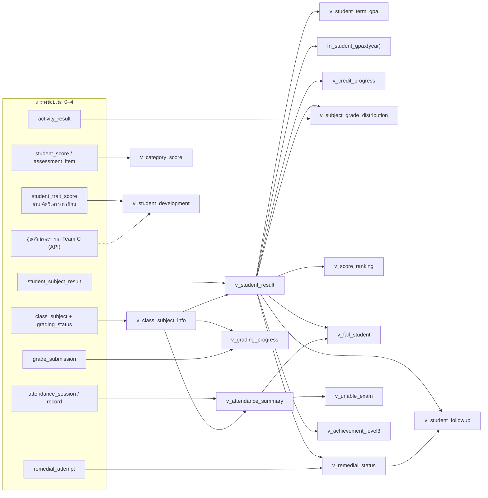

# ขอบเขต 5 — รายงาน

> **สถานะ:** ร่าง (2026-11-03) · อ้างตารางจาก [ขอบเขต 0–4](README.md#ขอบเขต) · ข้อตกลงอยู่ที่ [README.md](README.md#ข้อตกลง)

รายงานไม่มีตารางของตัวเอง เพราะเป็นการสรุปข้อมูลจากขอบเขต 0–4 ขอบเขตนี้จึงมี 2 อย่าง
1. **view และ function** ที่หน้ารายงานทุกหน้าอ่าน เพื่อให้ตัวเลขเดียวกันออกมาเท่ากันทุกหน้า
2. **กติกาการคำนวณ** ที่ตอนนี้แต่ละหน้าในระบบจำลองคิดไม่เหมือนกัน

> **2026-11-07:** เดิมขอบเขตนี้มีตารางเสริม 2 ตาราง ตัด `report_threshold` ออก (เกณฑ์ของหน้ารายงานเป็นค่าคงที่ในแอป ดูข้อ 2) และย้าย `curriculum_credit_requirement` ไป[ขอบเขต 1](01-curriculum.md#curriculum_credit_requirement--หน่วยกิตขั้นต่ำตามหลักสูตร) ส่วนคอลัมน์ `semester.remedial_deadline` ย้ายไป[ขอบเขต 0](00-core.md#semester_setting--ค่าตั้งค่างานวิชาการของภาคเรียน) (ฉบับที่ 2 อยู่ใน `semester_setting`)

> **ฉบับที่ 2 (2026-11-11):** ปี ภาค ระดับชั้น และห้อง อ่านจากตารางของ Team B (`registry.*`) · กำหนดส่งผลและกำหนดสอบซ่อมอ่านจาก `semester_setting` · view ในขอบเขตนี้เป็นต้นทางของข้อมูลที่ทีมอื่นดึงไปใช้ด้วย ได้แก่ Team B (`v_student_result`, `fn_student_gpax()`, `v_credit_progress`, `v_grading_progress` สำหรับ ปพ.1 ตัดสินจบ และเลื่อนชั้น) และ Team C (`v_student_result`, `v_student_term_gpa`, `v_attendance_summary` สำหรับ ปพ.3–7) ดู [cross-team.md ข้อ 4](cross-team.md#4-ข้อมูลของเราที่ทีมอื่นดึงไปใช้) · คุณลักษณะอันพึงประสงค์ใช้ของ Team C แล้ว `v_student_development` ส่วนคุณลักษณะฯ ต้องดึงจาก C ([ข้อ 3](cross-team.md#3-คุณลักษณะอันพึงประสงค์ใช้ของ-team-c))

## 1. ที่มาในระบบจำลอง

| หน้า | ตัวเลขหลัก | view ที่ใช้ |
|---|---|---|
| [overview.html](../../reports/overview.html) ภาพรวม | งานคะแนนค้าง ความคืบหน้าส่ง / ตรวจ / อนุมัติ สอบซ่อมค้างและเกินกำหนด ห้องเสี่ยง นักเรียนต้องติดตาม | `v_grading_progress`, `v_subject_grade_distribution`, `v_remedial_status`, `v_student_followup` |
| [student-retake-management.html](../../reports/student-retake-management.html) + รายละเอียด, [student-list-by-classroom.html](../../reports/student-list-by-classroom.html) | รายการสอบซ่อมรายนักเรียน / รายวิชา / รายห้อง สถานะ รอสอบซ่อม / สอบซ่อมแล้ว / ติดตามงาน ความเร่งด่วน | `v_remedial_status` |
| [fail-student-detail.html](../../reports/fail-student-detail.html) นักเรียนต้องปรับปรุง | นักเรียนที่ได้ 0 / ร / มส ต่อห้องเรียนที่สอน ช่วงคะแนน สาเหตุหลัก ระดับความเสี่ยง | `v_fail_student` |
| [student-score-ranking.html](../../reports/student-score-ranking.html) + รายละเอียด | อันดับคะแนนรวม คะแนนตามหมวด ร้อยละที่ต่ำกว่า 50 | `v_score_ranking`, `v_category_score` |
| [subject-results.html](../../reports/subject-results.html) + รายละเอียด | จำนวนต่อระดับผลการเรียน 8 ระดับ + ร / มส / ผ / มผ, GPA เฉลี่ย, อัตราผ่าน ≥ 3, แนวโน้มเทียบภาคก่อน | `v_subject_grade_distribution` |
| `academic-report.html#attendance`, [teacher-attendance.html](../../reports/teacher-attendance.html) | มา / สาย / ขาด / ลา รายนักเรียน ร้อยละ ใกล้ มส | `v_attendance_summary` ([ขอบเขต 4](04-attendance.md#4-ค่าที่คำนวณ-ไม่เก็บ)) |
| `#unable-exam` ผู้ไม่มีสิทธิ์สอบ | นักเรียน × วิชา ที่เวลาเรียนต่ำกว่าเกณฑ์ | `v_unable_exam` |
| `#score-subject` คะแนนรายวิชา | คะแนนรวมรายวิชาของนักเรียนในห้อง ต่ำกว่า 60% คะแนนที่ยังไม่บันทึก | `v_student_result` |
| `#average-score-year` คะแนนเฉลี่ยรายปี | คะแนนเฉลี่ยและระดับเฉลี่ยรายนักเรียน / ห้อง อันดับ สูงสุด / ต่ำสุด | `v_student_result`, `v_student_term_gpa` |
| `#record-report` ระเบียนสะสม / GPAX | GPA รายภาค GPAX สะสมถึงปีที่เลือก หน่วยกิตลงทะเบียน / ผ่าน / ที่ยังขาดรายกลุ่มสาระ วิชาไม่ผ่าน | `fn_student_gpax()`, `v_credit_progress` |
| ระบบเดิมที่ยังไม่มีหน้าใหม่ ([pain-points.md](../pain-points.md#รายหน้า)) | ผลสัมฤทธิ์ระดับ 3 ขึ้นไป · ประเมินพัฒนาผู้เรียน | `v_achievement_level3`, `v_student_development` |

## 2. เกณฑ์ของหน้ารายงาน (ค่าคงที่ในแอป ไม่เก็บในฐานข้อมูล)

ตัวเลขเหล่านี้เป็นเกณฑ์การแสดงผลของหน้ารายงาน ไม่ใช่ข้อมูลของโรงเรียนและแทบไม่เปลี่ยน จึงเก็บเป็นค่าคงที่ในไฟล์ตั้งค่าของแอปที่เดียว ให้ทุกหน้าใช้ค่าเดียวกัน แทนที่จะเขียนตายตัวกระจายในโค้ดแต่ละหน้าอย่างในระบบจำลอง (เดิมออกแบบเป็นตาราง `report_threshold` แต่ตัดออก เพราะไม่มีหน้าจอหรือ use case สำหรับแก้ค่า และตาราง key–value ใส่ชนิดข้อมูลหรือ constraint รายค่าไม่ได้)

| ค่าคงที่ | ค่า | ใช้ที่ |
|---|---|---|
| `LOW_SCORE_PERCENT` | 60 | คะแนนรายวิชา / คะแนนเฉลี่ยรายปี: ต่ำกว่าเกณฑ์ |
| `RANKING_FOLLOW_UP_SCORE` | 50 | ลำดับคะแนน: ต้องติดตาม และใช้นับร้อยละความเสี่ยง |
| `RANKING_RISK_HIGH_PERCENT` | 25 | ลำดับคะแนน: เสี่ยงสูง |
| `RANKING_RISK_MEDIUM_PERCENT` | 15 | ลำดับคะแนน: เสี่ยงปานกลาง |
| `SUBJECT_PASS_GRADE` | 3 | ผลการเรียนรายวิชา: นับเป็น "ผ่านเกณฑ์" (≥ 3) |
| `ROOM_RISK_PASS_RATE` | 50 | ภาพรวม: ห้องเสี่ยงเมื่ออัตราผ่านต่ำกว่านี้ |
| `GPAX_WARNING` | 2.00 | ระเบียนสะสม: ควรติดตาม |
| `FAIL_RISK_HIGH_COUNT` | 4 | นักเรียนต้องปรับปรุง: เสี่ยงสูงเมื่อนักเรียนต่ำกว่าเกณฑ์ในวิชาเดียวกันตั้งแต่ 4 คน |
| `REMEDIAL_URGENT_SUBJECTS` | 3 | สอบซ่อม: เร่งด่วนสูงเมื่อนักเรียนติดตั้งแต่ 3 วิชา |

เกณฑ์ที่ใช้ตัดสินผลจริงไม่อยู่ที่นี่ เช่น เวลาเรียนขั้นต่ำใช้ `grading_policy.min_attendance_percent` ([ขอบเขต 2](02-grading.md)) หน่วยกิตขั้นต่ำใช้ `curriculum_credit_requirement` ([ขอบเขต 1](01-curriculum.md))

## 3. view และ function

### 3.1 view พื้นฐาน

#### `v_class_subject_info` — ห้องเรียนที่สอนพร้อมข้อมูลที่ใช้กรอง

ทุกหน้ารายงานกรองด้วย ปี ภาค ระดับชั้น ห้อง แผน กลุ่มสาระ ครู และวิชา view นี้รวมคอลัมน์เหล่านี้ไว้แถวเดียว

| คอลัมน์ | ที่มา |
|---|---|
| class_subject_id, grading_status | `class_subject` |
| academic_year, semester_id, semester_no | `registry.semester` |
| education_level_id, level_name (`ม.2`), education_stage_id | `registry.classroom` → `registry.education_level` |
| classroom_id, classroom_name (`ม.2/1`) | `registry.classroom` |
| study_plan_id, plan_name | `study_plan_subject` → `study_plan` |
| subject_id, subject_code, subject_name, subject_type, credit, learning_area_id | `subject` |
| primary_teacher_id, teacher_ids (array) | `class_subject_teacher` |

#### `v_student_result` — ผลการเรียนที่รายงานใช้

`student_subject_result` + `v_class_subject_info` + ระดับ (`grade_scale.grade_value`) และคอลัมน์ `is_final = (grading_status = 'approved')`

**รายงานทางการ (GPA, GPAX, ระเบียนสะสม, ผลสัมฤทธิ์) ใช้เฉพาะ `is_final`** รายงานติดตามงาน (นักเรียนต้องปรับปรุง ลำดับคะแนน คะแนนรายวิชา) ใช้ทุกแถว เพื่อให้งานวิชาการเห็นปัญหาก่อนครูส่งผล และแสดงป้ายว่ายังไม่อนุมัติ

#### `v_attendance_summary` — เวลาเรียนรายนักเรียน × ห้องเรียนที่สอน

นิยามอยู่ใน [ขอบเขต 4](04-attendance.md#4-ค่าที่คำนวณ-ไม่เก็บ) คอลัมน์: checked_sessions, present, late, leave, absent, attendance_percent, remaining_absence (ขาดได้อีก), is_below_min

### 3.2 ผลการเรียนและหน่วยกิต

#### `v_student_term_gpa` — GPA รายภาค

| คอลัมน์ | การคำนวณ |
|---|---|
| student_id, semester_id | |
| gpa | `ROUND(SUM(grade_value × credit) / SUM(credit), 2)` |
| registered_credits | `SUM(credit)` ของวิชา `basic` / `additional` ทุกวิชาในภาค |
| earned_credits | `SUM(credit)` ที่ `grade_value >= 1` |
| failed_subjects | จำนวนที่ `grade_value = 0` หรือ `grade_result = 'มส'` |
| pending_subjects | จำนวนที่ `grade_result = 'ร'` หรือยังไม่ `is_final` |

GPA นับเฉพาะ `is_final` และวิชาที่มีระดับ 0–4 (รวม 0) ไม่นับ ร และวิชากิจกรรม ตรงกับ `calculateWeightedGpa()` ใน [record-report.js](../../assets/academic-report/js/modules/record-report.js) · หลังสอบซ่อม `student_subject_result.grade_result` ถูกอัปเดตเป็นระดับใหม่ GPA จึงใช้ระดับหลังสอบซ่อม

#### `fn_student_gpax(p_end_year SMALLINT)` — GPAX สะสม

function ที่คืนตาราง (student_id, gpax, registered_credits, earned_credits, failed_subjects) โดยคิดแบบเดียวกับ `v_student_term_gpa` แต่รวมทุกภาคที่ `academic_year <= p_end_year` หน้าระเบียนสะสมใช้ปีที่เลือกเป็นปีสิ้นสุด ("ผลสะสมถึงปีการศึกษา …") จึงต้องรับปีเป็นพารามิเตอร์ ทำเป็น view ธรรมดาไม่ได้

#### `v_credit_progress` — หน่วยกิตรายกลุ่มสาระเทียบกับเกณฑ์

นักเรียน × กลุ่มสาระ × ประเภทวิชา: earned_credits จาก `v_student_result` (`is_final`, `grade_value >= 1`) เทียบกับ `curriculum_credit_requirement` ([ขอบเขต 1](01-curriculum.md)) ของหลักสูตรที่ห้องปัจจุบันของนักเรียนใช้ ได้ missing_credits

### 3.3 สรุปรายวิชาและอันดับ

#### `v_subject_grade_distribution` — การกระจายระดับผลการเรียน

ต่อห้องเรียนที่สอน: students, จำนวนแต่ละระดับ (`g4`, `g35`, `g3`, `g25`, `g2`, `g15`, `g1`, `g0`), `r`, `ms`, avg_gpa, pass_count (≥ `SUBJECT_PASS_GRADE`), pass_rate, prev_pass_rate และ trend (เทียบกับรายวิชาเดียวกันของระดับชั้นเดียวกันในภาคก่อน) ชุมนุมนับ `pass` / `fail` จาก `activity_result` แยกแถว

หน้าผลการเรียนรายวิชาสรุปทั้งระดับชั้นด้วย ให้ `GROUP BY` subject_id + semester_id จาก view นี้อีกชั้น

#### `v_score_ranking` — อันดับคะแนนรวม

`RANK() OVER (PARTITION BY class_subject_id ORDER BY total_score DESC)` (อันดับแบบ 1, 1, 3 ตาม `average-score-year.js`) และ `rank_in_grade` ที่ partition ด้วย subject_id + semester_id เพื่อจัดอันดับข้ามห้อง · นักเรียนที่ `total_score IS NULL` ไม่ได้อันดับ ห้องเรียนที่สอนที่ไม่มีคะแนนเลยแสดงเป็น "ยังไม่มีคะแนน"

#### `v_category_score` — คะแนนตามหมวด

นักเรียน × ห้องเรียนที่สอน × `assessment_category`: คะแนนที่แปลงแล้วรวมในหมวด (`Σ score / max_score × weight_percent`) หน้ารายละเอียดลำดับคะแนนแสดงคอลัมน์ เก็บ / กลางภาค / ปลายภาค จาก view นี้

### 3.4 ติดตามนักเรียน

#### `v_fail_student` — นักเรียนต้องปรับปรุง

แถวของ `v_student_result` ที่ `grade_result IN ('0', 'ร', 'มส')` พร้อม total_score, score_band (`< 20` / `20–39` / `40–49`) และ **main_cause** ที่คำนวณจากข้อมูลจริงตามลำดับ

1. `มส` → `low_attendance` ขาดเรียน
2. มี `student_score.score_status = 'absent'` → `missed_exam` ขาดสอบ
3. มี `score_status = 'pending_work'` → `missing_work` ไม่ส่งงาน
4. อื่น ๆ → `low_score` คะแนนต่ำกว่าเกณฑ์

ระบบจำลองเดาสาเหตุจากข้อความหมายเหตุ (`fail-student-detail.html` บรรทัด 519–525) ซึ่งผิดได้ถ้าครูเขียนต่างไป

#### `v_remedial_status` — สถานะสอบซ่อม

ผลการเรียนที่ต้องสอบซ่อม (`grade_result = '0'` หรือมี `remedial_attempt`) รวมกับครั้งล่าสุดของ `remedial_attempt` ต่อหมวด

| คอลัมน์ | ค่า |
|---|---|
| remedial_status | `waiting` รอสอบซ่อม (ยังไม่มีครั้งไหน หรือครั้งล่าสุดเป็น `scheduled`) · `done` สอบซ่อมแล้ว (`passed` / `failed`) · `follow_up` ติดตามงาน |
| category_type | `collect` / `midterm` / `final` จาก `assessment_category` · NULL = ทั้งรายวิชา |
| is_overdue | `waiting` และวันนี้เลย `semester_setting.remedial_deadline` |

ความเร่งด่วนรายนักเรียน (เร่งด่วนสูง / ต้องติดตาม / ปกติ) คำนวณจากจำนวนวิชาใน view นี้ ตามค่าคงที่ในข้อ 2

#### `v_unable_exam` — ผู้ไม่มีสิทธิ์สอบ

แถวของ `v_attendance_summary` ที่ `attendance_percent < grading_policy.min_attendance_percent` ของระดับนั้น (หน้ารายงานให้ปรับเกณฑ์ชั่วคราวได้ ส่งเป็นเงื่อนไข `WHERE` ตอน query ไม่ต้องแก้ view)

#### `v_student_followup` — นักเรียนที่ต้องติดตาม

ต่อนักเรียนในภาคเรียน: risk_subjects (วิชาที่อยู่ใน `v_fail_student` หรือ `v_unable_exam`), overdue_remedial, high_risk (risk_subjects ≥ 2 หรือมีสอบซ่อมเกินกำหนด) ใช้ในหน้าภาพรวม

### 3.5 ความคืบหน้างานวิชาการ

#### `v_grading_progress` — ความคืบหน้าการส่งและอนุมัติผล

ต่อภาคเรียน (และแยกตามระดับชั้น / ห้อง / ครู ได้): จำนวนห้องเรียนที่สอนตาม `grading_status`, submitted_percent (`pending` + `approved`), approved_percent, รอบที่รอตรวจ (`grade_submission.decision IS NULL`), overdue (ยังไม่ส่งและเลย `semester_setting.grade_submission_deadline`)

### 3.6 รายงานของระบบเดิมที่ยังไม่มีหน้าใหม่

#### `v_achievement_level3` — ผลสัมฤทธิ์ระดับ 3 ขึ้นไป

ปีการศึกษา × ระดับชั้น × กลุ่มสาระ: students, level3_up (`grade_value >= 3`), percent จาก `v_student_result` ที่ `is_final`

#### `v_student_development` — ผลการประเมินพัฒนาผู้เรียน

ผลอ่าน คิดวิเคราะห์ และเขียน (`student_trait_score`) สรุปเป็นระดับ ดีเยี่ยม / ดี / ผ่าน / ไม่ผ่าน แบ่ง 3 ชั้นตามที่ระบบเดิมแยก (ภาพรวม → ห้อง → นักเรียน) ใน view เดียว ใช้ `GROUPING SETS` เพื่อ drill-down ได้โดยไม่ต้อง query ใหม่ (pain point P4 ใน [pain-points.md](../pain-points.md#ปัญหาที่ซ้ำกันหลายหน้า)) · **ฉบับที่ 2:** ส่วนคุณลักษณะอันพึงประสงค์ไม่อยู่ในฐานข้อมูลเรา ต้องดึงผลจาก Team C (`care.characteristic_evaluation`) ผ่าน API มารวมตอนแสดงผล view นี้จึงมีแค่อ่าน คิดวิเคราะห์ และเขียน

## 4. กติกาการคำนวณที่ระบบจำลองยังคิดไม่ตรงกัน

| เรื่อง | ระบบจำลอง | ในฐานข้อมูล |
|---|---|---|
| **เวลาเรียน (%)** | `script.js` (#attendance) ใช้เพดานจำนวนครั้งที่ขาด · `unable-exam-report.js` นับลาเป็นไม่มาเรียน · `teacher-attendance.html` นับลาเป็นมาเรียน (บรรทัด 525) | (มา + สาย) ÷ คาบที่เช็คแล้ว ตาม ADR 0011 ทุกหน้าอ่านจาก `v_attendance_summary` |
| **สถานะการเข้าเรียน** | academic-report ใช้ป้ายภาษาไทย 7 แบบ (ตรงเวลา สาย ขาด ลากิจ ลาป่วย กิจกรรม วันหยุด) · teacher-attendance ใช้ `present` / `late` / `absent` / `leave` | 4 ค่าของ `attendance_record.status` · วันหยุดใช้ `registry.school_calendar` ของ Team B · กิจกรรมใช้ `session_status = 'no_class'` · ลากิจ / ลาป่วยยังแยกไม่ได้ (ดูคำถามเปิด) |
| **คะแนนเฉลี่ยของสอบซ่อม** | แปลง `ร` เป็น 0.5 ตอนหาค่าเฉลี่ย (`student-retake-management.html`) | ไม่นับ ร ในค่าเฉลี่ย |
| **สถานะ "ต้องติดตาม / ดีเด่น"** | ในคะแนนเฉลี่ยรายปีเป็นค่าที่ใส่ไว้ในข้อมูลจำลอง ไม่ได้คำนวณ | ยังไม่มีนิยาม (ดูคำถามเปิด) |
| **เกณฑ์** | ตัวเลขตายตัวกระจายอยู่ในโค้ดแต่ละหน้า | ค่าคงที่ในไฟล์ตั้งค่าของแอปที่เดียว (ข้อ 2) |

## 5. ประสิทธิภาพ

- **materialized view** สำหรับ `v_subject_grade_distribution` และผลของ `fn_student_gpax` ระดับปีปัจจุบัน `REFRESH MATERIALIZED VIEW CONCURRENTLY` หลังอนุมัติผล (`grade_submission.decision = 'approved'`) เพราะข้อมูลทางการเปลี่ยนเฉพาะตอนอนุมัติเท่านั้น
- **index ที่รายงานต้องใช้** (นอกเหนือจาก PK / UK)
  - `student_subject_result (student_id)` สำหรับ GPA / GPAX รายคน
  - `attendance_record (student_id)` และ `attendance_session (class_subject_id, class_date)`
  - `class_subject (semester_id)`, (ห้องเรียนเป็นของ Team B ถ้า sync สำเนาเข้ามา ต้องมี index `(academic_year, education_level_id)`)
  - `remedial_attempt (student_subject_result_id, attempt_no DESC)` สำหรับหาครั้งล่าสุด
- การจำตัวกรองที่ค้นล่าสุดอยู่ในเบราว์เซอร์ (`AcademicLayout.lastSearch()`) ไม่ต้องเก็บในฐานข้อมูล

## 6. คำถามที่ยังเปิดอยู่

- **มส นับใน GPA ไหม** ตอนนี้นับเป็นวิชาไม่ผ่าน แต่ไม่นับใน GPA (เหมือน ร) เพราะไม่มีระดับใน `grade_scale` ระบบจำลองไม่มีกรณี มส ในระเบียนสะสมให้เทียบ ถ้าโรงเรียนนับ มส เป็น 0 ต้องเปลี่ยนสูตร
- **ลากิจ / ลาป่วย** หน้ารายงานการเข้าเรียนแยกสองแบบ แต่การเช็คชื่อ (ขอบเขต 4, ADR 0011) มีแค่ "ลา" ถ้าต้องแยก ต้องเพิ่มค่าใน `attendance_record.status`
- **สถานะ "ต้องติดตาม" และ "ผลการเรียนดีเด่น"** ในคะแนนเฉลี่ยรายปีจะคิดจากอะไร เช่น ต่ำกว่า `LOW_SCORE_PERCENT` และ GPA ≥ 3.50
- **สมรรถนะสำคัญ** ระบบเดิมประเมินพัฒนาผู้เรียน 3 ประเภท (คุณลักษณะ / อ่าน คิดวิเคราะห์ และเขียน / สมรรถนะ) ฉบับที่ 2 คุณลักษณะฯ เป็นของ Team C และ `trait_item.trait_type` ในขอบเขต 2 เหลือแค่ `reading_thinking` ถ้าต้องมีรายงานสมรรถนะ ต้องเพิ่ม `competency` (และตกลงกับ C ว่าใครประเมิน)
