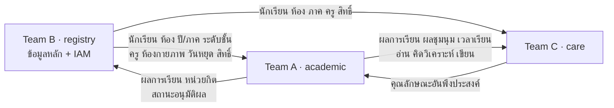

# การเชื่อมข้อมูลกับทีมอื่น (Team B และ Team C)

> **สถานะ:** ฉบับที่ 2 (2026-11-11) ตกลงกับ Team B และ Team C แล้วบางส่วน (ดูข้อ 0) · ขอบเขต 0–5 แก้ตามข้อตกลงนี้แล้ว (2026-11-11) ยกเว้นรูป ER ใน `er/` · สรุปการเทียบตารางทั้งหมดอยู่ที่ [other/cross-team-table-ownership.md](../../other/cross-team-table-ownership.md)

ระบบโรงเรียนมี 3 service ใช้ Web Portal และ API Gateway (Nginx) ร่วมกัน แต่แต่ละ service มี schema ของตัวเอง

| ทีม | schema | เจ้าของข้อมูล | อ้างอิง |
|---|---|---|---|
| A (เรา) | `academic` | หลักสูตร ตารางสอน เช็คชื่อ คะแนน ผลการเรียน อ่าน คิดวิเคราะห์ และเขียน | ไฟล์ในโฟลเดอร์นี้ |
| B | `registry` (รอยืนยัน) | นักเรียน ห้องเรียน ปี / ภาค ระดับชั้น บุคลากร บัญชีและสิทธิ์ ปฏิทิน อาคารสถานที่ · ปพ.1, ปพ.2 | `other/DEVELOPMENT OF MASTER DATA ... FOR SCHOOLS.pdf` หัวข้อ 3.4 |
| C | `care` (รอยืนยัน) | เยี่ยมบ้าน พฤติกรรม คัดกรอง แบบประเมิน คุณลักษณะอันพึงประสงค์ · ปพ.3–7, บัตรนักเรียน | `other/Student Care Track.pdf` หัวข้อ 3.6 |

## 0. ข้อตกลง

| # | เรื่อง | ข้อตกลง | ใครแก้ |
|---|---|---|---|
| 1 | ข้อมูลหลัก | ใช้ตารางของ B แทนตารางข้อมูลหลักของเรา 10 ตาราง (ข้อ 1) | A |
| 2 | ปีการศึกษา | `registry.academic_year` ใช้ปี พ.ศ. (`SMALLINT`) เป็น PK · FK `academic_year` ของเราใช้ต่อได้ | B |
| 3 | ห้องกายภาพ | `registry.school_room` เพิ่ม `room_type`, `max_classes`, `short_name` และขอเพิ่ม `room_code`, `is_active` | B |
| 4 | ภาคเรียนปัจจุบัน | ขอ B เพิ่ม `registry.semester.is_current` (มีได้ภาคเดียว) | B |
| 5 | คอลัมน์วิชาการของภาคเรียน | เก็บใน `academic.semester_setting` ของเรา | A |
| 6 | คุณลักษณะอันพึงประสงค์ | ใช้ของ C · เราเหลือแค่อ่าน คิดวิเคราะห์ และเขียน (ข้อ 3) | A |
| 7 | การตั้งชื่อ | snake_case เอกพจน์ แยก schema ต่อทีม · เอกสารของเราเขียนตารางทีมอื่นพร้อม schema เช่น `registry.student` และวงเล็บชื่อเดิมตอนกล่าวถึงครั้งแรก | ทุกทีม |

## 1. ตารางที่ตัดออก ใช้ของ B แทน

| ตารางเดิมของเรา | ขอบเขต | ใช้ของ B (ชื่อเดิมในรายงาน B) | การเปลี่ยนแปลงฝั่งเรา |
|---|---|---|---|
| `academic_year` | [0](00-core.md#32-ตารางของ-team-b-ที่เราอ่าน) | `registry.academic_year` (`AcademicYears`) | FK เดิมใช้ได้ · `start_date` / `end_date` คำนวณจาก `MIN(start_date)` / `MAX(end_date)` ของ `registry.semester` ในปีนั้น |
| `semester` | [0](00-core.md#32-ตารางของ-team-b-ที่เราอ่าน) | `registry.semester` (`Semesters`) | FK `semester_id` ชี้ไป B · คอลัมน์วิชาการย้ายไป `semester_setting` (ด้านล่าง) · `is_current` อ่านจาก B |
| `grade_level` | [0](00-core.md#32-ตารางของ-team-b-ที่เราอ่าน) | `registry.education_level` (`EducationLevels`) + `registry.education_stage` (`EducationStage`) | FK `grade_level_id` ทุกตัว → `education_level_id` · คอลัมน์ `education_level` (ม.ต้น / ม.ปลาย) ใน `curriculum`, `grading_policy` → `education_stage_id` |
| `student` | [0](00-core.md#32-ตารางของ-team-b-ที่เราอ่าน) | `registry.student` (`Student`) | อ่านอย่างเดียว |
| `classroom` | [0](00-core.md#32-ตารางของ-team-b-ที่เราอ่าน) | `registry.classroom` (`Classroom`) | `home_room_id` → `registry.classroom.school_room_id` · `study_plan_id` → ใช้ `study_program_id` ของ B (ข้อ 2) |
| `student_classroom` | [0](00-core.md#32-ตารางของ-team-b-ที่เราอ่าน) | `registry.student_class_history` (`StudentClassHistory`) | มี `start_date` / `end_date` · เช็คชื่อและรายชื่อในตารางกรอกคะแนนต้องหาห้องตามวันที่ · `class_no` มีใน B |
| `homeroom_teacher` | [0](00-core.md#32-ตารางของ-team-b-ที่เราอ่าน) | `registry.classroom_homeroom_teacher` (`ClassroomHomeroomTeacher`) | `user_id` → `employee_id` |
| `app_user` (+ `role`, `user_role`) | [0 หัวข้อ 3.1](00-core.md#32-ตารางของ-team-b-ที่เราอ่าน) | `registry.app_user` (`User`) + `employee` + `job_detail` + `position` + `department` · `permission` + `user_permission` | ชื่อจาก `employee` · ตำแหน่งจาก `job_detail.position_id` · สถานะจาก `job_detail.work_status` · บทบาทดูข้อ 5 |
| `room` | [3](03-timetable.md#31-ห้องและวิชาที่ครูสอนได้) | `registry.school_room` (`SchoolRoom`) + `registry.building` | B เพิ่มคอลัมน์ให้ครบ (ข้อตกลง 3) · FK `room_id` ใน `timetable_entry`, `room_unavailability` ฯลฯ → `school_room_id` |
| `school_holiday` | [4](04-attendance.md#3-data-dictionary) | `registry.school_calendar` (`SchoolCalendar`, ประเภท = วันหยุด) | ของ B เป็นช่วง `event_start_date`–`event_end_date` ต้องกระจายเป็นรายวันตอนเช็คชื่อ |

### `semester_setting` — ค่าตั้งค่างานวิชาการของภาคเรียน (ตารางใหม่ของเรา)

| ฟิลด์ | ชนิดข้อมูล | คีย์ | Null | คำอธิบาย |
|---|---|---|---|---|
| semester_id | INTEGER | PK, FK → `registry.semester` | N | ภาคเรียน (1:1) |
| grade_submission_deadline | DATE | | Y | กำหนดส่งผลการเรียน (เดิมอยู่ใน `semester` ขอบเขต 0) |
| remedial_deadline | DATE | | Y | กำหนดสอบซ่อม (เดิมอยู่ใน `semester` ขอบเขต 0) |
| unavailability_deadline | DATE | | Y | วันปิดรับเวลาไม่ว่างของครู (เดิมเพิ่มใน `semester` จากขอบเขต 3) |

ภาคเรียนที่ยังไม่มีแถวในตารางนี้ถือว่ายังไม่ได้ตั้งค่า (ทุกค่าเป็น NULL)

## 2. ตารางที่ทับกับ B บางส่วน แต่ยังเป็นของเรา

| ตารางของเรา | ตารางของ B | สถานะ | ข้อเสนอ |
|---|---|---|---|
| `learning_area` ([0](00-core.md#learning_area--กลุ่มสาระการเรียนรู้)) | `registry.department` (`Department`) | รอตกลง | เก็บ `learning_area` ไว้ใช้กับ `subject` · สังกัดครูอ่านจาก `registry.job_detail.department_id` แล้วตัด `app_user.learning_area_id` · ถ้าต้องกรองครูตามกลุ่มสาระ ให้เพิ่ม `learning_area.department_id` |
| `study_plan` ([1](01-curriculum.md#study_plan--แผนการเรียน)) | `registry.study_program` (`StudyProgram`) | รอตกลง | เพิ่ม `study_plan.study_program_id` FK → `registry.study_program` · หา `study_plan` ของห้องจาก (หลักสูตรที่ใช้งานอยู่ของช่วงชั้น, ระดับชั้น, `classroom.study_program_id`) |
| `time_structure`, `period` ([3](03-timetable.md#time_structure--โครงสร้างเวลาของช่วงชั้น)) | `registry.school_schedule` (`SchoolSchedule`) | เก็บทั้งคู่ | `school_days` ต้องไม่ขัดกับ `school_schedule.study_days` |
| `teacher_subject` ([3](03-timetable.md#teacher_subject--วิชาที่ครูสอนได้)) | — | ของเรา | ตัดคำกำกับ "(งานบุคคล)" แล้ว · FK `user_id` → `registry.app_user` |
| `notification` ([3](03-timetable.md#notification--การแจ้งเตือน)) | — (C มี `care.notification`) | ของเรา | แยก schema ได้ |

## 3. คุณลักษณะอันพึงประสงค์ใช้ของ Team C

ตกลงให้ C เป็นเจ้าของ ได้แก่ `care.desirable_characteristic`, `care.characteristic_round`, `care.characteristic_evaluation`, `care.characteristic_eval_item` (ชื่อเดิม `DesirableCharacteristic`, `CharacteristicRound`, `CharacteristicEvaluation`, `CharacteristicEvalItem`)

สิ่งที่ต้องแก้ฝั่งเรา:

| ที่ | ก่อน | หลัง |
|---|---|---|
| [`trait_item`](02-grading.md#trait_item--รายการประเมินอ่าน-คิดวิเคราะห์-และเขียน) | `trait_type` = `characteristic` (8 ข้อ) · `reading_thinking` (5 ด้าน) | เหลือ `reading_thinking` · จะตัดคอลัมน์ `trait_type` ทิ้ง หรือเก็บไว้รองรับสมรรถนะสำคัญ ([คำถามเปิดของขอบเขต 5](05-reports.md#6-คำถามที่ยังเปิดอยู่)) ก็ได้ |
| `student_trait_score` | ผลคุณลักษณะฯ และอ่าน คิดวิเคราะห์ เขียน | เหลือแค่ผลอ่าน คิดวิเคราะห์ และเขียน |
| หน้าบันทึกคะแนน (UC-12, UC-25) | แท็บ "คุณลักษณะฯ / อ่าน คิดวิเคราะห์ และเขียน" | เหลือแค่อ่าน คิดวิเคราะห์ และเขียน |
| [`v_student_development`](05-reports.md#v_student_development--ผลการประเมินพัฒนาผู้เรียน) | อ่านจาก `student_trait_score` | ส่วนคุณลักษณะฯ ดึงจาก C ผ่าน API |

## 4. ข้อมูลของเราที่ทีมอื่นดึงไปใช้

ทีมอื่นไม่ query schema `academic` ตรง ต้องเรียกผ่าน Internal API ส่งเฉพาะ**ผลที่อนุมัติแล้ว** (`is_final` ใน [v_student_result](05-reports.md#v_student_result--ผลการเรียนที่รายงานใช้)) ยกเว้นระบุไว้

| ผู้ใช้ | ใช้ทำอะไร | ตาราง / view ต้นทางของเรา | หมายเหตุ |
|---|---|---|---|
| B | ออก ปพ.1 | `v_student_result`, `fn_student_gpax()`, `subject` (รหัส ชื่อ หน่วยกิต กลุ่มสาระ) | B เขียนในบทที่ 5 ว่าหน้าจอ ปพ.1 ยังแสดงผลการเรียนไม่ได้เพราะรอข้อมูลจากเรา |
| B | ตัดสินสำเร็จการศึกษา | `v_credit_progress`, `curriculum_credit_requirement` | |
| B | เลื่อนชั้นปลายปี | `v_grading_progress` (`class_subject.grading_status`, `grade_submission`) | ต้องการแค่ว่าห้องหรือระดับชั้นนี้อนุมัติครบหรือยัง |
| C | ปพ.3–7 | `v_student_result`, `v_student_term_gpa`, `activity_result`, `v_attendance_summary`, `student_trait_score` (อ่าน คิดวิเคราะห์ เขียน) | C บันทึกเวลาที่ดึงไว้ใน `care.generation_job.source_fetched_at` |
| C | ปพ.5 | `student_score`, `assessment_item`, `assessment_category` | ใช้คะแนนรายช่อง ไม่ใช่แค่ผลรวม |
| C | ค่าตั้งต้นในแบบคัดกรอง | `v_student_result` | อ้างผ่าน `care.screening_item.source_field` ยังไม่ระบุฟิลด์ |

## 5. คำถามที่ยังเปิดอยู่

1. **ชื่อ schema** ของ B และ C จะใช้ `registry` และ `care` ไหม และ B กับ C จะเปลี่ยนชื่อตารางเป็น snake_case จริงหรือไม่
2. **สังกัดครู** และ **แผนการเรียน** ตามข้อ 2
3. **รูปแบบการเชื่อม** sync สำเนาข้อมูลของ B เข้ามา (FK บังคับได้) หรือเรียก API ทุกครั้ง (FK ข้าม service ไม่ได้ ต้องตรวจในแอป)
4. **บทบาทผู้ใช้** ครูผู้สอน (`teacher`) และครูฝ่ายวิชาการ (`academic`) จะ map กับ `registry.app_user.access_role` หรือ `registry.permission` อย่างไร
5. **บัญชีนักเรียนและผู้ปกครอง** `registry.app_user` ผูกกับ `employee` อย่างเดียว
6. **สถานะนักเรียน** ค่าใน `registry.student.status` ตรงกับ `studying` / `transferred` / `graduated` หรือไม่
7. **วันหยุดเฉพาะระดับชั้น** `registry.school_calendar` แยกตามระดับชั้นได้ไหม
