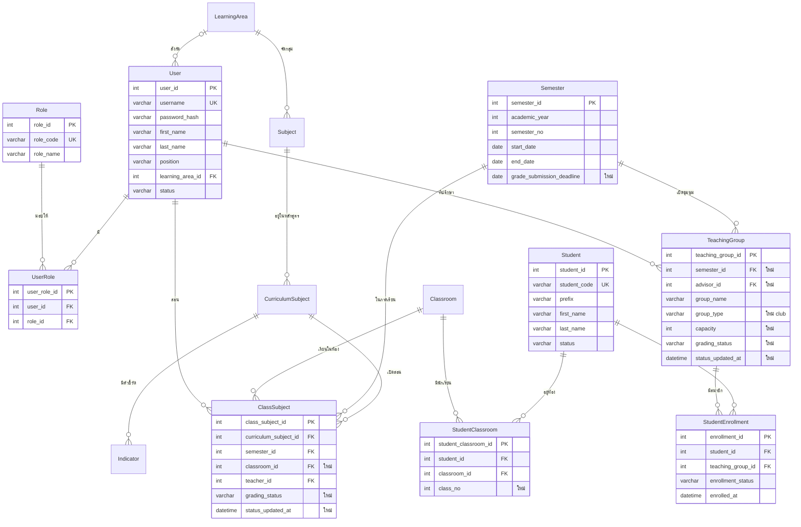
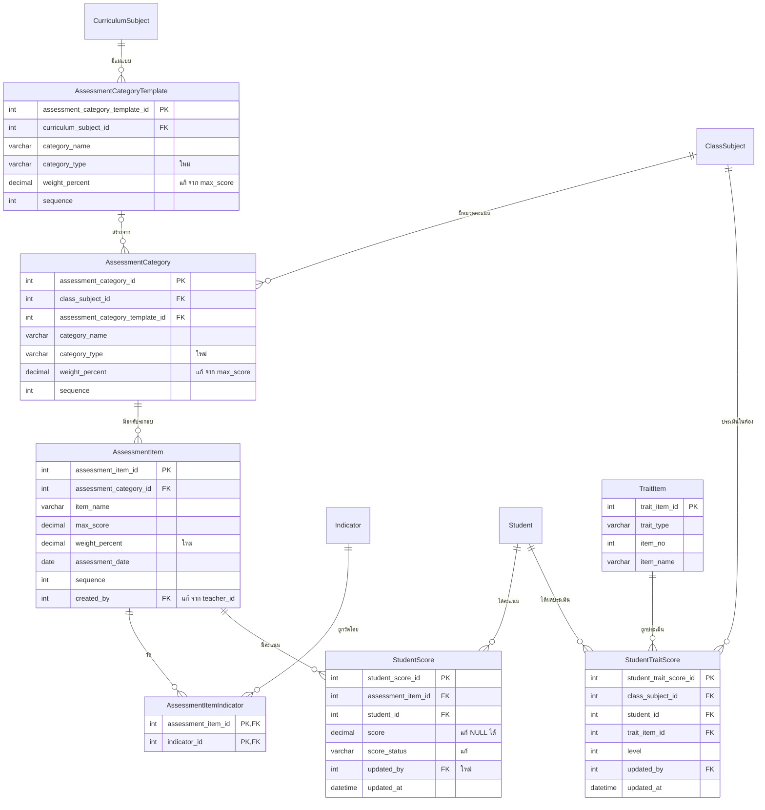
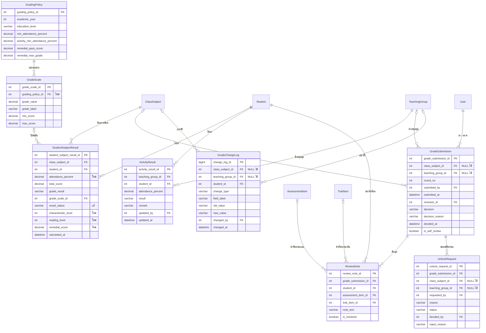

# ER & Data Dictionary — ระบบบันทึกคะแนน

เอกสารนี้ต่อยอดจาก ER เดิมของโครงงาน และปรับให้รองรับสิ่งที่ตัดสินใจไว้ใน [ADR 0001–0010](adr/) กับ Demo
คำศัพท์ทั้งหมดใช้ตาม [GLOSSARY](../GLOSSARY.md)

> **ฉบับที่ 2 (2026-10-13):** แก้ตาม [ADR 0010](adr/0010-classsubject-vs-teachinggroup.md)
> `ClassSubject` = รายวิชา × ห้อง × ภาคเรียน (ห้องเรียนที่สอน) · `TeachingGroup` = **ชุมนุม** (ผ / มผ)
> ฉบับแรกถือว่า `TeachingGroup` = ห้องเรียนที่สอน ซึ่ง**ผิด**
> ⚠ `er-diagram.html` ยังเป็นฉบับแรก ให้ใช้ ER diagram ในไฟล์นี้ (หัวข้อ 3) เป็นหลัก

**สัญลักษณ์:** 🆕 ตารางหรือฟิลด์ใหม่ · ✏️ แก้ของเดิม · ➖ แนะนำให้ลบ · (ไม่มีสัญลักษณ์) = คงเดิม

---

## 1. ความหมายของตารางหลักใน ER เดิม (ยืนยันกับผู้ใช้แล้ว)

| ตาราง | หมายถึง | เป็นหน่วยส่งผลไหม | ประเมินแบบ |
|---|---|---|---|
| `CurriculumSubject` | รายวิชาในหลักสูตรที่ต้องเรียน (พื้นฐาน / เพิ่มเติม) | — | — |
| `ClassSubject` | รายวิชา × **ห้อง** × ภาคเรียน เช่น ค22101 ม.2/1 1/2569 = **ห้องเรียนที่สอน** | ✅ | คะแนน → เกรด 0–4 / ร / มส |
| `TeachingGroup` | **ชุมนุม** คละห้อง มีครูที่ปรึกษา | ✅ | ผ / มผ |

- **นักเรียนของ `ClassSubject`** มาจาก `StudentClassroom` (ทั้งห้อง) จึงไม่ต้องลงทะเบียนรายวิชา
- **สมาชิกของ `TeachingGroup`** มาจาก `StudentEnrollment`
- **รายวิชาเพิ่มเติม**เรียนทั้งห้อง จึงใช้ `ClassSubject` เหมือนวิชาพื้นฐาน

---

## 2. สรุปสิ่งที่ต้องแก้จาก ER เดิม

### 2.1 ปัญหาใน ER เดิม (ควรแก้แม้ไม่มีฟีเจอร์ใหม่)

| # | ปัญหา | ผลกระทบ | วิธีแก้ |
|---|---|---|---|
| 1 | มี FK `student_id`, `teacher_id`, `published_by` แต่**ไม่มีตาราง Student / Teacher / User** | FK อ้างถึงตารางที่ไม่มีอยู่ | 🆕 `Student`, `User` (+ `Role`, `UserRole`) |
| 2 | `ClassSubject` **ไม่มี `classroom_id`** | ไม่รู้ว่ารายวิชานี้สอนห้องไหน และหานักเรียนของรายวิชาไม่ได้ | ✏️ เพิ่ม `ClassSubject.classroom_id` + UK (curriculum_subject_id, classroom_id, semester_id) |
| 3 | `TeachingGroup.class_subject_id` | ชุมนุมคละห้อง ผูกกับรายวิชา × ห้องไม่ได้ | ➖ `class_subject_id` · 🆕 `semester_id`, `advisor_id`, `group_type` |
| 4 | `AssessmentCategory`/`AssessmentItem` มีแค่ `max_score` **ไม่มีสัดส่วน (%)** | ทำตาม UC-11 ไม่ได้ (ต้องมีชื่อ คะแนนเต็ม และสัดส่วน) | ✏️ เพิ่ม `weight_percent` ทั้งสองตาราง (ดูข้อ 4.2) |
| 5 | `AssessmentItem.teacher_id` | ซ้ำกับครูของห้อง ไม่ชัดว่าหมายถึงอะไร | ✏️ เปลี่ยนเป็น `created_by` |
| 6 | `StudentSubjectResult` มีทั้ง `class_subject_id` และ `teaching_group_id` | ตอนนี้ชุมนุมใช้ ผ/มผ ไม่มีเกรด `teaching_group_id` ในตารางนี้จึงไม่ถูกต้อง | ➖ `teaching_group_id` · ผลชุมนุมย้ายไป 🆕 `ActivityResult` |
| 7 | `TimetableEntry` มีทั้ง `class_subject_id` และ `teaching_group_id` | ถูกต้องตามความหมายใหม่ (คาบวิชาหลัก หรือคาบชุมนุม) แต่ควรบังคับให้มีค่าเพียงตัวเดียว | CHECK มีค่าได้เพียง 1 ตัว (ไม่ต้องเปลี่ยนโครงสร้าง) |
| 8 | ไม่มี UNIQUE ที่ควรมี | กรอกคะแนนซ้ำคนเดิม ช่องเดิมได้ | UK ใน `StudentScore`, `StudentSubjectResult`, `StudentEnrollment` |
| 9 | `Subject` ไม่ผูกกับกลุ่มสาระ | FR ข้อ 1 (จัดการกลุ่มสาระ) ไม่มีที่เก็บ | 🆕 `LearningArea` + ✏️ `Subject.learning_area_id` |
| 10 | ไม่มีเลขที่นักเรียนในห้อง | ตารางกรอกคะแนนเรียงตามเลขที่ไม่ได้ | ✏️ `StudentClassroom.class_no` |

### 2.2 สิ่งที่ต้องเพิ่มเพื่อรองรับฟีเจอร์ใหม่

| ฟีเจอร์ | อ้างอิง | ตาราง / ฟิลด์ |
|---|---|---|
| ผู้ใช้มีหลายบทบาท | ADR 0003 | 🆕 `User`, `Role`, `UserRole` |
| สถานะของหน่วยส่งผล | ADR 0002, 0010 | ✏️ `grading_status` ใน `ClassSubject` และ `TeachingGroup` |
| รอบการตรวจ: ส่ง / อนุมัติ / ตีกลับ / ตรวจงานตนเอง | ADR 0002, 0007 | 🆕 `GradeSubmission` (FK 2 ตัว + CHECK) |
| หมุดข้อสังเกต | ADR 0006 | 🆕 `ReviewNote` |
| คำขอปลดล็อก | ADR 0005 | 🆕 `UnlockRequest` (FK 2 ตัว + CHECK) |
| ประวัติการแก้ไข | UC-12 ขั้นที่ 15 | 🆕 `GradeChangeLog` (FK 2 ตัว + CHECK) |
| คุณลักษณะฯ / อ่าน คิดวิเคราะห์ และเขียน | UC-24 | 🆕 `TraitItem`, `StudentTraitScore` |
| ตัวชี้วัด | UC-11 | 🆕 `Indicator`, `AssessmentItemIndicator` |
| ร / ขาดสอบ แทนคะแนน | UC-12 A-3 | ✏️ `StudentScore.score_status`, `score` เป็น NULL ได้ |
| สอบซ่อม | UC-25 | ✏️ ฟิลด์ remedial ใน `StudentSubjectResult` |
| เกณฑ์ตัดสินผล (รวมเกณฑ์ชุมนุม) | UC-26 | 🆕 `GradingPolicy` + ✏️ `GradeScale.grading_policy_id` |
| เวลาเรียนวิชาหลัก (ตัดสิน มส) | — | ✏️ `StudentSubjectResult.attendance_percent` |
| ผลชุมนุม ผ / มผ | ADR 0010 | 🆕 `ActivityResult` |
| กำหนดส่งผลการเรียน | Demo | ✏️ `Semester.grade_submission_deadline` |

### 2.3 ตารางที่ไม่ต้องแก้
`StudyProgram`, `Classroom`, `CurriculumSubject`, `Timetable`, `Room`, `Period` คงเดิม · `TimetableEntry` เพิ่มแค่ CHECK (ข้อ 2.1 #7)
**ไม่ต้องมีตาราง:** ร่างที่ยังไม่บันทึกอยู่ฝั่งหน้าจอเท่านั้น (ADR 0004)

---

## 3. ER Diagram (Mermaid)

ดูได้ใน VS Code (Markdown Preview + Mermaid) หรือวางที่ [mermaid.live](https://mermaid.live) แล้ว export เป็น PNG/SVG
แบ่งเป็น 3 ภาพตามกลุ่มงาน ในแต่ละภาพจะแสดงฟิลด์เฉพาะตารางหลักของภาพนั้น

### 3.1 ผู้ใช้ นักเรียน ห้องเรียนที่สอน และชุมนุม


### 3.2 โครงสร้างคะแนนและการบันทึก (วิชาหลัก)


### 3.3 ผลการเรียน ผลชุมนุม และการตรวจอนุมัติ


---

## 4. ประเด็นออกแบบที่ควรรู้

### 4.1 หน่วยส่งผลมี 2 แบบ ใช้ "FK 2 ตัว + CHECK"
`GradeSubmission`, `UnlockRequest`, `GradeChangeLog` มีทั้ง `class_subject_id` และ `teaching_group_id` ที่ NULL ได้ และต้องมีค่าเพียงตัวเดียว:
```sql
CHECK ((class_subject_id IS NOT NULL AND teaching_group_id IS NULL)
    OR (class_subject_id IS NULL AND teaching_group_id IS NOT NULL))
```
สถานะ (`grading_status`) อยู่ที่ตัวหน่วยเอง ทั้ง `ClassSubject` และ `TeachingGroup` ใช้ค่าชุดเดียวกัน

### 4.2 คะแนนเต็มกับสัดส่วน (วิชาหลัก)
- `AssessmentCategory.weight_percent` = สัดส่วนของหมวด เช่น เก็บ 60 / กลางภาค 20 / ปลายภาค 20 **รวมทุกหมวดต้องเท่ากับ 100**
- `AssessmentItem.max_score` = คะแนนดิบเต็ม · `AssessmentItem.weight_percent` = สัดส่วนในคะแนนรวม · **ผลรวมใน 1 หมวดต้องเท่ากับ weight ของหมวด**
- คะแนนที่แปลงแล้ว = `score / max_score × weight_percent` → รวมทุก item ได้ `total_score` (เต็ม 100)
- เมื่อ `ClassSubject` เป็นรายห้อง โครงสร้างคะแนนจึง**ตั้งแยกรายห้อง** (ตรงกับ Demo) ส่วนความเหมือนกันระหว่างห้องได้จาก `AssessmentCategoryTemplate` ของ `CurriculumSubject`

### 4.3 ชุมนุม (ผ / มผ)
- ไม่มีโครงสร้างคะแนน ไม่มีเกรด จึงไม่ใช้ `AssessmentCategory`, `StudentScore` และ `StudentSubjectResult`
- ครูกรอก `ActivityResult.attendance_percent` ถ้าต่ำกว่า `GradingPolicy.activity_min_attendance_percent` ระบบจะ**เสนอ** มผ แต่ครูเป็นผู้เลือก `result` สุดท้าย
- หมุดข้อสังเกตของชุมนุมปักได้แค่ระดับแถว (`assessment_item_id` และ `trait_item_id` เป็น NULL ทั้งคู่)

### 4.4 ค่าที่คำนวณได้ แต่เลือกเก็บไว้
`StudentSubjectResult.total_score / grade_result / result_status` และ `GradeSubmission.is_self_review` เก็บไว้เพื่อให้รายงานเร็ว และเป็นหลักฐานของรอบที่อนุมัติแล้ว (ถ้าเกณฑ์เปลี่ยนภายหลัง ผลเดิมต้องไม่เปลี่ยนตาม)

---

## 5. Data Dictionary

รูปแบบคอลัมน์: **ฟิลด์ · ชนิดข้อมูล · คีย์ · Null · คำอธิบาย / ค่าที่เป็นไปได้**

### 5.1 ผู้ใช้และบทบาท

#### 🆕 User — ผู้ใช้ระบบ (ครู)
| ฟิลด์ | ชนิดข้อมูล | คีย์ | Null | คำอธิบาย |
|---|---|---|---|---|
| user_id | INT | PK | N | รหัสผู้ใช้ |
| username | VARCHAR(50) | UK | N | ชื่อเข้าสู่ระบบ |
| password_hash | VARCHAR(255) | | N | รหัสผ่านที่เข้ารหัสแล้ว |
| prefix | VARCHAR(20) | | Y | คำนำหน้า |
| first_name | VARCHAR(100) | | N | ชื่อ |
| last_name | VARCHAR(100) | | N | นามสกุล |
| position | VARCHAR(100) | | Y | ตำแหน่ง |
| learning_area_id | INT | FK → LearningArea | Y | กลุ่มสาระที่สังกัด |
| status | VARCHAR(20) | | N | `active`, `inactive` |
| created_at | DATETIME | | N | วันที่สร้างบัญชี |

#### 🆕 Role — บทบาท
| ฟิลด์ | ชนิดข้อมูล | คีย์ | Null | คำอธิบาย |
|---|---|---|---|---|
| role_id | INT | PK | N | รหัสบทบาท |
| role_code | VARCHAR(20) | UK | N | `teacher` ครูผู้สอน · `academic` ครูฝ่ายวิชาการ · `admin` ผู้ดูแลระบบ |
| role_name | VARCHAR(50) | | N | ชื่อบทบาทภาษาไทย |

#### 🆕 UserRole — ผู้ใช้ × บทบาท (ADR 0003)
| ฟิลด์ | ชนิดข้อมูล | คีย์ | Null | คำอธิบาย |
|---|---|---|---|---|
| user_role_id | INT | PK | N | รหัส |
| user_id | INT | FK → User | N | ผู้ใช้ |
| role_id | INT | FK → Role | N | บทบาท |
| assigned_at | DATETIME | | N | วันที่ได้รับบทบาท |
| | | UK (user_id, role_id) | | |

### 5.2 นักเรียน ห้องเรียน รายวิชา และชุมนุม

#### 🆕 Student — นักเรียน
| ฟิลด์ | ชนิดข้อมูล | คีย์ | Null | คำอธิบาย |
|---|---|---|---|---|
| student_id | INT | PK | N | รหัสภายในระบบ |
| student_code | VARCHAR(20) | UK | N | เลขประจำตัวนักเรียน |
| prefix | VARCHAR(20) | | N | ด.ช. / ด.ญ. / นาย / นางสาว |
| first_name | VARCHAR(100) | | N | ชื่อ |
| last_name | VARCHAR(100) | | N | นามสกุล |
| status | VARCHAR(20) | | N | `studying`, `moved_out`, `graduated` |

#### ✏️ StudentClassroom — นักเรียน × ห้องประจำชั้น
| ฟิลด์ | ชนิดข้อมูล | คีย์ | Null | คำอธิบาย |
|---|---|---|---|---|
| student_classroom_id | INT | PK | N | รหัส |
| student_id | INT | FK → Student | N | นักเรียน |
| classroom_id | INT | FK → Classroom | N | ห้อง |
| 🆕 class_no | INT | | N | เลขที่ในห้อง |
| | | UK (classroom_id, class_no) · UK (classroom_id, student_id) | | |

#### 🆕 LearningArea — กลุ่มสาระการเรียนรู้
| ฟิลด์ | ชนิดข้อมูล | คีย์ | Null | คำอธิบาย |
|---|---|---|---|---|
| learning_area_id | INT | PK | N | รหัส |
| area_name | VARCHAR(100) | UK | N | เช่น คณิตศาสตร์ |

#### ✏️ Subject — วิชา
| ฟิลด์ | ชนิดข้อมูล | คีย์ | Null | คำอธิบาย |
|---|---|---|---|---|
| subject_id | INT | PK | N | รหัส |
| subject_code | VARCHAR(20) | | N | รหัสวิชา |
| subject_name | VARCHAR(100) | | N | ชื่อวิชา |
| 🆕 learning_area_id | INT | FK → LearningArea | N | กลุ่มสาระ |

#### 🆕 Indicator — ตัวชี้วัด / ผลการเรียนรู้
| ฟิลด์ | ชนิดข้อมูล | คีย์ | Null | คำอธิบาย |
|---|---|---|---|---|
| indicator_id | INT | PK | N | รหัส |
| curriculum_subject_id | INT | FK → CurriculumSubject | N | รายวิชาในหลักสูตร |
| indicator_code | VARCHAR(30) | | N | เช่น ค1.1 ม.2/1 |
| description | VARCHAR(500) | | N | ข้อความตัวชี้วัด |
| sequence | INT | | N | ลำดับ |

#### ✏️ Semester — ภาคเรียน
| ฟิลด์ | ชนิดข้อมูล | คีย์ | Null | คำอธิบาย |
|---|---|---|---|---|
| semester_id | INT | PK | N | รหัส |
| academic_year | INT | | N | ปีการศึกษา (พ.ศ.) |
| semester_no | INT | | N | 1 / 2 |
| start_date | DATE | | N | วันเริ่มภาค |
| end_date | DATE | | N | วันสิ้นภาค |
| 🆕 grade_submission_deadline | DATE | | Y | กำหนดส่งผลการเรียน (ใช้กับทั้งวิชาหลักและชุมนุม) |

#### ✏️ ClassSubject — ห้องเรียนที่สอน (รายวิชา × ห้อง × ภาคเรียน)
| ฟิลด์ | ชนิดข้อมูล | คีย์ | Null | คำอธิบาย |
|---|---|---|---|---|
| class_subject_id | INT | PK | N | รหัส |
| curriculum_subject_id | INT | FK → CurriculumSubject | N | รายวิชา (พื้นฐาน / เพิ่มเติม) |
| semester_id | INT | FK → Semester | N | ภาคเรียน |
| 🆕 classroom_id | INT | FK → Classroom | N | ห้องที่เรียน นักเรียนมาจาก `StudentClassroom` ของห้องนี้ |
| teacher_id | INT | FK → User | N | ครูผู้สอน |
| 🆕 grading_status | VARCHAR(20) | | N | `not_started` ยังไม่ตั้งโครงสร้าง · `draft` กำลังบันทึก · `pending` รอตรวจ · `approved` อนุมัติแล้ว |
| 🆕 status_updated_at | DATETIME | | Y | เวลาที่สถานะเปลี่ยนล่าสุด |
| | | UK (curriculum_subject_id, classroom_id, semester_id) | | 1 ห้องเรียน 1 รายวิชาต่อภาค |

#### ✏️ TeachingGroup — ชุมนุม
| ฟิลด์ | ชนิดข้อมูล | คีย์ | Null | คำอธิบาย |
|---|---|---|---|---|
| teaching_group_id | INT | PK | N | รหัส |
| ➖ class_subject_id | INT | FK | — | **ลบ** ชุมนุมไม่ผูกกับรายวิชา × ห้อง (ADR 0010) |
| 🆕 semester_id | INT | FK → Semester | N | ภาคเรียนที่เปิดชุมนุม |
| 🆕 advisor_id | INT | FK → User | N | ครูที่ปรึกษาชุมนุม |
| group_name | VARCHAR(50) | | N | ชื่อชุมนุม เช่น ชุมนุมหุ่นยนต์ |
| 🆕 group_type | VARCHAR(20) | | N | `club` (เผื่อกิจกรรมแบบอื่นในอนาคต) |
| 🆕 capacity | INT | | Y | จำนวนรับสูงสุด |
| 🆕 grading_status | VARCHAR(20) | | N | `draft` · `pending` · `approved` (ไม่มี `not_started` เพราะไม่มีโครงสร้างคะแนน) |
| 🆕 status_updated_at | DATETIME | | Y | เวลาที่สถานะเปลี่ยนล่าสุด |

#### StudentEnrollment — สมาชิกชุมนุม
| ฟิลด์ | ชนิดข้อมูล | คีย์ | Null | คำอธิบาย |
|---|---|---|---|---|
| enrollment_id | INT | PK | N | รหัส |
| student_id | INT | FK → Student | N | นักเรียน |
| teaching_group_id | INT | FK → TeachingGroup | N | ชุมนุม |
| enrollment_status | VARCHAR(20) | | N | `enrolled`, `withdrawn` |
| enrolled_at | DATETIME | | N | วันที่สมัคร |
| | | UK (student_id, teaching_group_id) | | |

### 5.3 โครงสร้างคะแนนและการบันทึก (วิชาหลัก)

#### ✏️ AssessmentCategoryTemplate — แม่แบบหมวดคะแนนของรายวิชาในหลักสูตร
| ฟิลด์ | ชนิดข้อมูล | คีย์ | Null | คำอธิบาย |
|---|---|---|---|---|
| assessment_category_template_id | INT | PK | N | รหัส |
| curriculum_subject_id | INT | FK → CurriculumSubject | N | รายวิชาในหลักสูตร |
| category_name | VARCHAR(50) | | N | ชื่อหมวด |
| 🆕 category_type | VARCHAR(20) | | N | `collect` คะแนนเก็บ · `midterm` กลางภาค · `final` ปลายภาค |
| ✏️ weight_percent (เดิม max_score) | DECIMAL(5,2) | | N | สัดส่วนแนะนำ (%) |
| sequence | INT | | N | ลำดับ |

#### ✏️ AssessmentCategory — หมวดคะแนนของห้องเรียนที่สอน
| ฟิลด์ | ชนิดข้อมูล | คีย์ | Null | คำอธิบาย |
|---|---|---|---|---|
| assessment_category_id | INT | PK | N | รหัส |
| class_subject_id | INT | FK → ClassSubject | N | ห้องเรียนที่สอน (รายห้อง) |
| assessment_category_template_id | INT | FK → AssessmentCategoryTemplate | Y | สร้างจากแม่แบบใด |
| category_name | VARCHAR(50) | | N | ชื่อหมวด |
| 🆕 category_type | VARCHAR(20) | | N | `collect` / `midterm` / `final` |
| ✏️ weight_percent (เดิม max_score) | DECIMAL(5,2) | | N | สัดส่วนของหมวด **ทุกหมวดรวมกันต้องเท่ากับ 100** |
| sequence | INT | | N | ลำดับ |

#### ✏️ AssessmentItem — องค์ประกอบคะแนน
| ฟิลด์ | ชนิดข้อมูล | คีย์ | Null | คำอธิบาย |
|---|---|---|---|---|
| assessment_item_id | INT | PK | N | รหัส |
| assessment_category_id | INT | FK → AssessmentCategory | N | หมวด |
| item_name | VARCHAR(100) | | N | ชื่อองค์ประกอบ |
| max_score | DECIMAL(5,2) | | N | คะแนนดิบเต็ม (> 0) |
| 🆕 weight_percent | DECIMAL(5,2) | | N | สัดส่วนในคะแนนรวม (> 0) |
| assessment_date | DATE | | Y | วันที่ประเมิน |
| sequence | INT | | N | ลำดับคอลัมน์ |
| ✏️ created_by (เดิม teacher_id) | INT | FK → User | N | ผู้สร้าง |
| 🆕 created_at | DATETIME | | N | วันที่สร้าง |

#### 🆕 AssessmentItemIndicator — องค์ประกอบคะแนน × ตัวชี้วัด (M:N)
| ฟิลด์ | ชนิดข้อมูล | คีย์ | Null | คำอธิบาย |
|---|---|---|---|---|
| assessment_item_id | INT | PK, FK → AssessmentItem | N | องค์ประกอบ |
| indicator_id | INT | PK, FK → Indicator | N | ตัวชี้วัด |

#### ✏️ StudentScore — คะแนนรายช่อง
| ฟิลด์ | ชนิดข้อมูล | คีย์ | Null | คำอธิบาย |
|---|---|---|---|---|
| student_score_id | INT | PK | N | รหัส |
| assessment_item_id | INT | FK → AssessmentItem | N | องค์ประกอบ |
| student_id | INT | FK → Student | N | นักเรียน |
| ✏️ score | DECIMAL(5,2) | | **Y** | 0 ถึง max_score · NULL เมื่อสถานะไม่ใช่ `scored` |
| ✏️ score_status | VARCHAR(20) | | N | `scored` · `pending_work` **ร** รอส่งงาน · `absent` **ข** ขาดสอบ |
| updated_at | DATETIME | | N | บันทึกล่าสุด |
| 🆕 updated_by | INT | FK → User | N | ผู้บันทึกล่าสุด |
| | | UK (assessment_item_id, student_id) | | |

#### 🆕 TraitItem — รายการประเมินคุณลักษณะฯ / อ่าน คิดวิเคราะห์ และเขียน
| ฟิลด์ | ชนิดข้อมูล | คีย์ | Null | คำอธิบาย |
|---|---|---|---|---|
| trait_item_id | INT | PK | N | รหัส |
| trait_type | VARCHAR(30) | | N | `characteristic` (8 ข้อ) · `reading_thinking` (5 ด้าน) |
| item_no | INT | | N | ข้อที่ |
| item_name | VARCHAR(200) | | N | เช่น มีวินัย |
| is_active | BOOLEAN | | N | ใช้งานอยู่ |

#### 🆕 StudentTraitScore — ผลประเมินรายข้อ
| ฟิลด์ | ชนิดข้อมูล | คีย์ | Null | คำอธิบาย |
|---|---|---|---|---|
| student_trait_score_id | INT | PK | N | รหัส |
| class_subject_id | INT | FK → ClassSubject | N | ห้องเรียนที่สอน |
| student_id | INT | FK → Student | N | นักเรียน |
| trait_item_id | INT | FK → TraitItem | N | ข้อที่ประเมิน |
| level | TINYINT | | N | 3 ดีเยี่ยม · 2 ดี · 1 ผ่าน · 0 ไม่ผ่าน |
| updated_by | INT | FK → User | N | ผู้บันทึก |
| updated_at | DATETIME | | N | บันทึกล่าสุด |
| | | UK (class_subject_id, student_id, trait_item_id) | | |

### 5.4 ผลการเรียน ผลชุมนุม เกณฑ์ และการตรวจอนุมัติ

#### 🆕 GradingPolicy — ชุดเกณฑ์การตัดสินผล (UC-26)
| ฟิลด์ | ชนิดข้อมูล | คีย์ | Null | คำอธิบาย |
|---|---|---|---|---|
| grading_policy_id | INT | PK | N | รหัส |
| academic_year | INT | | N | ปีการศึกษาที่เริ่มใช้ |
| education_level | VARCHAR(20) | | N | `lower_secondary`, `upper_secondary` |
| min_attendance_percent | DECIMAL(5,2) | | N | เวลาเรียนขั้นต่ำของวิชาหลัก ค่าเริ่มต้น 80 (ต่ำกว่านี้ = มส) |
| activity_min_attendance_percent | DECIMAL(5,2) | | N | เวลาเข้าร่วมขั้นต่ำของชุมนุม ค่าเริ่มต้น 80 (ต่ำกว่านี้ระบบเสนอ มผ) |
| remedial_pass_score | DECIMAL(5,2) | | N | คะแนนผ่านสอบซ่อม (%) ค่าเริ่มต้น 50 |
| remedial_max_grade | DECIMAL(3,1) | | N | ระดับสูงสุดหลังสอบซ่อม ค่าเริ่มต้น 1.0 |
| rounding_method | VARCHAR(20) | | N | วิธีปัดคะแนนรวม เช่น `round_half_up` |
| created_by | INT | FK → User | N | ผู้กำหนด |
| created_at | DATETIME | | N | วันที่กำหนด |
| | | UK (academic_year, education_level) | | |

#### ✏️ GradeScale — ช่วงคะแนนของแต่ละระดับผลการเรียน
| ฟิลด์ | ชนิดข้อมูล | คีย์ | Null | คำอธิบาย |
|---|---|---|---|---|
| grade_scale_id | INT | PK | N | รหัส |
| 🆕 grading_policy_id | INT | FK → GradingPolicy | N | อยู่ในชุดเกณฑ์ใด |
| grade_value | DECIMAL(3,1) | | N | 4 … 0 |
| grade_label | VARCHAR(50) | | N | เช่น ผลการเรียนดีเยี่ยม |
| min_score | DECIMAL(5,2) | | N | คะแนนต่ำสุดของช่วง |
| max_score | DECIMAL(5,2) | | N | คะแนนสูงสุดของช่วง |
| ➖ education_level | VARCHAR(20) | | — | ย้ายไปที่ GradingPolicy |

#### ✏️ StudentSubjectResult — ผลการเรียนรายวิชา (วิชาหลัก)
| ฟิลด์ | ชนิดข้อมูล | คีย์ | Null | คำอธิบาย |
|---|---|---|---|---|
| student_subject_result_id | INT | PK | N | รหัส |
| class_subject_id | INT | FK → ClassSubject | N | ห้องเรียนที่สอน |
| ➖ teaching_group_id | INT | FK | — | **ลบ** ชุมนุมใช้ `ActivityResult` |
| student_id | INT | FK → Student | N | นักเรียน |
| 🆕 attendance_percent | DECIMAL(5,2) | | Y | เวลาเรียน (%) ใช้ตัดสิน มส (นำเข้าหรือกรอกเอง) |
| total_score | DECIMAL(5,2) | | Y | คะแนนรวม 0–100 |
| grade_result | VARCHAR(5) | | Y | `4`…`0`, `ร`, `มส` |
| grade_scale_id | INT | FK → GradeScale | **Y** | NULL เมื่อได้ ร / มส |
| ✏️ result_status | VARCHAR(20) | | N | `incomplete` · `pass` · `remedial` · `remedial_pass` · `pending` (ร) · `no_exam_right` (มส) |
| 🆕 characteristic_level | TINYINT | | Y | สรุปคุณลักษณะฯ 0–3 |
| 🆕 reading_level | TINYINT | | Y | สรุปอ่าน คิดวิเคราะห์ และเขียน 0–3 |
| 🆕 remedial_score | DECIMAL(5,2) | | Y | คะแนนสอบซ่อม (%) |
| 🆕 remedial_recorded_by | INT | FK → User | Y | ผู้บันทึกผลสอบซ่อม |
| 🆕 remedial_recorded_at | DATETIME | | Y | เวลาบันทึก |
| calculated_at | DATETIME | | N | เวลาคำนวณล่าสุด |
| | | UK (class_subject_id, student_id) | | |

#### 🆕 ActivityResult — ผลชุมนุม (ผ / มผ)
| ฟิลด์ | ชนิดข้อมูล | คีย์ | Null | คำอธิบาย |
|---|---|---|---|---|
| activity_result_id | INT | PK | N | รหัส |
| teaching_group_id | INT | FK → TeachingGroup | N | ชุมนุม |
| student_id | INT | FK → Student | N | นักเรียน (ต้องเป็นสมาชิกใน StudentEnrollment) |
| attendance_percent | DECIMAL(5,2) | | Y | เวลาเข้าร่วม (%) |
| result | VARCHAR(10) | | Y | `pass` **ผ** · `fail` **มผ** · NULL = ยังไม่ประเมิน (ครูเป็นผู้เลือก) |
| remark | VARCHAR(255) | | Y | หมายเหตุ เช่น เหตุผลที่ให้ มผ ทั้งที่เวลาเข้าร่วมครบ |
| updated_by | INT | FK → User | N | ผู้บันทึก |
| updated_at | DATETIME | | N | บันทึกล่าสุด |
| | | UK (teaching_group_id, student_id) | | |

#### 🆕 GradeSubmission — รอบการตรวจ (ใช้ทั้งวิชาหลักและชุมนุม)
| ฟิลด์ | ชนิดข้อมูล | คีย์ | Null | คำอธิบาย |
|---|---|---|---|---|
| grade_submission_id | INT | PK | N | รหัส |
| class_subject_id | INT | FK → ClassSubject | Y | หน่วยส่งผล: ห้องเรียนที่สอน |
| teaching_group_id | INT | FK → TeachingGroup | Y | หน่วยส่งผล: ชุมนุม |
| round_no | INT | | N | รอบที่ 1, 2, 3… ของหน่วยนั้น |
| submitted_by | INT | FK → User | N | ครูผู้ส่ง |
| submitted_at | DATETIME | | N | เวลาส่ง |
| reviewer_id | INT | FK → User | Y | ผู้ตรวจ |
| decision | VARCHAR(20) | | Y | NULL รอตรวจ · `approved` · `returned` · `unlocked` |
| decision_reason | VARCHAR(500) | | Y | **บังคับเมื่อ `returned`** |
| decided_at | DATETIME | | Y | เวลาตัดสิน |
| is_self_review | BOOLEAN | | N | ผู้ตรวจเป็นครูผู้สอน/ที่ปรึกษาของหน่วยนั้น (ADR 0007) |
| | | CHECK หน่วยส่งผล (ข้อ 4.1) | | |

#### 🆕 ReviewNote — หมุดข้อสังเกต (ADR 0006)
| ฟิลด์ | ชนิดข้อมูล | คีย์ | Null | คำอธิบาย |
|---|---|---|---|---|
| review_note_id | INT | PK | N | รหัส |
| grade_submission_id | INT | FK → GradeSubmission | N | รอบการตรวจ |
| student_id | INT | FK → Student | N | นักเรียน |
| assessment_item_id | INT | FK → AssessmentItem | Y | ปักที่ช่องคะแนน (วิชาหลัก) |
| trait_item_id | INT | FK → TraitItem | Y | ปักที่ช่องประเมิน (วิชาหลัก) |
| note_text | VARCHAR(500) | | N | ข้อความ |
| is_resolved | BOOLEAN | | N | ครูกด "แก้แล้ว" |
| resolved_at | DATETIME | | Y | เวลาที่กดแก้แล้ว |
| created_by | INT | FK → User | N | ผู้ปักหมุด |
| created_at | DATETIME | | N | เวลาปักหมุด |
| | | CHECK | | 2 FK ข้างบนมีค่าได้ไม่เกิน 1 ตัว · ว่างทั้งคู่ = ปักทั้งแถว (ชุมนุมใช้แบบนี้เท่านั้น) |

#### 🆕 UnlockRequest — คำขอปลดล็อก (ADR 0005)
| ฟิลด์ | ชนิดข้อมูล | คีย์ | Null | คำอธิบาย |
|---|---|---|---|---|
| unlock_request_id | INT | PK | N | รหัส |
| grade_submission_id | INT | FK → GradeSubmission | N | รอบที่ขอปลดล็อก |
| class_subject_id | INT | FK → ClassSubject | Y | หน่วยส่งผล (ซ้ำจากรอบ เพื่อ query ง่าย) |
| teaching_group_id | INT | FK → TeachingGroup | Y | หน่วยส่งผล |
| requested_by | INT | FK → User | N | ครูผู้ขอ |
| reason | VARCHAR(500) | | N | เหตุผล (บังคับ) |
| requested_at | DATETIME | | N | เวลายื่น |
| status | VARCHAR(20) | | N | `pending` · `approved` · `rejected` |
| decided_by | INT | FK → User | Y | ผู้พิจารณา |
| decided_at | DATETIME | | Y | เวลาพิจารณา |
| reject_reason | VARCHAR(500) | | Y | **บังคับเมื่อ `rejected`** |
| | | CHECK หน่วยส่งผล (ข้อ 4.1) | | ต้องตรงกับหน่วยของ grade_submission |

#### 🆕 GradeChangeLog — ประวัติการแก้ไข (UC-12 ขั้นที่ 15)
| ฟิลด์ | ชนิดข้อมูล | คีย์ | Null | คำอธิบาย |
|---|---|---|---|---|
| change_log_id | BIGINT | PK | N | รหัส |
| class_subject_id | INT | FK → ClassSubject | Y | หน่วยส่งผล |
| teaching_group_id | INT | FK → TeachingGroup | Y | หน่วยส่งผล |
| student_id | INT | FK → Student | Y | NULL ถ้าเป็นการแก้โครงสร้าง |
| change_type | VARCHAR(20) | | N | `score` · `trait` · `structure` · `remedial` · `activity` |
| field_label | VARCHAR(150) | | N | สิ่งที่แก้ |
| old_value | VARCHAR(100) | | Y | ค่าเดิม |
| new_value | VARCHAR(255) | | Y | ค่าใหม่ |
| changed_by | INT | FK → User | N | ผู้แก้ไข |
| changed_at | DATETIME | | N | เวลา |
| | | CHECK หน่วยส่งผล (ข้อ 4.1) | | |

---

## 6. กฎทางธุรกิจที่ต้องบังคับในระบบ (ใช้ constraint ไม่ได้)

1. ผลรวม `AssessmentCategory.weight_percent` ของ 1 `ClassSubject` = 100 และผลรวม `AssessmentItem.weight_percent` ในหมวด = weight ของหมวด (UC-11 E-1)
2. `StudentScore.score` อยู่ระหว่าง 0 ถึง `max_score` (UC-12 E-1, E-2) และนักเรียนต้องอยู่ใน `StudentClassroom` ของ `ClassSubject.classroom_id`
3. `ActivityResult.student_id` ต้องเป็นสมาชิกใน `StudentEnrollment` ของชุมนุมนั้น
4. แก้ข้อมูลของหน่วยส่งผลได้เฉพาะเมื่อ `grading_status` เป็น `not_started` หรือ `draft` (ล็อกเมื่อ `pending` / `approved`)
5. ผู้แก้ต้องเป็น `ClassSubject.teacher_id` หรือ `TeachingGroup.advisor_id` เท่านั้น ฝ่ายวิชาการแก้ไม่ได้ (ADR 0001)
6. ใน 1 หน่วยส่งผล มี `GradeSubmission` ที่ `decision IS NULL` ได้ไม่เกิน 1 รอบ และมี `UnlockRequest` ที่ `pending` ได้ไม่เกิน 1 รายการ
7. การเปลี่ยนสถานะ: ส่งผล → `pending` · อนุมัติ → `approved` · ตีกลับ หรืออนุมัติคำขอปลดล็อก → `draft`
8. ส่งผลชุมนุมได้เมื่อสมาชิกทุกคนมี `ActivityResult.result` แล้ว · ส่งผลวิชาหลักได้เมื่อผ่านรายการตรวจก่อนส่ง (UC-18)
9. อนุมัติหลายหน่วยพร้อมกันได้เฉพาะหน่วยที่ `pending` + ไม่มีคำขอปลดล็อกค้าง + `is_self_review = false` (ADR 0009)

---

## 7. ความสัมพันธ์ระหว่างตาราง

ใช้เป็นคู่มือลากเส้นใน `er-tables.drawio`

**วิธีอ่าน:**
- **ตารางแม่** คือฝั่ง "1" และเป็นเจ้าของ PK · **ตารางลูก** คือฝั่ง "หลาย" และเป็นฝั่งที่มี FK
- **ความสัมพันธ์**
  - `1 : 0..*` แม่ 1 แถว มีลูกได้ 0 ถึงหลายแถว และ FK ห้ามว่าง
  - `0..1 : 0..*` FK ว่างได้ คือลูกไม่จำเป็นต้องมีแม่
  - `1 : 1..*` แม่ต้องมีลูกอย่างน้อย 1 แถว
- **หัวเส้นใน draw.io** (ใส่ใน Edit Style ของเส้น)

| ฝั่ง | ความหมาย | ค่าที่ใช้ |
|---|---|---|
| แม่ | FK ห้ามว่าง | `startArrow=ERmandOne` |
| แม่ | FK ว่างได้ | `startArrow=ERzeroToOne` |
| ลูก | 0 ถึงหลายแถว | `endArrow=ERzeroToMany` |
| ลูก | อย่างน้อย 1 แถว | `endArrow=ERoneToMany` |

- **★ = เส้นหลัก** ควรวาดทุกเส้น · **☆ = เส้นรอง** ใช้บอกว่า "ใครบันทึก/แก้ไข" (FK ไปที่ `User` เช่น `created_by`, `updated_by`) ถ้าวาดทุกเส้น `User` จะมีเส้นพันกันมาก **ข้ามได้** แล้วเขียนหมายเหตุใต้แผนภาพแทน

### 7.1 ผู้ใช้และบทบาท
| # | ตารางแม่ (1) | ตารางลูก (หลาย) | FK ในตารางลูก | ความสัมพันธ์ | หัวเส้น (แม่ / ลูก) | ความหมาย | |
|---|---|---|---|---|---|---|---|
| 1 | User | UserRole | user_id | 1 : 0..* | ERmandOne / ERzeroToMany | ผู้ใช้ 1 คนมีได้หลายบทบาท | ★ |
| 2 | Role | UserRole | role_id | 1 : 0..* | ERmandOne / ERzeroToMany | บทบาทหนึ่งมอบให้ได้หลายคน | ★ |
| 3 | LearningArea | User | learning_area_id | 0..1 : 0..* | ERzeroToOne / ERzeroToMany | ครูสังกัดกลุ่มสาระ (ไม่บังคับ) | ★ |
| 4 | LearningArea | Subject | learning_area_id | 1 : 0..* | ERmandOne / ERzeroToMany | วิชาอยู่ในกลุ่มสาระ | ★ |

> **User ↔ Role เป็น M:N** โดยมี `UserRole` เป็นตารางเชื่อม (ADR 0003)

### 7.2 นักเรียนและห้องเรียน
| # | ตารางแม่ (1) | ตารางลูก (หลาย) | FK ในตารางลูก | ความสัมพันธ์ | หัวเส้น (แม่ / ลูก) | ความหมาย | |
|---|---|---|---|---|---|---|---|
| 5 | Student | StudentClassroom | student_id | 1 : 0..* | ERmandOne / ERzeroToMany | นักเรียนอยู่ห้องประจำชั้น (หลายปีมีหลายแถว) | ★ |
| 6 | Classroom | StudentClassroom | classroom_id | 1 : 0..* | ERmandOne / ERzeroToMany | ห้องมีนักเรียนหลายคน พร้อมเลขที่ | ★ |
| 7 | StudyProgram | Classroom | study_program_id | 1 : 0..* | ERmandOne / ERzeroToMany | ห้องอยู่ในแผนการเรียน | ★ |
| 8 | Student | StudentEnrollment | student_id | 1 : 0..* | ERmandOne / ERzeroToMany | นักเรียนสมัครชุมนุม | ★ |
| 9 | TeachingGroup | StudentEnrollment | teaching_group_id | 1 : 0..* | ERmandOne / ERzeroToMany | ชุมนุมมีสมาชิกหลายคน | ★ |

> **Student ↔ Classroom เป็น M:N** ผ่าน `StudentClassroom` · **Student ↔ TeachingGroup (ชุมนุม) เป็น M:N** ผ่าน `StudentEnrollment`

### 7.3 หลักสูตร รายวิชา ห้องเรียนที่สอน และชุมนุม
| # | ตารางแม่ (1) | ตารางลูก (หลาย) | FK ในตารางลูก | ความสัมพันธ์ | หัวเส้น (แม่ / ลูก) | ความหมาย | |
|---|---|---|---|---|---|---|---|
| 10 | Subject | CurriculumSubject | subject_id | 1 : 0..* | ERmandOne / ERzeroToMany | วิชาอยู่ในหลักสูตรได้หลายระดับชั้น/ภาค | ★ |
| 11 | CurriculumSubject | Indicator | curriculum_subject_id | 1 : 0..* | ERmandOne / ERzeroToMany | รายวิชามีตัวชี้วัดหลายข้อ | ★ |
| 12 | CurriculumSubject | ClassSubject | curriculum_subject_id | 1 : 0..* | ERmandOne / ERzeroToMany | รายวิชาเปิดสอนได้หลายห้อง/หลายภาค | ★ |
| 13 | Semester | ClassSubject | semester_id | 1 : 0..* | ERmandOne / ERzeroToMany | ห้องเรียนที่สอนอยู่ในภาคเรียน | ★ |
| 14 | Classroom | ClassSubject | classroom_id | 1 : 0..* | ERmandOne / ERzeroToMany | ห้องหนึ่งเรียนหลายรายวิชา (ADR 0010) | ★ |
| 15 | User | ClassSubject | teacher_id | 1 : 0..* | ERmandOne / ERzeroToMany | ครูผู้สอนของห้องเรียนที่สอน | ★ |
| 16 | Semester | TeachingGroup | semester_id | 1 : 0..* | ERmandOne / ERzeroToMany | ชุมนุมเปิดในภาคเรียน | ★ |
| 17 | User | TeachingGroup | advisor_id | 1 : 0..* | ERmandOne / ERzeroToMany | ครูที่ปรึกษาชุมนุม | ★ |

> `ClassSubject` คือ CurriculumSubject × Classroom × Semester ห้ามซ้ำ (UK) ส่วน `TeachingGroup` **ไม่เชื่อม**กับ `ClassSubject` แล้ว (ADR 0010)

### 7.4 โครงสร้างคะแนนและการบันทึก (วิชาหลัก)
| # | ตารางแม่ (1) | ตารางลูก (หลาย) | FK ในตารางลูก | ความสัมพันธ์ | หัวเส้น (แม่ / ลูก) | ความหมาย | |
|---|---|---|---|---|---|---|---|
| 18 | CurriculumSubject | AssessmentCategoryTemplate | curriculum_subject_id | 1 : 0..* | ERmandOne / ERzeroToMany | แม่แบบหมวดคะแนนของรายวิชา | ★ |
| 19 | ClassSubject | AssessmentCategory | class_subject_id | 1 : 0..* | ERmandOne / ERzeroToMany | หมวดคะแนนของแต่ละห้อง (0 = ยังไม่ตั้งโครงสร้าง) | ★ |
| 20 | AssessmentCategoryTemplate | AssessmentCategory | assessment_category_template_id | 0..1 : 0..* | ERzeroToOne / ERzeroToMany | หมวดที่สร้างจากแม่แบบ (สร้างเองก็ได้) | ★ |
| 21 | AssessmentCategory | AssessmentItem | assessment_category_id | 1 : 1..* | ERmandOne / ERoneToMany | หมวดมีองค์ประกอบอย่างน้อย 1 รายการ | ★ |
| 22 | AssessmentItem | AssessmentItemIndicator | assessment_item_id | 1 : 0..* | ERmandOne / ERzeroToMany | องค์ประกอบวัดหลายตัวชี้วัด | ★ |
| 23 | Indicator | AssessmentItemIndicator | indicator_id | 1 : 0..* | ERmandOne / ERzeroToMany | ตัวชี้วัดถูกวัดโดยหลายองค์ประกอบ | ★ |
| 24 | AssessmentItem | StudentScore | assessment_item_id | 1 : 0..* | ERmandOne / ERzeroToMany | คะแนนของแต่ละคนในองค์ประกอบนั้น | ★ |
| 25 | Student | StudentScore | student_id | 1 : 0..* | ERmandOne / ERzeroToMany | นักเรียนมีคะแนนหลายช่อง | ★ |
| 26 | ClassSubject | StudentTraitScore | class_subject_id | 1 : 0..* | ERmandOne / ERzeroToMany | ผลประเมินคุณลักษณะฯ ของห้องนั้น | ★ |
| 27 | Student | StudentTraitScore | student_id | 1 : 0..* | ERmandOne / ERzeroToMany | นักเรียนมีผลประเมินหลายข้อ | ★ |
| 28 | TraitItem | StudentTraitScore | trait_item_id | 1 : 0..* | ERmandOne / ERzeroToMany | ข้อประเมินถูกใช้กับทุกคน | ★ |
| 29 | User | AssessmentItem | created_by | 1 : 0..* | ERmandOne / ERzeroToMany | ผู้สร้างองค์ประกอบ | ☆ |
| 30 | User | StudentScore | updated_by | 1 : 0..* | ERmandOne / ERzeroToMany | ผู้บันทึกคะแนนล่าสุด | ☆ |
| 31 | User | StudentTraitScore | updated_by | 1 : 0..* | ERmandOne / ERzeroToMany | ผู้บันทึกผลประเมินล่าสุด | ☆ |

> **AssessmentItem ↔ Indicator เป็น M:N** ผ่าน `AssessmentItemIndicator`
> **ลำดับชั้น:** ClassSubject → AssessmentCategory → AssessmentItem → StudentScore (1 ห้อง → หลายหมวด → หลายองค์ประกอบ → คะแนนรายคน)

### 7.5 ผลการเรียนและผลชุมนุม
| # | ตารางแม่ (1) | ตารางลูก (หลาย) | FK ในตารางลูก | ความสัมพันธ์ | หัวเส้น (แม่ / ลูก) | ความหมาย | |
|---|---|---|---|---|---|---|---|
| 32 | GradingPolicy | GradeScale | grading_policy_id | 1 : 1..* | ERmandOne / ERoneToMany | ชุดเกณฑ์มีช่วงเกรด 8 ระดับ | ★ |
| 33 | ClassSubject | StudentSubjectResult | class_subject_id | 1 : 0..* | ERmandOne / ERzeroToMany | ผลการเรียนของนักเรียนในห้องนั้น | ★ |
| 34 | Student | StudentSubjectResult | student_id | 1 : 0..* | ERmandOne / ERzeroToMany | นักเรียนมีผลหลายรายวิชา | ★ |
| 35 | GradeScale | StudentSubjectResult | grade_scale_id | 0..1 : 0..* | ERzeroToOne / ERzeroToMany | ช่วงเกรดที่ใช้ตัดสิน (ว่างเมื่อได้ ร / มส) | ★ |
| 36 | TeachingGroup | ActivityResult | teaching_group_id | 1 : 0..* | ERmandOne / ERzeroToMany | ผล ผ/มผ ของสมาชิกชุมนุม | ★ |
| 37 | Student | ActivityResult | student_id | 1 : 0..* | ERmandOne / ERzeroToMany | นักเรียนมีผลชุมนุมแต่ละภาค | ★ |
| 38 | User | GradingPolicy | created_by | 1 : 0..* | ERmandOne / ERzeroToMany | ฝ่ายวิชาการผู้กำหนดเกณฑ์ | ☆ |
| 39 | User | StudentSubjectResult | remedial_recorded_by | 0..1 : 0..* | ERzeroToOne / ERzeroToMany | ผู้บันทึกผลสอบซ่อม | ☆ |
| 40 | User | ActivityResult | updated_by | 1 : 0..* | ERmandOne / ERzeroToMany | ผู้บันทึกผลชุมนุม | ☆ |

> `GradingPolicy` **ไม่มี FK** ไปยังผลการเรียน ระบบเลือกชุดเกณฑ์จาก `academic_year` + `education_level` ของห้องนั้น แล้วบันทึกช่วงเกรดที่ใช้ลงใน `grade_scale_id`

### 7.6 การตรวจและอนุมัติ (ใช้ร่วมกันทั้งวิชาหลักและชุมนุม)
| # | ตารางแม่ (1) | ตารางลูก (หลาย) | FK ในตารางลูก | ความสัมพันธ์ | หัวเส้น (แม่ / ลูก) | ความหมาย | |
|---|---|---|---|---|---|---|---|
| 41 | ClassSubject | GradeSubmission | class_subject_id | 0..1 : 0..* | ERzeroToOne / ERzeroToMany | รอบการตรวจของห้องเรียนที่สอน | ★ |
| 42 | TeachingGroup | GradeSubmission | teaching_group_id | 0..1 : 0..* | ERzeroToOne / ERzeroToMany | รอบการตรวจของชุมนุม | ★ |
| 43 | User | GradeSubmission | submitted_by | 1 : 0..* | ERmandOne / ERzeroToMany | ครูผู้ส่ง | ★ |
| 44 | User | GradeSubmission | reviewer_id | 0..1 : 0..* | ERzeroToOne / ERzeroToMany | ฝ่ายวิชาการผู้ตรวจ (ว่างระหว่างรอตรวจ) | ★ |
| 45 | GradeSubmission | ReviewNote | grade_submission_id | 1 : 0..* | ERmandOne / ERzeroToMany | หมุดข้อสังเกตของรอบนั้น | ★ |
| 46 | Student | ReviewNote | student_id | 1 : 0..* | ERmandOne / ERzeroToMany | หมุดปักที่นักเรียนคนไหน | ★ |
| 47 | AssessmentItem | ReviewNote | assessment_item_id | 0..1 : 0..* | ERzeroToOne / ERzeroToMany | ปักที่ช่องคะแนน | ★ |
| 48 | TraitItem | ReviewNote | trait_item_id | 0..1 : 0..* | ERzeroToOne / ERzeroToMany | ปักที่ช่องประเมินคุณลักษณะฯ | ★ |
| 49 | GradeSubmission | UnlockRequest | grade_submission_id | 1 : 0..* | ERmandOne / ERzeroToMany | ขอปลดล็อกรอบไหน | ★ |
| 50 | ClassSubject | UnlockRequest | class_subject_id | 0..1 : 0..* | ERzeroToOne / ERzeroToMany | คำขอของห้องเรียนที่สอน | ★ |
| 51 | TeachingGroup | UnlockRequest | teaching_group_id | 0..1 : 0..* | ERzeroToOne / ERzeroToMany | คำขอของชุมนุม | ★ |
| 52 | User | UnlockRequest | requested_by | 1 : 0..* | ERmandOne / ERzeroToMany | ครูผู้ขอ | ★ |
| 53 | User | UnlockRequest | decided_by | 0..1 : 0..* | ERzeroToOne / ERzeroToMany | ฝ่ายวิชาการผู้พิจารณา | ★ |
| 54 | ClassSubject | GradeChangeLog | class_subject_id | 0..1 : 0..* | ERzeroToOne / ERzeroToMany | ประวัติการแก้ของห้องเรียนที่สอน | ★ |
| 55 | TeachingGroup | GradeChangeLog | teaching_group_id | 0..1 : 0..* | ERzeroToOne / ERzeroToMany | ประวัติการแก้ของชุมนุม | ★ |
| 56 | Student | GradeChangeLog | student_id | 0..1 : 0..* | ERzeroToOne / ERzeroToMany | แก้ข้อมูลของนักเรียนคนไหน (ว่าง = แก้โครงสร้าง) | ★ |
| 57 | User | ReviewNote | created_by | 1 : 0..* | ERmandOne / ERzeroToMany | ผู้ปักหมุด | ☆ |
| 58 | User | GradeChangeLog | changed_by | 1 : 0..* | ERmandOne / ERzeroToMany | ผู้แก้ไข | ☆ |

> เส้นคู่ #41–42, #50–51 และ #54–55 คือ **FK 2 ตัว + CHECK** (ข้อ 4.1) ใน 1 แถวจะมีเส้นที่ใช้งานจริงเพียงเส้นเดียว แนะนำให้ใส่ข้อความ `{XOR}` ระหว่างเส้นคู่ในแผนภาพ
> **ลำดับชั้น:** ClassSubject/TeachingGroup → GradeSubmission (หลายรอบ) → ReviewNote (หลายหมุด) และ UnlockRequest

### 7.7 ตารางสอน (คงเดิม)
| # | ตารางแม่ (1) | ตารางลูก (หลาย) | FK ในตารางลูก | ความสัมพันธ์ | หัวเส้น (แม่ / ลูก) | ความหมาย | |
|---|---|---|---|---|---|---|---|
| 59 | Semester | Timetable | semester_id | 1 : 0..* | ERmandOne / ERzeroToMany | ตารางสอนของภาคเรียน (หลายเวอร์ชัน) | ★ |
| 60 | Timetable | TimetableEntry | timetable_id | 1 : 0..* | ERmandOne / ERzeroToMany | คาบในตารางสอน | ★ |
| 61 | ClassSubject | TimetableEntry | class_subject_id | 0..1 : 0..* | ERzeroToOne / ERzeroToMany | คาบของวิชาหลัก | ★ |
| 62 | TeachingGroup | TimetableEntry | teaching_group_id | 0..1 : 0..* | ERzeroToOne / ERzeroToMany | คาบชุมนุม | ★ |
| 63 | Period | TimetableEntry | period_id | 1 : 0..* | ERmandOne / ERzeroToMany | คาบที่ | ★ |
| 64 | Room | TimetableEntry | room_id | 1 : 0..* | ERmandOne / ERzeroToMany | ห้องที่ใช้สอน | ★ |
| 65 | User | TimetableEntry | teacher_id | 1 : 0..* | ERmandOne / ERzeroToMany | ครูที่สอนคาบนั้น | ★ |
| 66 | User | Timetable | published_by | 0..1 : 0..* | ERzeroToOne / ERzeroToMany | ผู้เผยแพร่ตารางสอน | ☆ |

> #61–62 เป็นเส้นคู่ XOR แบบเดียวกับข้อ 7.6 (ข้อ 2.1 #7)

### 7.8 สรุปจำนวนเส้น
- **เส้นหลัก (★) 57 เส้น · เส้นรอง (☆) 9 เส้น · รวม 66 เส้น** ครบทุก FK ใน Data Dictionary
- **ตารางที่มีเส้นต่อมากที่สุด:**
  - `User` 18 เส้น (เหลือ 9 เส้นถ้าไม่วาดเส้นรอง)
  - `ClassSubject` 11 เส้น
  - `Student` 8 เส้น
  - `TeachingGroup` 8 เส้น
  
  ถ้าต้องการให้แผนภาพอ่านง่าย ให้วาง `ClassSubject` กับ `TeachingGroup` ไว้กลางหน้า วาง `Student` และ `User` ไว้คนละฝั่ง
- **ตารางเชื่อม (M:N) 4 ตาราง:** `UserRole`, `StudentClassroom`, `StudentEnrollment`, `AssessmentItemIndicator`

---

## 8. การเช็คชื่อรายคาบ ([ADR 0011](adr/0011-attendance-drives-ms-and-locks-with-submission.md))

> เพิ่ม 2026-10-13 · Demo: `attendance.html` · ตารางสอนใช้ `TimetableEntry` เดิม

- **เวลาเรียน (%) ไม่ได้กรอกเองอีกต่อไป** แต่คำนวณจาก (มา + สาย) ÷ คาบที่เช็คแล้ว ดังนั้น `StudentSubjectResult.attendance_percent` จึงเป็นค่าที่คำนวณได้ และเก็บไว้ตอนส่งผลการเรียนเป็น snapshot (ข้อ 4.4)
- เก็บเฉพาะคาบที่เช็คแล้ว คาบที่ยังไม่เช็คหาได้จาก `TimetableEntry` × วันที่ในภาคเรียน ที่ยังไม่มีแถวใน `AttendanceSession`
- **ลา** เป็นสถานะที่ครูผู้สอนเลือกตอนเช็คชื่อ การแจ้งลาโดยครูประจำชั้น (`LeaveNotice`) อยู่นอกขอบเขตของรอบนี้

#### 🆕 HomeroomTeacher — ครูประจำชั้น
| ฟิลด์ | ชนิดข้อมูล | คีย์ | Null | คำอธิบาย |
|---|---|---|---|---|
| homeroom_teacher_id | INT | PK | N | รหัส |
| classroom_id | INT | FK → Classroom | N | ห้อง |
| user_id | INT | FK → User | N | ครูประจำชั้น (ห้องหนึ่งมีได้มากกว่า 1 คน) |
| | | UK (classroom_id, user_id) | | |

#### 🆕 AttendanceSession — คาบที่เช็คชื่อแล้ว
| ฟิลด์ | ชนิดข้อมูล | คีย์ | Null | คำอธิบาย |
|---|---|---|---|---|
| attendance_session_id | INT | PK | N | รหัส |
| timetable_entry_id | INT | FK → TimetableEntry | N | คาบในตารางสอน (บอกห้องเรียนที่สอน คาบที่ และครู) |
| class_date | DATE | | N | วันที่สอน |
| checked_by | INT | FK → User | N | ผู้เช็คชื่อ |
| checked_at | DATETIME | | N | เวลาที่บันทึกล่าสุด |
| | | UK (timetable_entry_id, class_date) | | |

#### 🆕 AttendanceRecord — สถานะการเข้าเรียนของนักเรียนในคาบ
| ฟิลด์ | ชนิดข้อมูล | คีย์ | Null | คำอธิบาย |
|---|---|---|---|---|
| attendance_record_id | INT | PK | N | รหัส |
| attendance_session_id | INT | FK → AttendanceSession | N | คาบ |
| student_id | INT | FK → Student | N | นักเรียน |
| status | VARCHAR(10) | | N | `present` มา · `late` สาย · `leave` ลา · `absent` ขาด (มา และ สาย นับเป็นเวลาเรียน) |
| | | UK (attendance_session_id, student_id) | | |

**กฎที่ต้องบังคับในระบบ**
- เช็คชื่อหรือแก้ `AttendanceRecord` ได้เฉพาะครูของ `TimetableEntry` และเฉพาะเมื่อ `ClassSubject` ยังไม่ส่งผล (สถานะไม่ใช่รอตรวจ/อนุมัติ) หลังจากนั้นต้องใช้ `UnlockRequest`
- การแก้ `AttendanceRecord` ที่บันทึกแล้วต้องลง `GradeChangeLog`
